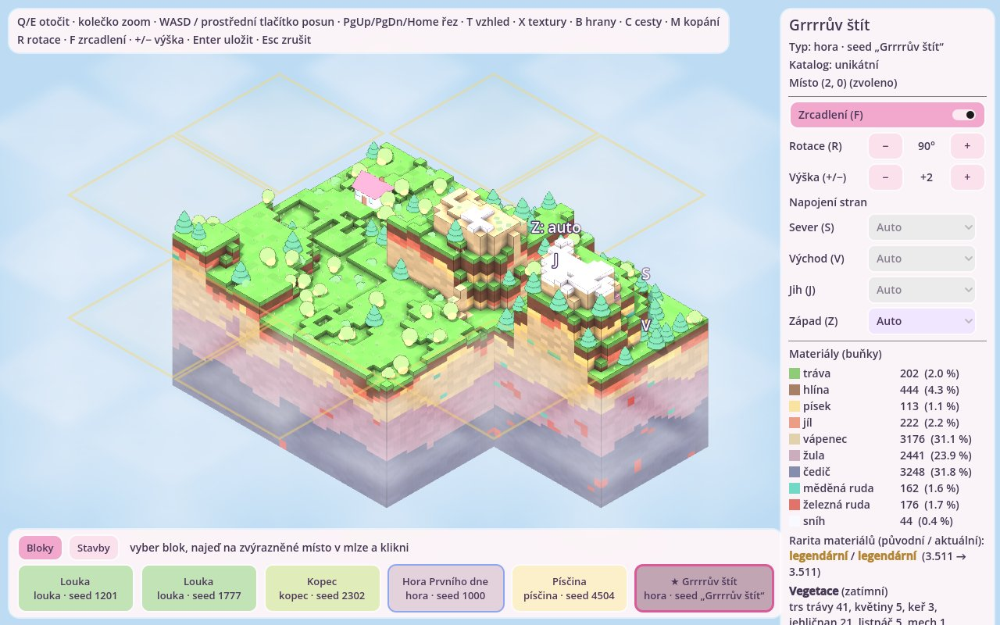
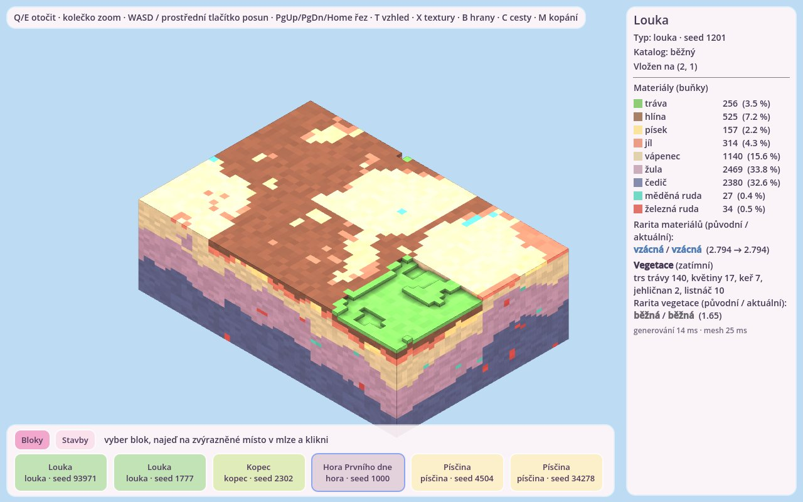

# Architektura

Zpět na [osnovu](index.md).

Stav: rozdělení práce klient / server Jan potvrdil. Formát `WVB1` je **návrh**, čeká na schválení.

## Shrnutí

17. 11. 2026 Jan přesunul generátor a simulaci na klienta. Klient blok vygeneruje, nechá ustát a dopočítat a pošle celé pole. Server výsledek zvaliduje a uloží. 18. 11. 2026 20:09 to Jan zopakoval i pro telefony: generování je zatím primárně na klientovi, server ukládá a validuje.

Aby klient i server mluvili stejně, je v `navrhy/format-bloku-wvb1.md` návrh kontejneru `WVB1` (little-endian). Nese identifikaci bloku, seed, recept, verze generátoru a simulace, volby vložení, souhrn materiálů, zásobník ze serveru a komprimované vrstvy buněk. Hash je SHA-256 přes hlavičku a nekomprimované vrstvy; server ho vždy přepočítá. Komprese vrstev je deflate, kterou umí Godot i .NET bez dalších knihoven.

Sdílené tabulky materiálů a hornin jsou ve [`sdilene/`](../sdilene/) (`materialy_voda.json`, `horniny_voda.json`). Kopie v prototypu se má při změně obnovit skriptem; po přidání polí pevnosti zatím není shodná.

Validátor gen-v3 běží při každém vložení bloku (**rozhodnuto** 17. 11. 2026 20:39: „vždy, 4,5 ms není mnoho“).

## Hlavní rozhodnutí a návrhy

- Generování a simulace na klientovi, server ukládá a validuje. Jan 17. 11. 2026 18:12, potvrzeno 18. 11. 2026 20:09.
- Očekávaný souhrn rud určuje server při vydání bloku (základ z receptu a seedu + bonus). Server kontroluje každou rudu proti vydanému cíli (minus schodek) a součet pevných buněk. Port celého generátoru do C# kvůli kontrole rud proto v dohodě s Willage-backend není nutný. Úprava 17. 11. 2026 18:35, čeká na Jana.
- Zásobník gen-v3: vstup je seřazený seznam položek ze serveru, klient nic neřadí. Hlavička nese `stack` a `stack_hash`. Jan 18:58, upřesnění s backendem 19:01, čeká na schválení.
- V návrhu `WVB1` mají rozměry zatím vždy 16 × 16 × 64. Pozdější studie vzorkují týž blok i v jiném rozlišení; formát se kvůli tomu zatím neměnil.
- Kód prototypu nemá být monolit: scéna je rozdělená na uzly s krátkými skripty (na žádost Jana, **ve zkoušce**, větev `refaktor-uzly`).

## Zdroje a snímky

- [`navrhy/format-bloku-wvb1.md`](../navrhy/format-bloku-wvb1.md)
- [`sdilene/`](../sdilene/)
- [`DENIK.md`](../DENIK.md) – A/1 prototyp a uzly, A/2 validátor, A/3 požadavek 20:09
- [`godot-prototyp/`](../godot-prototyp/)

*Náhled vkládaného bloku v prototypu (`godot-prototyp/shots/02_nahled_hora.png`). Klient ukáže tvar ještě před potvrzením.*

*Řez blokem v prototypu (`godot-prototyp/shots/08_rez.png`). Pole buněk je to, co by v návrhu WVB1 šlo na server.*
