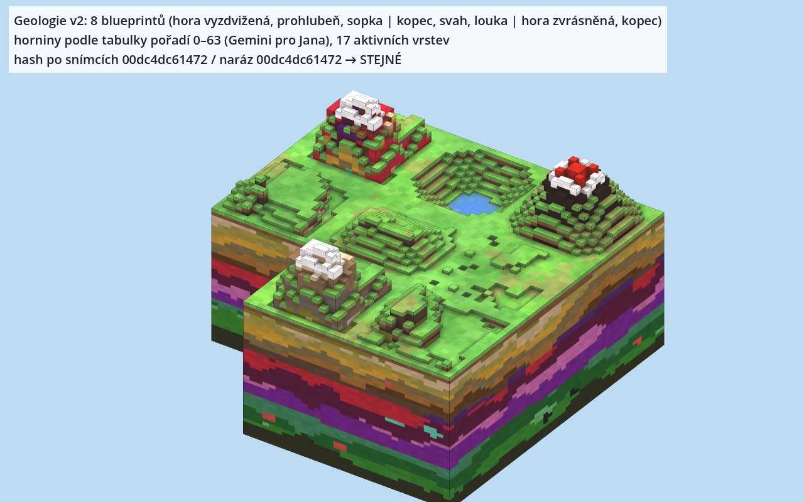
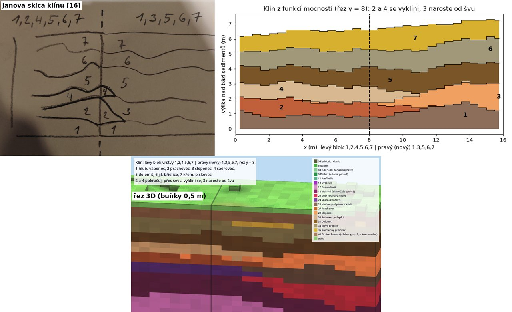

# Blueprint terén

Zpět na [osnovu](index.md).

Stav: **ve zkoušce** (`blueprint-studie/`, v2.1 / v2.2). Část pravidel Jan 18. 11. 2026 17:38 rozhodl, zbytek čeká.

## Shrnutí

Divák vloží blueprint: tvar povrchu (louka, kopec, svah, prohlubeň, hora, sopka), seed a počty minerálů a kovů. Rarita se počítá jen z nich, základní horniny se nepočítají. V náhledu se okraj povrchu dorovná na sousedy. Po potvrzení se spočítají vrstvy jako pokračování sousedů a do bloku se vtisknou minerály a nejvýš jedna dutina.

Od v2.1 nejsou buňky zdrojem tvaru. Povrch `hm_f` a hranice vrstev `bs[k]` jsou spojité funkce v metrech na řídicí mřížce 0,5 m, mezi body se interpoluje bilinearně. Buňky funkce jen vzorkují, takže stejný blok jde spočítat v 16 × 16 × 64 i v 32 × 32 × 128 (ve zkoušce shoda 94,9 % pevných buněk, počty přesně × 8).

Horniny berou pořadí z tabulky (`data/poradi_hornin.json`: 64 hornin a navíc sopouch, výchozí podmnožina 17). Typ terénu vrstvy ohne: kopec je zvedne, prohlubeň prohne, vyzdvižená hora má jádro z hluboké horniny, zvrásněná hora je antiklinála, sopka má vrstvy sbíhavé ke kráteru a sopouch.

## Hlavní rozhodnutí

- Minerály jen do povolených hostitelů, v přesných počtech. Když hostitel nestačí, vznikne schodek a nahlásí se. Jan 16:02.
- Navazuje se v mocnostech: okraj = přesně mocnost souseda (Dirichlet). Do 3 m (`taper_m`) přejde průběh v tvar blueprintu. Vrstva přítomná jen na jedné straně vnikne klínem nebo se vyklíní.
- Strana bez souseda bere vrstvy, které definuje samotný blueprint (jeho podmnožina hornin). **Rozhodnuto** Janem 17:38.
- V rohu má skutečný soused přednost před regionálním základem.
- V bloku je buď nic, nebo jeden rezervoár, nebo jedna jeskyně; tvar je jedno. Blueprint s VODU i VZDUCHEM se odmítne (`blueprint.cavity_conflict`). Dutina je jedna souvislá komponenta. **Rozhodnuto** Janem 17:38.
- Pevnost (load / cantilever) je zatím jen v tabulkách, výpočet zřícení není.
- Délku klínu 3 m Jan 17:38 nechal být; doladění je otevřené.

## Zdroje a snímky

- [`blueprint-studie/README.md`](../blueprint-studie/README.md)
- [`blueprint-studie/PROP.md`](../blueprint-studie/PROP.md) – cíl, výsledky v1–v2.2, otevřené otázky
- [`blueprint-studie/ZDROJE.md`](../blueprint-studie/ZDROJE.md)
- [`DENIK.md`](../DENIK.md) – A/2 položky Blueprint až v2.2
- původní snímky: [`blueprint-studie/shots/46_horniny_*`](../blueprint-studie/shots/), GIFy funkcí `48_funkce_*.gif`

*Typy terénu a vrstvy hornin (snímek `blueprint-studie/shots/46_horniny_iso.png`).*

*Klín: vrstva přítomná jen na jedné straně přejde šev a vyklíní se (`blueprint-studie/shots/46_horniny_klin.png`).*
