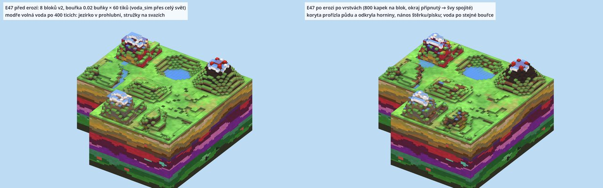

# Eroze a usazování

Zpět na [osnovu](index.md).

Stav: eroze při generování je **ve zkoušce** (E47). Odplavování a usazování za běhu hry je **plán** (Jan 20:18–20:20), studie ještě není.

## Shrnutí

Jsou tu dva různé kroky, které se nemají splést.

**Při generování** (E47) eroze mění jen funkci povrchu. Hranice vrstev zůstanou, koryta proříznou půdu a horniny na svazích, v prohlubni zůstane nános štěrku a písku. Režim s připnutým okrajem zachoval šev povrchu 0,00 a šev vrstev 0,09. Eroze je deterministická. Původní konstanty byly na blocích v2 moc silné (vrchol hory −8,6 m), proto se použily slabší. Otevřené je, jestli se má eroze dělat po blocích s připnutým okrajem, nebo jen jednou na hrubém světě.

**Za běhu hry** Jan 20:18–20:20 popsal jinou mechaniku. Každý materiál dostane náchylnost k erozi: práh je kumulativní objem vody, který musí protéct buňkou nebo po ní, aby ji odplavil. Z průtoku se spočítá čas (událost, žádný pravidelný tik). Vykopání nebo položení buňky odpočet vynuluje.

V tůních, kde voda neproudí, se materiál usazuje. Odplavení i usazení závisí na rychlosti proudění: pro každý materiál jsou dva prahy rychlosti. Časy se zase předpočítají z průtoku jako události. K tomu je potřeba zjednodušená mechanika proudění (rychlost v korytě), ne plná dynamika tekutin. Studie tohoto proudění v souborech ještě není.

## Zdroje a snímky

- [`DENIK.md`](../DENIK.md) – A/2 E47; nápady 20:18 (náchylnost k erozi) a 20:20 (usazování)
- [`blueprint-studie/PROP.md`](../blueprint-studie/PROP.md) – E47 výsledky a otevřená otázka, zda erozi počítat po blocích nebo na hrubém světě
- původní snímky: `blueprint-studie/shots/47_voda_eroze_*`

*E47: eroze při generování mění povrch, vrstvy nechá být (`blueprint-studie/shots/47_voda_eroze_iso.png`). Není to ještě runtime odplavování po materiálech.*
