# Generování zemského masivu: vrstvy, hory, švy

*Autor: Utalag · soukromý devlog, nezveřejněno · stav 19. 11. 2026 ráno · zdroj: `DENIK.md`, `blueprint-studie/PROP.md`
(E45–E50, E56), snímky ze `blueprint-studie/shots/`*

## 1. Co se řeší a proč

Ostrov se skládá z bloků 8 × 8 m, které hráči (diváci na Twitchi) vkládají jako **blueprinty**: louka, kopec, svah,
prohlubeň, hora, sopka + seed + počty minerálů. Pod povrchem musí být **věrohodná geologie**, protože se v ní kope,
teče v ní voda a nachází se v ní suroviny. Požadavky:

- **Bloky na sebe navazují:** vrstvy přes šev nesmí skočit, vrstva, kterou má jen soused, vnikne klínem.
- **Nezávislost na rozlišení:** stejný blok se dá navzorkovat hrubě (telefon, LOD) i jemně (detail).
- **Determinismus:** stejný seed = stejný blok na klientovi i na serveru (validace).
- **Přesné počty minerálů:** jen v povolených hostitelských horninách, schodek se nahlásí, nic se nepřesune jinam.
- **Rychle:** limit 3 s na blok, cíl telefon.

## 2. Podkladová data

- **Řídicí mřížka 0,5 m** (16 × 16 bodů na blok): povrch `hm_f` a hranice vrstev `bs[k]` jako 2D matice. Buňky jen
  vzorkují funkce v metrech.
- **Tabulka hornin** `data/poradi_hornin.json`:
  - 65 hornin podle pořadí kůry (64 od Gemini + sopouch), výchozí aktivní podmnožina 17
  - 10 horských hornin podle typu a výšky
  - 11 minerálů s hostiteli (`data/mineraly_hostitele.json`: diamanty v kimberlitu, drahokamy v pegmatitu, Fe-Ti
    v gabru, uhlí v sedimentech)
- **Vodní a mechanické vlastnosti:** `sdilene/materialy_voda.json` (perm, por, res, ret, load, cantilever, ero_v,
  ero_vol, sed_v) a `sdilene/horniny_voda.json` (63 hornin). Popis polí je v [Voda: algoritmy](voda-algoritmy.md).
- **Svět:**
  - hrubý svět (E49) má 64 × 64 bodů po 1 m pro 8 × 8 bloků (terén, déšť, eroze a řeky, biomy, typy dlaždic)
  - detail má 16 / blok (0,5 m) nebo 64 × 64 × 256 buněk na blok (0,125 m, E50)

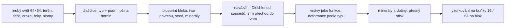

## 3. Varianty a co z nich vyšlo

### 3.1 Blueprint v1: tvar povrchu + vrstvy ze sousedů (E45)

- **Princip:**
  - Okraje povrchu se v náhledu dorovnají v pásu 4 buněk (harmonická korekce).
  - Hranice vrstev se protáhnou ze sousedů Laplaceovou rovnicí: Dirichlet na stranách se sousedem, Neumann na
    volných stranách.
  - Pod tím je regionální deska ve světových souřadnicích (fBm s domain warpem).

$$\nabla^2 b_k = 0 \ \text{uvnitř bloku},\quad b_k = b_k^{\mathrm{soused}} \ \text{na švu},\quad \partial_n b_k = 0 \ \text{na volné straně}$$

- **Fungovalo:**
  - skok vrstev na švu 0,07 buňky (nezávislé bloky gen-v3 2,65)
  - povrch na švu 3,86 → 0
  - minerály 12/12 přesně
  - vložení 21–95 ms
- **Nefungovalo:**
  - Se společnou deskou švy navazují skoro samy (0,17 i bez Laplace). Laplace je hlavně pro bloky mimo desku.
  - Písek ze sousedů gen-v3 nenavazuje (1,53), protože je to vrstva u povrchu.

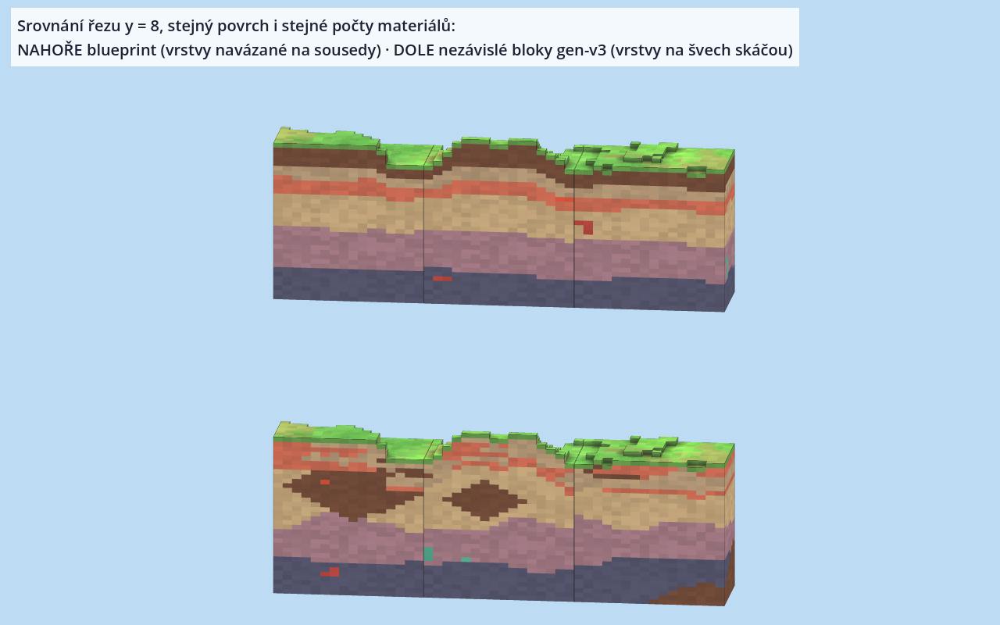

### 3.2 Blueprint v2: 65 hornin a deformace podle typu terénu (E46)

- **Typy:**
  - **nížina / kopec:** vrstvy se ohnou
  - **prohlubeň:** vrstvy se prohnou
  - **hora vyzdvižená:** antiklinála s jádrem z krystalinika
  - **hora zvrásněná:** vrásy
  - **sopka:** vrstvy sbíhavé ke kráteru, sopouch
  - tělesa: kimberlitový komín, solný dóm, pegmatit, skarn
- **Fungovalo:**
  - Jádro hory je 40 % krystalinikum, jen 6 % sedimenty (bez deformace 85 % horské kůže).
  - Šev C (s Laplacem) 0,38 proti A 1,91 a B 1,18.
  - Determinismus.
- **Nefungovalo:**
  - Tenké vrstvy (1–3 buňky) zhoršují šev oproti v1 (0,08), protože je vidět zaokrouhlení na buňku.
  - Pegmatit se v hoře náhodně neobjevil → schodek drahokamů.
  - Skarn nepřechází přes šev.
  - Horská kůže je pořád 39 % jádra.

| hora vyzdvižená | hora zvrásněná | sopka | nížina |
|---|---|---|---|
| 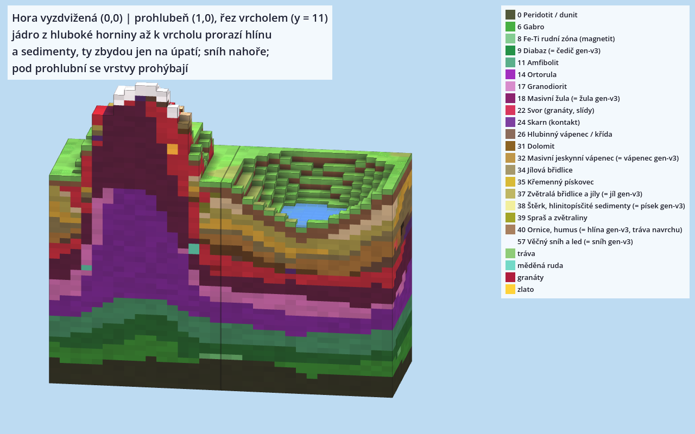 | 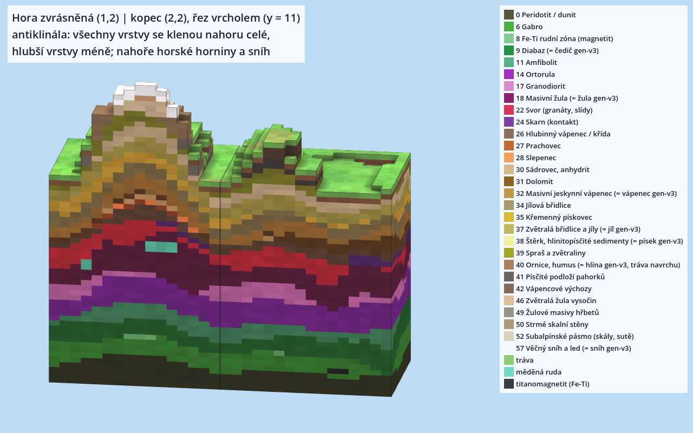 | 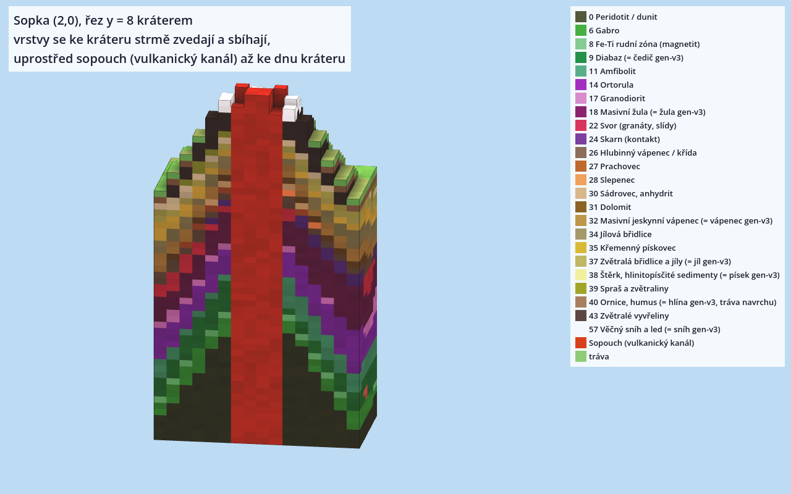 | 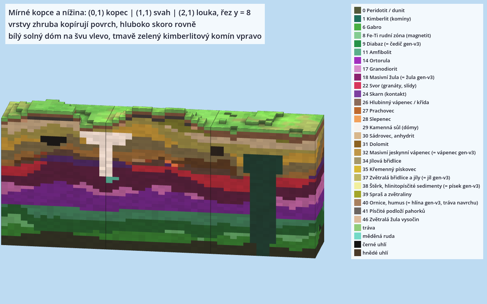 |

Srovnání se skicou řezu (E46):

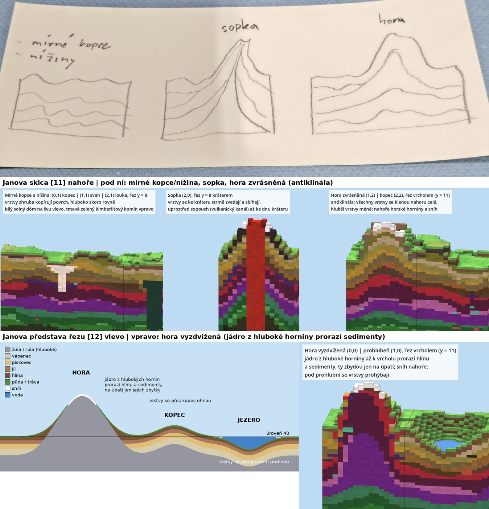

### 3.3 Blueprint v2.1–v2.2: vrstvy jako funkce, klíny, jedna dutina (E46b)

- **Princip:** navazuje se v **mocnostech**, ne v hranicích.

$$t_k(x) = b_k(x) - b_{k-1}(x),\qquad t_k^{\mathrm{šev}} = t_k^{\mathrm{soused}},\qquad t_k \to t_k^{\mathrm{blueprint}} \ \text{do 3 m od švu}$$

  - Vrstva, kterou blok nemá, vnikne klínem (mocnost klesá k nule). Vrstva, kterou nemá soused, se vyklíní.
  - V bloku je nejvýš jedna dutina: rezervoár v nepropustné hornině, nebo jeskyně pod nosným stropem (`load`).
- **Fungovalo:**
  - 16 vs. 32 na blok shoda 94,9 % (pevné / vzduch 99,7 %), počty přesně × 8
  - náhlé objevení vrstvy na švu 0 (bez navázání 12)
  - jeskyně 90/90, rezervoár 60/60
- **Nefungovalo:**
  - Uvnitř bloku jsou strmé přechody přítomnosti vrstev.
  - Skarn je jen svislý.
  - Voda se vzorkovala jen při 16.

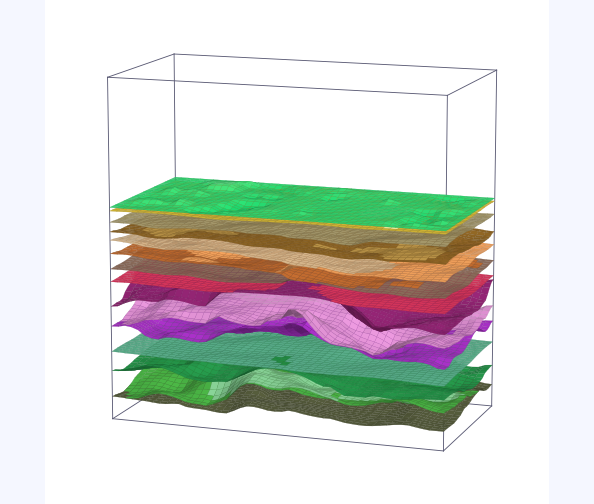
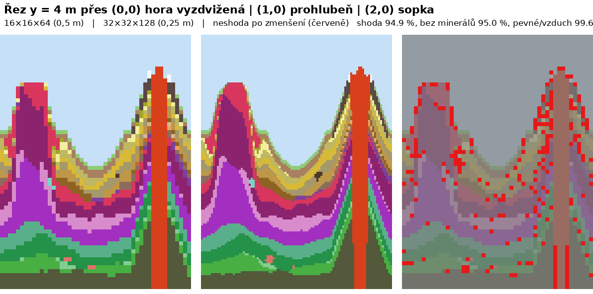
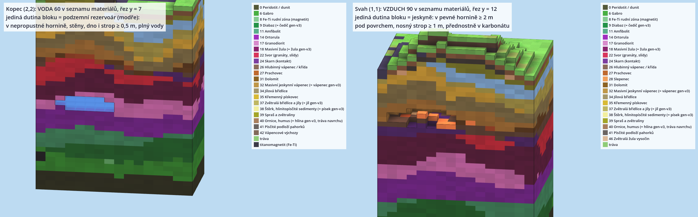

### 3.4 Funkce vrstev ve 3D (E48)

GIFy a statické snímky ploch hranic v krychli bloku. Je na nich vidět, že vrstvy jsou spojité plochy a vyklíněné
vrstvy jsou díry. Jádro hory a sopouch nejsou hranice vrstev, takže v grafech chybí.

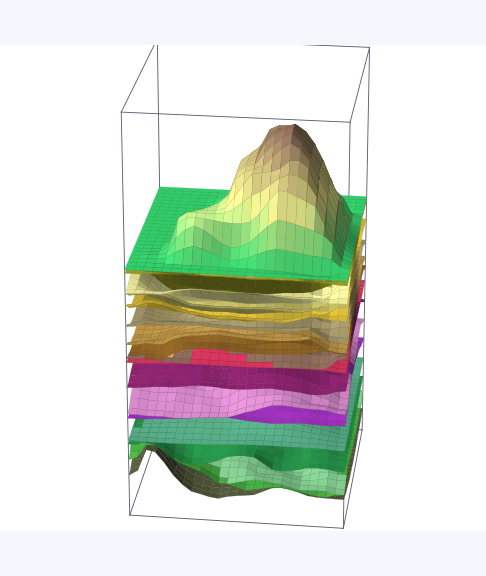
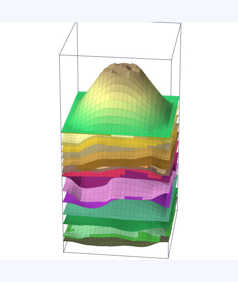

### 3.5 Hrubý svět → dlaždice → detail (E49)

- **Princip** (Janův nápad podle Dwarf Fortress):
  - Napřed celý svět hrubě (terén, déšť, eroze a řeky, biomy).
  - Pak řez na dlaždice s typem a podmnožinou hornin.
  - Nakonec detail od první dlaždice do šířky, s navázáním na sousedy.
- **Fungovalo:**
  - 8 × 8 bloků za 15–17 s (hrubá fáze 0,6 s)
  - švy povrchu 0,00, validátor 64/64
  - deterministické
- **Nefungovalo:**
  - Typ hory po dlaždicích dával šev vrstev 0,48, protože jádro vyzdvižené hory přes šev nenavazuje. Typ hory po
    masivech to snížil na 0,16, všechny hory zvrásněné 0,03.
  - Počet dávek eroze mění svět (seed na dávku).

| hrubý terén | eroze a řeky | biomy |
|---|---|---|
| 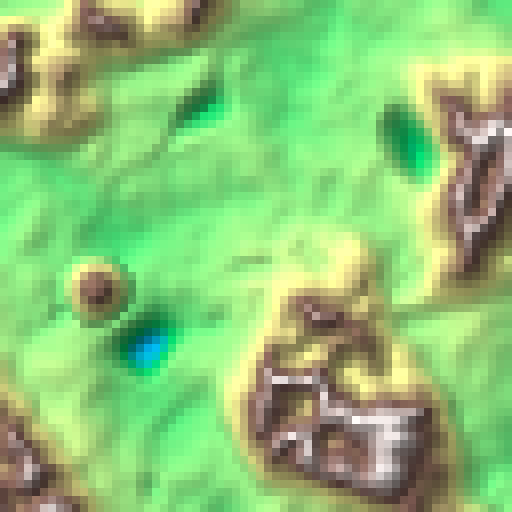 | 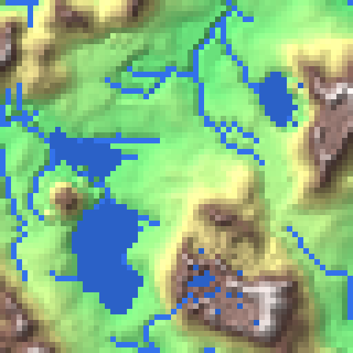 | 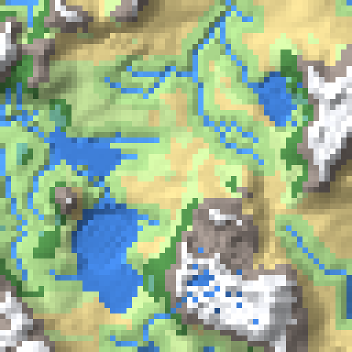 |

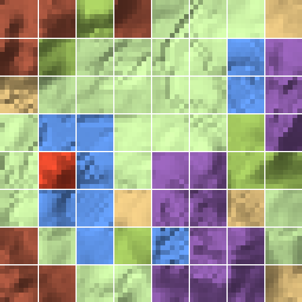

### 3.6 Eroze po vrstvách (E47)

Eroze mění jen funkci povrchu, hranice vrstev zůstávají. Koryta prořízla půdu a horniny na svazích, nános je
v prohlubni.

- **Fungovalo:** šev povrchu 0,00 s připnutým okrajem.
- **Nefungovalo:** původní konstanty byly na v2 moc silné (vrchol −8,6 m). Eroze nesoustředila tok do koryt
  (42 → 37 %).

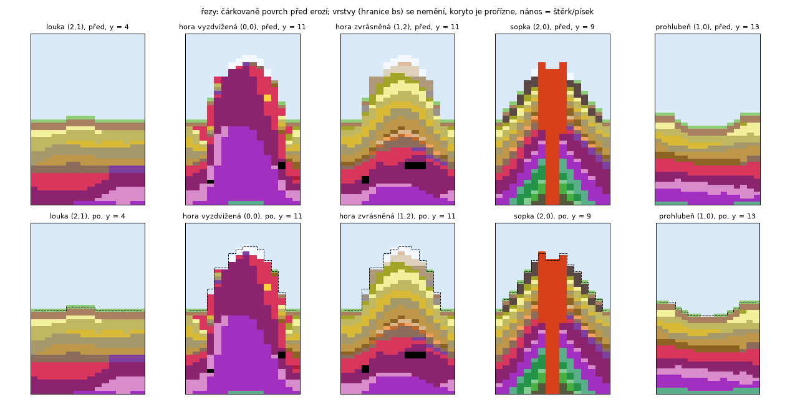

### 3.7 Větší rozlišení: 64 × 64 × 256 buněk na blok (E50)

- **Fungovalo:**
  - celý svět 516 s na 1 jádře (detail 354 s, blok medián 5,3 s)
  - 64× víc buněk stojí jen 23× víc času
  - švy jemných buněk čisté
- **Nefungovalo:**
  - Peak 4 GB, hlavně podzemní voda ve slovnících. Vyřešilo to E52: funkce nad vrstvami, 288 MB.
  - Telefon: odhad C# + 4 vlákna ~20 s jen pro detail.

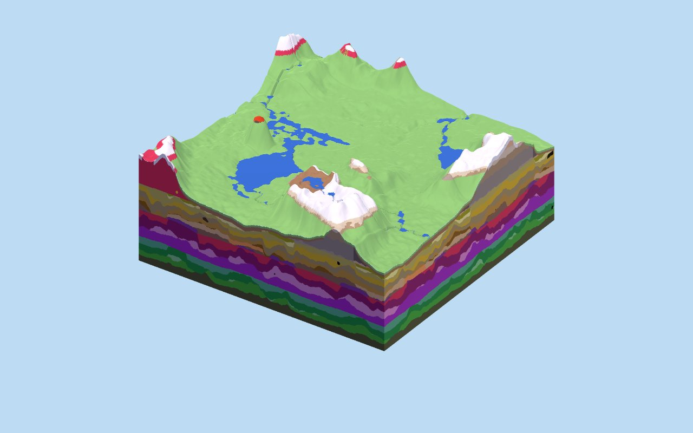

### 3.8 Mírnější výškové přechody (E56)

- **Princip:** omezovač sklonu hrubé mapy jako tepelná eroze. Kde rozdíl sousedů přesáhne sklon · vzdálenost, část
  přebytku se přesune dolů. Hmota se zachová, hora se rozšíří.

$$\Delta h_{ij} > s_{\max}\, d_{ij} \ \Rightarrow\ h_i \mathrel{-}= \tfrac18 (\Delta h_{ij} - s_{\max} d_{ij}),\ h_j \mathrel{+}= \tfrac18(\ldots)$$

  Navíc vyhlazení 3 × 3 a širší pata masky hor.
- **Výsledky** (výchozí vypnuto, Jan 03:40 rozhodnutí odložil):

  | | před | ≤ 45° | ≤ 31° |
  |---|---|---|---|
  | nad 45° | 21,3 % | 15,9 % | 2,4 % |
  | p95 sklonu | 63° | 50° | 42° |
  | pata hory | 12,1 m | 17,0 m | 15,7 m |
  | největší schod | 3,5 m | 1 m | 1,5 m |

- **Nefungovalo:**
  - Omezovač hrubé mapy neomezí jemný povrch (šum 0,6 buňky).
  - Medián sklonu roste, údolí se zvedla o 1,5–2 m.
  - Louky 24 → 8–10 dlaždic.
  - Při 31° je vidět mřížka bloků.

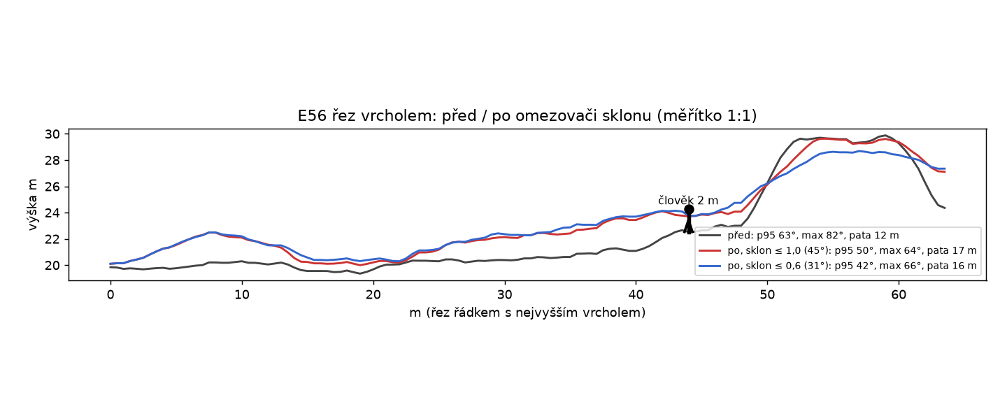
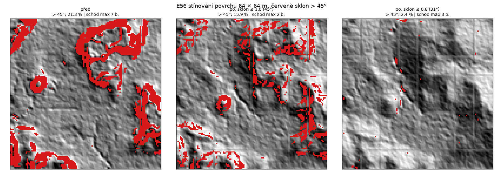

## 4. Co se osvědčilo (shrnutí)

- **Funkce v metrech místo buněk:** nezávislost na rozlišení, stejný terén pro všechny hráče, ukládají se jen změny.
- **Navazování v mocnostech + klíny:** švy bez skoků, vrstvy se mohou objevit a zmizet věrohodně.
- **Hrubý svět napřed:** dlaždice vědí, kam patří (pohoří, řeky, biomy). Typ hory určovat po masivech.
- **Přesný otisk minerálů do hostitelů:** server ověří Σ počtů.

## 5. Co zůstává otevřené

- Jádro vyzdvižené hory jako navazovaná funkce (šev 0,16 → ?).
- Strop sklonu a jestli smí měnit typy dlaždic (E56).
- Tenké vrstvy při buňce 0,5 m (zaokrouhlení).
- Skarn a tělesa přes šev.
- Čas detailu na telefonu (C#, vlákna, sekce 16³ / 32³ na vyžádání).
