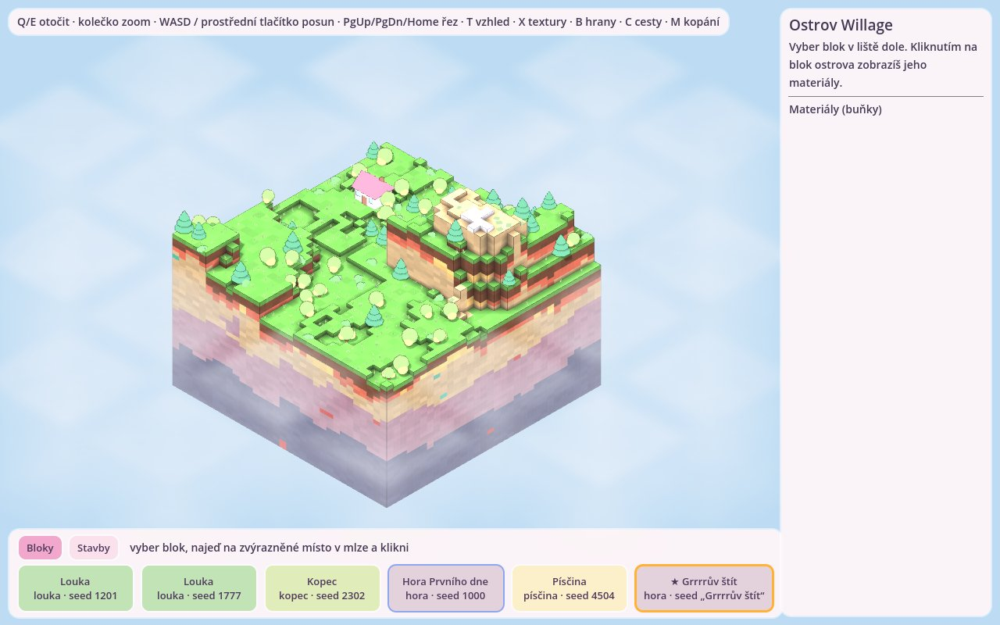
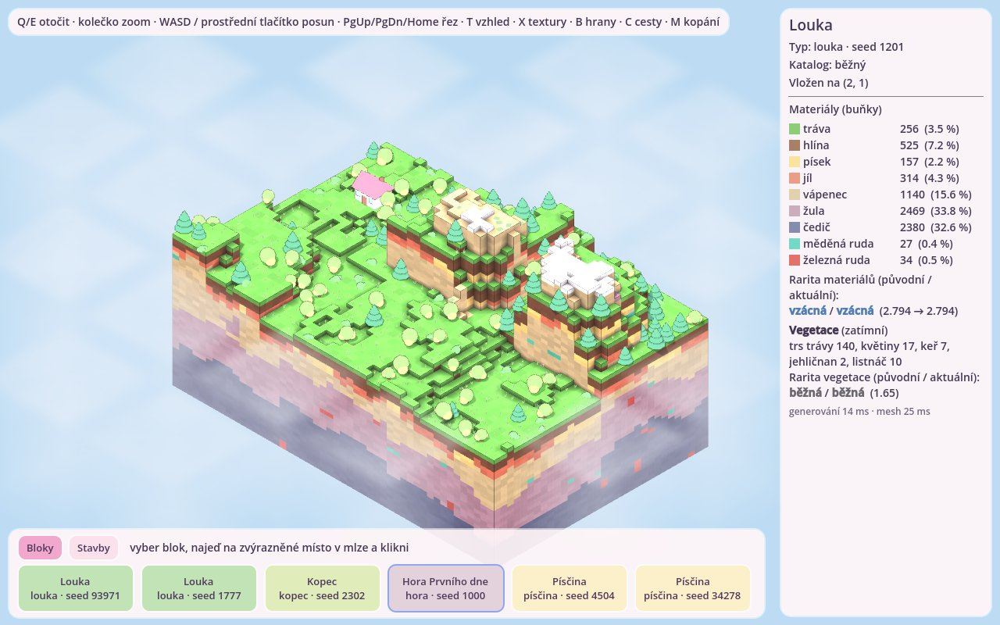

# Koncept

Zpět na [osnovu](index.md).

Stav: základ ostrova a skládání z bloků je **rozhodnutý**. Ostrov jako základna s chudým podzemím a plnou geologií jen na výpravách je **hypotéza**.

## Shrnutí

Willage je ostrovní vesnice pro stream na Twitchi. Hráč ostrov sestavuje z bloků, které dostane (běžné s náhodným seedem, pevné se stejným seedem pro všechny, unikátní s pojmenovaným seedem). Blok vzniká z typu (recept: hora, louka, kopec…) a seedu. Kopání a úpravy terénu probíhají přímo na ostrově; doly jsou přepnutí do samostatné mapy.

Ostrov na začátku je zhruba kruhový: čtyři připravené bloky, zbytek je mlha. Mlha je zvláštní materiál, nedá se v ní kopat ani stavět, a mizí jen vložením nového bloku. Rozšiřování jde libovolným směrem, ale odemkne se vždy jen jeden blok sousedící s ostrovem.

Materiál je omezený a zachovává se: vytěžené buňky jdou do inventáře a jdou znovu položit. Posun výšky a dorovnání stran při vkládání materiál nestojí. Rostliny, cesty a stavby jsou samostatná vrstva nad terénem, ne buňky bloku.

Hratelný prototyp je v Godotu 4.7.2: ostrov z bloků 16 × 16 × 64 buněk (buňka 1 × 1 × 0,5 m), izometrická kamera, vkládání s náhledem, kopání, cesty a stavby. Vzhled má jít kawaii směrem (pastel, toon, obrysy).

## Hlavní rozhodnutí

- Terén má výšky a vrstvy materiálů, síla vrstev se liší. Buňky jsou krychle (hexy zamítnuty). **Rozhodnuto** 17. 11. 2026.
- Blok je 3D pole buněk. Výchozí velikost v prototypu je 16 × 16 × 64. Jan k tomu později řekl, že 16 × 16 s buňkou 1 × 1 × 0,5 m je „moc hrubé“; jemnější rozlišení je ve zkoušce.
- Při vkládání: zrcadlení, rotace po 90°, posun výšky o ±1 až 4 vrstvy, u každé strany Automaticky / Dorovnat / Ponechat. Mění se jen nový blok, sousedé nikdy.
- Výnos kopání: vždy 1 blok materiálu + šance na nález. **Rozhodnuto** 17. 11. 2026 17:53.
- Stavby budou předem dané. Editor s pohyblivými díly (vodní kolo, hřídele) Jan zamítl jako příliš složitou mechaniku.

## Hypotézy (ne rozhodnutí)

- **Ostrov jako základna** (Jan 17:11–17:20; 17:20: „byl to nápad“). Povrch ostrova zůstává plně upravitelný. Podzemí ostrova jen pár obecných vrstev bez vzácných surovin. Režim úpravy terénu mění povrch a vrstvy pod ním nechává být. Režim prokopání vymění dlaždici za vstup do podzemí; těžba probíhá v podzemí nebo na mapách výprav s plnou geologií. Blueprinty na ostrově by nesly jen tvar a vzhled povrchu. Hráč může terén ostrova odebírat i vracet materiálem natěženým jinde; odebraný materiál se vrací do inventáře celý.
- **Zdroj blueprintů z výpravy** (Jan 17:23–17:25). Hráč na výpravě označí kus mapy a zkopíruje ho. Nic se z mapy nevyřezává; výřez nese tvar povrchu a procenta toho, co by mohlo být v podzemí. Podzemí se vygeneruje až při vložení doma a napojí se na sousedy. Dva hráči se stejným výřezem můžou dostat jiné složení, protože seed podzemí je vlastní každé kopii.
- **Kronika a předhistorie** (`kronika-a-predhistorie.md`) je nápad s nízkou prioritou, ne hlavní vývoj.

## Zdroje a snímky

- [`teren-bloky-bunky.md`](../teren-bloky-bunky.md) – plánování s Janem 17. 11. 2026
- [`DENIK.md`](../DENIK.md) – A/1 prototyp, A/2 nápady 17:11–17:25
- [`godot-prototyp/`](../godot-prototyp/) – hratelný prototyp
- [`kronika-a-predhistorie.md`](../kronika-a-predhistorie.md) – vedlejší nápad

*Začátek ostrova v prototypu (snímek `godot-prototyp/shots/01_start.png`).*

*Ostrov po vložení bloku (`godot-prototyp/shots/04_vlozeno.png`).*
