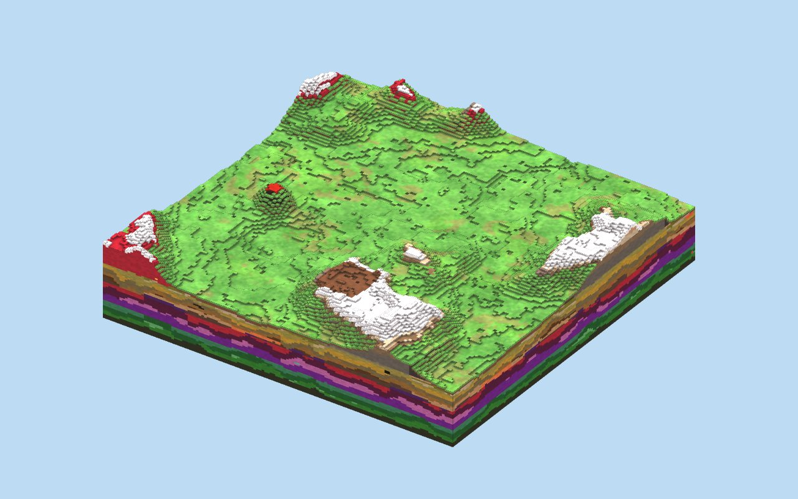
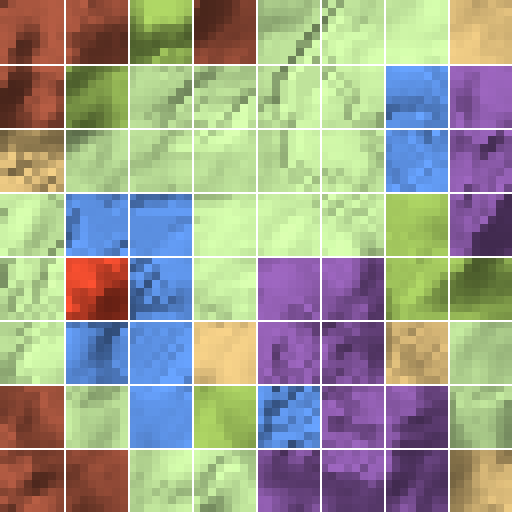
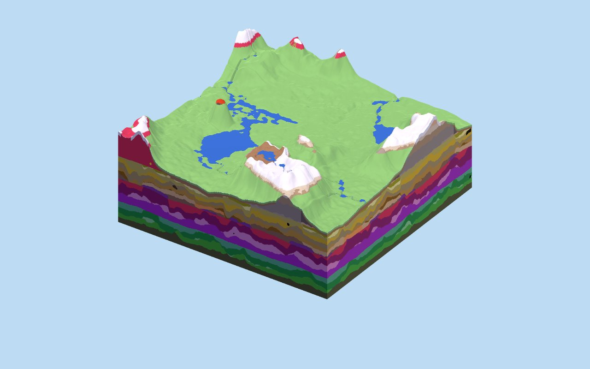

# Svět a měřítko

Zpět na [osnovu](index.md).

Stav: hrubý svět + dlaždice + detail je **hypotéza** zkoušená v E49 a E50. Proporční měřítko, sekce, LOD a velikost bloku vesnice jsou **hypotézy**, Jan se ještě nerozhodl.

## Shrnutí

Jan 18:03 navrhl spojit hrubou simulaci světa (jako v Dwarf Fortress) s blueprint geologií po dlaždicích: jednou nahrubo spočítat terén, biomy, erozi a řeky, rozřezat je na dlaždice, podle biomu a výšky přiřadit typ a podmnožinu hornin a podrobné vrstvy, klíny, minerály a dutiny dopočítat až když je dlaždice potřeba. První dlaždice se spočítá celá, další se navazují na sousedy.

E49 to vyzkoušelo na světě 8 × 8 bloků. Hrubá fáze trvala asi 0,6 s, celý svět 15–17 s, švy povrchu 0,00, skok mocnosti na švu 0, validátor 64/64, běh je deterministický. Volná strana povrchu bere výšku z hrubého světa; v rohu má skutečný soused přednost. Švy vrstev byly horší (0,48), když se typ hory volil po dlaždicích, protože jádro vyzdvižené hory přes šev nenavazuje. Typ hory po masivech to snížil na 0,16.

E50 vzalo stejný svět a navzorkovalo každý blok v 64 × 64 × 256 buňkách (buňka 0,125 m, svět 512 × 512 × 256 = 67 milionů buněk). Blok ve studii zůstává 8 × 8 × 32 m, mění se jen hustota vzorků. Minerály a dutiny drží objem: cíl × (n/16)³. Hrubý svět je stejný jako v E49 (~0,55 s). Celé generování na boxu v GDScriptu na jednom vlákně trvalo 515 s, švy povrchu u jemných buněk 0,00. Čísla fází jsou na stránce [Výkon a mobil](vykon-a-mobil.md).

E90 (2026-11-20 07:30) zkusilo LOD na mapě 3 × 3 km (24 × 24 bloků po 128 m). Výška je funkce E49 natažená ×8 a s reliéfem ×3; nezávisí na rozlišení. Kolem 4 hráčů se 3 × 3 bloky vzorkují po kouscích 16 m: nejbližší 0,25 m, do 48 m 0,5 m, dál 1 m; zbytek mapy 8 m sloupce. Celkem 2,27 M trojúhelníků, stavba 4,9 s, 270 MB RSS, síť je ≈ 94 % paměti. Bez sešití vznikají díry jen mezi různými úrovněmi (max 5 m), se stěnou dolů k sousedovi 0 děr. Posun hráče o 16 m přestaví 15 kousků + 35 sousedů za 296 ms. 1 m všude by stálo ≈ 57 s a 2,6 GB. Je to hypotéza, Jan nerozhodl.

## Hypotézy (ne rozhodnutí)

- **Proporční svět** (Jan 18:35–18:53): výška kolem 3000 m (hora ~1000 m, podzemí ~2000 m), postava ~2 m (4 buňky po 0,5 m). Šířka hory se stejnou výškou a základnou ~2000 m (sklon ~45°).
- **Sekce a LOD** (návrh v tomtéž nápadu): blok dělit na kousky i do výšky i do šířky (např. 16³), počítat a ukládat jen kousky u povrchu, postavy a výkopů, jednolité kousky jako jedno číslo, zdálky jen hrubý povrch.
- **Blok vesnice 128 × 128 m** (256 × 256 buněk po 0,5 m), uvnitř kousky 32³; hora 1000 m ≈ 16 × 16 bloků (spíš na výpravy), ve vesnici kopce do ~100–200 m. Jan 18:58: líbí se, ale ještě se rozhodne. Velikost bloku v metrech je otevřená.
- **Svět výprav** (Jan 18:59): tentýž algoritmus (funkce + kousky na vyžádání), dost velký pro víc hráčů najednou. Stejné funkce = stejný terén pro všechny, ukládají se jen změny.

## Zdroje a snímky

- [`DENIK.md`](../DENIK.md) – A/2 E49, nápady 18:03 a 18:35–18:59; A/3 proporční svět
- [`blueprint-studie/PROP.md`](../blueprint-studie/PROP.md) – plán E49 a E50
- [`blueprint-studie/README.md`](../blueprint-studie/README.md)
- měření: [`blueprint-studie/shots/bench_svet8.txt`](../blueprint-studie/shots/bench_svet8.txt), [`bench_svet64.txt`](../blueprint-studie/shots/bench_svet64.txt)
- GIFy fází: `blueprint-studie/shots/49_svet_8x8_faze.gif`, `50_svet64_faze.gif`

*E49: malý svět 8 × 8 po hrubé fázi a detailu dlaždic (`blueprint-studie/shots/49_svet_8x8_iso.png`).*

*Typy dlaždic (a biomy) z E49 (`blueprint-studie/shots/49_svet_8x8_dlazdice.png`). Barvy typů jsou popsané v README studie.*

*E50: tentýž svět, bloky vzorkované v 64 × 64 × 256 buňkách (`blueprint-studie/shots/50_svet64_iso.png`).*
