# Voda na ostrově: algoritmy povrchu a podzemí

*Autor: Utalag · soukromý devlog, nezveřejněno · stav 19. 11. 2026 ráno · čísla jen z měření E47–E58
(`blueprint-studie/PROP.md`, `shots/bench_*`, `shots/alg58/`)*

## 1. O co jde a proč

Willage je vesnice na Twitchi. Streamer a diváci staví na **plovoucím ostrově** z bloků 8 × 8 m, kopou a stavějí.
Voda má být součástí hry:

- **Prameny** vyvěrají tam, kde to dává geologický smysl.
- Voda teče **korytem**, plní **tůně** a přes okraj ostrova padá **vodopádem do mlhy**.
- Část vody **vsakuje** do propustných vrstev, teče **podzemím** a vyvěrá jinde jako pramen nebo ve stěně ostrova.
- Voda **eroduje** a **usazuje**: koryto se prohlubuje a tůň se zanáší.
- Hráč kopáním mění terén a voda na to musí **hned a věrohodně** reagovat.

Proč to nejde „fyzikálně naplno“:

- **Klient a server.** Generování a simulace běží na klientovi (i na telefonu). Server ukládá a validuje, takže výpočet
  musí být **deterministický**: stejný vstup → stejný otisk stavu.
- **Levně.** Desítky hráčů najednou, telefon 30 FPS. Nic nesmí tikat po sekundách celý svět.
- **Nepozorovaný ostrov.** Když se nikdo nedívá, čas běží dál. Dohnání musí být jeden skok, ne simulace po tikách.

Proto se voda počítá jako **ustálený stav** (kudy teče, kolik l/s, jaké tůně), plus **události** (kdy se tůň naplní,
kdy se odnese buňka). Po změně terénu se přepočte jen to, co se změnilo.

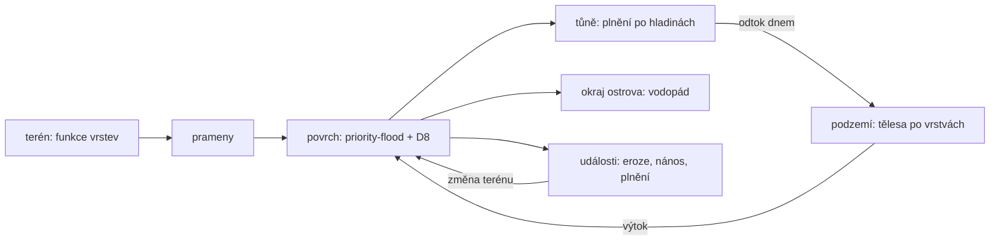

## 2. Podkladová data: na čem se počítá

### Terén jako funkce, ne buňky

- **Blok** = 8 × 8 m. **Řídicí mřížka** 0,5 m = 16 × 16 bodů na blok.
- Na řídicí mřížce jsou 2D matice:
  - `hm_f` = výška povrchu (v buňkách 0,5 m)
  - `bs[k]` = horní hranice vrstvy k (součty mocností)
  - mezi body se interpoluje bilineárně
- **Buňky** jsou jen vzorky funkcí. Jedna buňka = 1 bajt s id materiálu.
  - 16 / blok → buňka 0,5 m
  - 64 / blok → buňka 0,125 m (svět E50: 64 × 64 × 256 buněk na blok)
- **Velikosti světů ve studiích:**

  | svět | bloky | povrch vody | podzemí |
  |---|---|---|---|
  | svet8 (E49) | 8 × 8 = 64 × 64 m | 128² (0,5 m) | — |
  | svet64 (E50, E52–E58) | 8 × 8, buňka 0,125 m | 128² / 256² / 512² (16 / 32 / 64 na blok) | 128² sloupců, **312 028 pásem**, 1345 těles |
  | hrubý svět (E56) | 64 × 64 bodů po 1 m | — | — |

- **Pásma podzemí** (E52 varianta 4): každý sloupec řídicí mřížky je zásobník pásem `[lo, hi)` v metrech s materiálem.
  Uložená jsou v CSR polích:
  - `cs[sloupec]` → rozsah pásem
  - pole `lo`, `hi`, `mat`, `por`, `body`
  - sousedé pásem `ns` / `nb`
  - Dutiny a čočky z buněk se přidají jako další pásma s objemem z buněk.

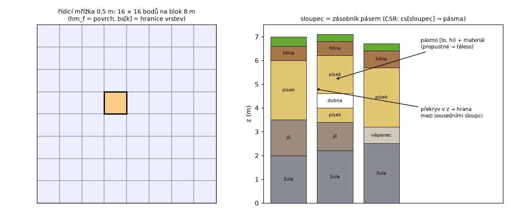

### Vlastnosti materiálů (`sdilene/materialy_voda.json`, verze 3)

Jedna tabulka pro všechny studie (Jan 19:18). Horniny jsou navíc v `sdilene/horniny_voda.json` (63 hornin) se stejnými
poli.

| pole | význam | jednotka |
|---|---|---|
| `perm` | propustnost 0–1 (0 nepropustí, 1 jako vzduch) | relativní |
| `por` | pórovitost, kolik vody buňka pojme | × objem buňky |
| `res` | odpor povrchu (0 hladký, 1 voda skoro neteče) | relativní |
| `ret` | zadržená voda nad hladinou (polní kapacita), ≤ por | × objem buňky |
| `load` | kolik buněk nad sebou unese jako strop dutiny | buňky 0,5 m |
| `cantilever` | kolik buněk převisne bez podpory | buňky |
| `ero_v` | kritická rychlost proudu pro erozi (Hjulström) | m/s |
| `ero_vol` | objem vody přes buňku při v ≥ ero_v, než ji odnese | m³ |
| `sed_v` | rychlost, pod kterou se materiál usazuje | m/s |

- Globálně: `perm_leak` = 0,05 (perm ≤ 0,05 vodu nepropustí, to je i práh dna E55), `perched_depth` = 2 buňky.
- **Příklady:**

  | materiál | perm | por | ero_v | ero_vol |
  |---|---|---|---|---|
  | písek | 0,8 | 0,35 | 0,25 m/s | 600 m³ |
  | hlína | 0,3 | 0,4 | 0,35 m/s | 1500 m³ |
  | tráva | 0,25 | 0,4 | 1,2 m/s | 4000 m³ |
  | jíl | 0 | 0,45 | 0,8 m/s | 8000 m³ |
  | vápenec | 0 | 0 | 4 m/s | 2 · 10⁶ m³ |
  | žula | 0 | 0 | 6 m/s | 10⁸ m³ |

- Kras (rozpustné horniny) má vlastní pravidlo ponoru.

### Parametry výpočtu (výběr, `scripts/bp/params.gd`)

- **Prameny a tok:** `strz_thr_q` (práh koryta), `ponor_perm` (od jaké perm je hornina propustná pro podzemí),
  `ponor_inf_q`, `ponor_cap_q` (ztráty), `pit_drain_q` (odtok tůně dnem), `tok_margin` (okraj lokálního okna).
- **Podzemí:** `ug_hloubka` (do jaké hloubky pod tůní se hledá těleso), `ug_leak_q` (průsak do slabě propustného
  okolí), `p52_rezim` (`nadrz` / `preliv` / `auto`), `p55_perm_dno` 0,05.
- **E58:** `p58_var` (`base`, `A`, `B`, `C` a kombinace), `p58_dz` 0,0625 m, `p58_bfs_max` 20 000, `p58_sdz` 1 buňka.

## 3. Přístupy

### 3.1 Povrch: priority-flood + D8 (`voda/tok.gd`, E47c, E51b)

- **Princip:**
  - Priority-flood [20] od okraje ostrova spočítá `fill` (hladinu, kam by se voda musela zvednout, aby odtekla).
  - Každá buňka pak pošle vodu D8 do souseda s největším spádem.
  - Průtok se sečte od nejvyšších buněk. Ztráty: vsak, ponor, odtok tůně dnem.
- **Vzorce:**

$$\mathrm{fill}_j = \max\left(h_j,\ \mathrm{fill}_i + \varepsilon\right),\quad i = \text{buňka, ze které fronta došla k } j$$

$$\mathrm{to}(i) = \arg\max_j \frac{\mathrm{fill}_i - \mathrm{fill}_j}{d_{ij}},\qquad Q^{\mathrm{in}}_i = s_i + \sum_{j:\ \mathrm{to}(j)=i} Q^{\mathrm{eff}}_j$$

- **Tůně a čas naplnění:** objem po hladinách z, čas události

$$t_{\mathrm{plná}} = \frac{V(z)}{Q_{\mathrm{in}} - Q_{\mathrm{ztráty}}}$$

- **Lokální přepočet (E51b):** okno kolem změny + okraj, ověří se, že okraj okna dál odtéká. Pak jen po proudu, dokud se
  průtok mění (ranné zastavení).

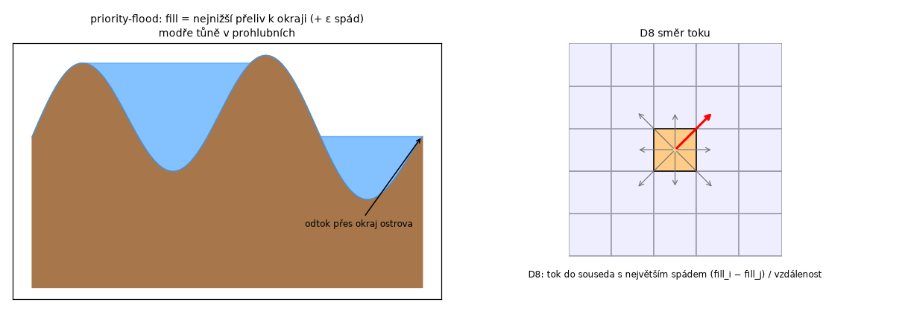

- **Výkon:**

  | mapa | celý route | lokální změna |
  |---|---|---|
  | 64² (E53) | 93 ms | 2,8 ms |
  | 128² | 378 ms | 2,8 ms |
  | 256² | 1400 ms | 12,5 ms |
  | 512² | 5656 ms | 54,7 ms |

  Řádek 64² je z E53, ostatní z E58.
- **Proč to funguje:** fronta je jeden průchod a lokální okno je malé. **Negativa:** fronta je sekvenční (nejde
  paralelizovat). Šířka koryta je 1 buňka (D8), ne podle průtoku.

### 3.2 Eroze a usazování událostmi (E51)

- **Princip:** rychlost proudu podle Manninga

$$v = \frac{1}{n} R^{2/3} S^{1/2},\quad R \approx h,\ n = 0{,}035$$

- Když v ≥ `ero_v` materiálu, odpočítává se `ero_vol`. Buňka se odnese v čase, který je dopředu znám → událost v haldě
  s absolutním časem.
- Usazení nastane pod `sed_v` v tůni.
- **Výkon:** halda 1 M položek: pop + push 2,6 µs. Dohnání 60 dní = 511 událostí za 0,77 s, otisk shodný s během po dnech
  (E54).
- **Negativa:** odnesená hmota jde celá do první tůně po proudu, bez usazování cestou.

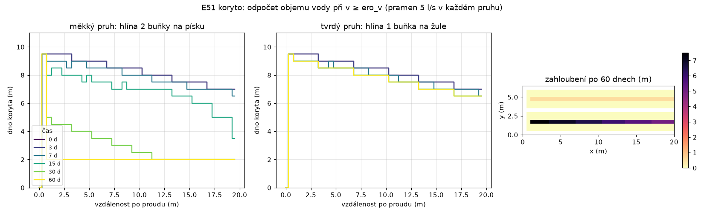

### 3.3 Plošné metody celými poli (E53)

- **Pravidlo rozlévání** ceil(Q/k): voda se rozteče na tolik celých buněk, kolik unesou. Jan: přítok 4 do písku
  k = 0,5 → 8 buněk.

$$w = \left\lceil \frac{Q}{k_{\mathrm{mat}}} \right\rceil$$

  Na hladkém svahu sedí přesně: 8 → 16 buněk za 67 průchodů.
- **Mělká voda (trubky, Mei 2007 [34]):** 8 ms na krok v GDScriptu (64²), numpy 47× rychleji.
- **Vektorové pole jako funkce:** průtok řezem 3,846 l/s při vzorkování 1× / 2× / 4×, nezávislé na rozlišení.
- **Negativa:**
  - Na skutečném terénu se ani jedna metoda za 3000 průchodů / 4000 kroků (37–44 s) neustálí.
  - Lokální změna trvá sekundy, proti 2,8 ms u fronty. Proto zůstává fronta jako zdroj stavu.

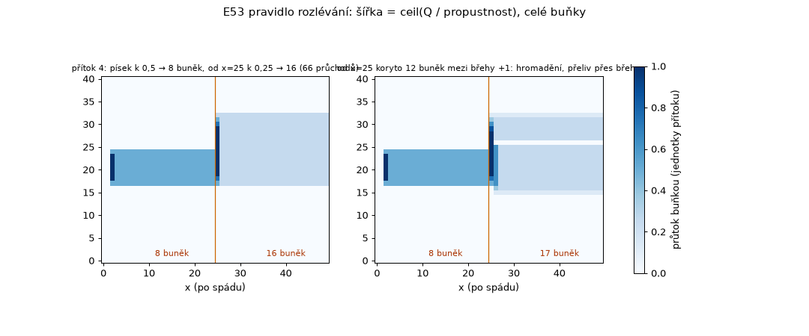

### 3.4 Podzemí: buňky ve slovníku (E47d, E52 varianta 1)

- **Princip:** propustné buňky (perm ≥ `ponor_perm`, kras, dutina) tvoří 3D tělesa. Těleso se plní jako tůň po
  vrstvách z do nejnižšího výstupu: povrch, stěna ostrova nebo jiná tůň.
- **Výkon:** svet64 při 64 / blok **4002 MB, 155 s**. Jedno těleso má 9,7 M buněk ve slovnících.
- **Negativa:** paměť a čas. Na telefonu nepoužitelné.

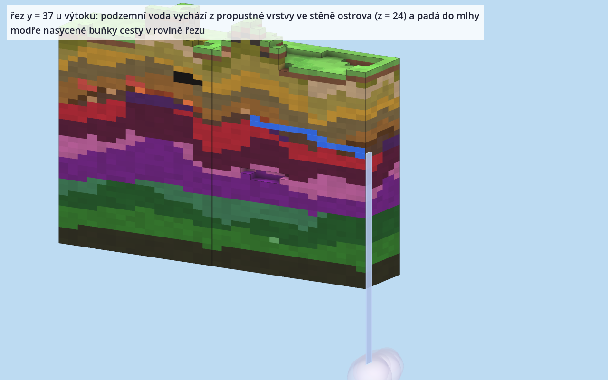

### 3.5 Plochá pole a hrubá mřížka (E52 varianty 2 a 3)

- **Pole** (PackedArray místo slovníku): **575 MB, 36 s**, výsledek shodný se slovníkem (2,87 l/s).
- **Hrubá mřížka 32:** 271 MB, 4,4 s, ale **průsak 0,42 místo 2,87 l/s**. Tenké vrstvy se v hrubých buňkách spojí nebo
  rozpadnou. Výsledek závisí na rozlišení → vyřazeno.

### 3.6 Funkce nad vrstvami: plnění od nejnižšího z (E52 varianta 4, E55)

- **Princip:** místo buněk pásma sloupců řídicí mřížky.
  - Souvislost = pásma ve sloupci, která se dotýkají, a pásma sousedních sloupců s překryvem v z.
  - Hladina se hledá jako minimax přes spodky překryvů (priority-flood po pásmech).
- **Režimy:**
  - `nadrz`: celé těleso je jedna nádrž, hladina = nejnižší výstup, průsak ze všech pásem.
  - `preliv`: voda steče na nejnižší místo, hladina stoupá k nejnižšímu výchozu, tam vyvěrá pramen.
  - `auto` (E55): podle materiálu pod tělesem. Nepropustné dno → `preliv`, propustné → `nadrz`, smíšené → průsak
    jen dnem, zbytek výstupem.
- **Bilance** (každé těleso, do 1e-9):

$$Q_{\mathrm{in}} = Q_{\mathrm{průsak}} + Q_{\mathrm{výtok}} + \frac{dV}{dt},\qquad Q_{\mathrm{průsak}}^{\mathrm{dno}} = \sum_{\mathrm{dno\ propustné}} A \cdot \mathrm{perm}_{\mathrm{pod}} \cdot \mathrm{leak}$$

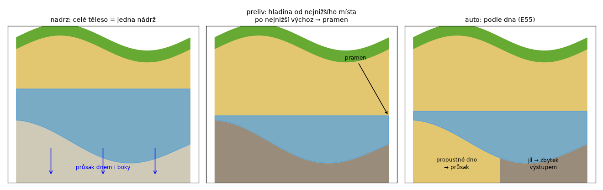

- **Výkon:** 288 MB (14× méně než slovník), řešení 0,6 s (`nadrz`) / 1,6 s (`auto`).
  - Nezávislé na rozlišení: 2,86 / 2,86 / 2,86 l/s.
  - V `auto` průsak 0,377 / 0,377 / 0,378 a výtok 2,485 l/s při dutinách 16 / 32 / 64.
- **Negativa:**
  - Mapa dna má hrany po blocích.
  - Výtok jen stěnou ostrova.
  - **Výkop nad tělesem přepočítá celé podzemí: 6 řešení, ~1,7 s.** To je úzké hrdlo E57.

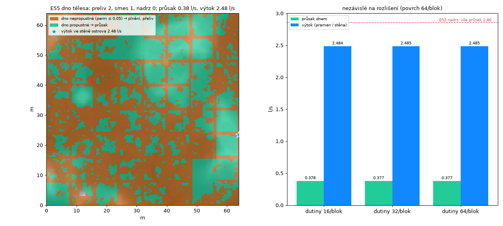

### 3.7 Darcy 2D a 3D (E52 varianta 5)

- **Princip:** Darcyho zákon a konečné objemy. Neznámá je tlaková výška h, matice se řeší CG s Jacobiho
  předpodmíněním [33].

$$\mathbf{q} = -K\,\nabla h,\qquad \sum_{f} K_f \frac{h_j - h_i}{d_{ij}} A_f = s_i,\qquad K_f = \frac{2K_iK_j}{K_i + K_j}$$

- **Výkon:**
  - **2D** (vrstva): 4,6–7 s, 3200 iterací. Výsledek silně závisí na K (kupa 9 m při K 1e-4).
  - **3D** při 16 / blok: 99 k neznámých, 1333 iterací, **58 s**. Při 32 / blok odhad ~15 min na řešení.
- **Negativa:** bez podmínky průsakové plochy voda obíhá mezi výchozy (85 m³/s proti 3,6 l/s vstupu, bilance −20 %).
  Pro hru příliš drahé.

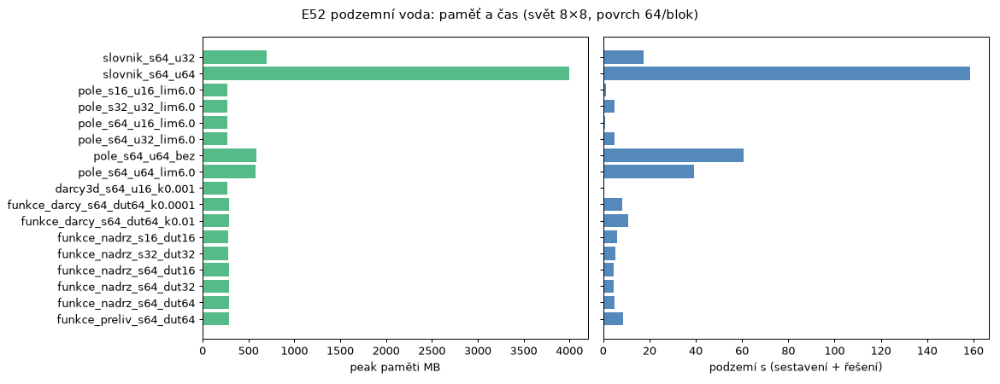

### 3.8 Nové varianty E58: A, B, C a jejich kombinace

Cíl: výkop nad tělesem nesmí stát 1,7 s. Výsledek musí zůstat **přesně stejný** jako u `auto` (E55).

- **A, kbelíková fronta:** priority-flood přes kbelíky po hladinách `dz` místo jedné haldy. V aktuálním kbelíku je
  malá halda, takže pořadí (klíč, id) je stejné jako u haldy a výsledek bit po bitu stejný. Vložení O(1), halda jen
  přes kbelík: O(N + Σ b log b) místo O(N log N).

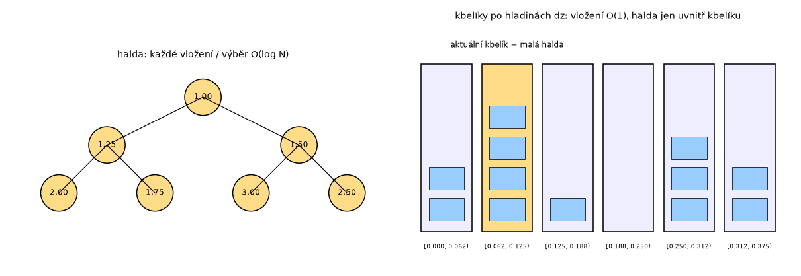

- **B, graf těles:** uzel = celé těleso se souhrny:
  - Σ průsak
  - seznam kandidátů výstupu (z, typ, sloupec)
  - plocha dna podle materiálu
  - objem po hladině

  Dotaz = najít nejnižšího kandidáta (setříděný seznam) místo BFS přes 312 tis. pásem. Kandidáti, kteří se shodují
  v toleranci 2 · 10⁻⁶ m → přesný BFS (za 20 výkopů ani jednou).
- **C, lokální přepočet s ranným zastavením:** každé volání si pamatuje **stopu** = sloupce navštívených pásem
  a sousedy.
  - Výkop mimo stopu → beze změny.
  - S B: **delta** souhrnů jen za pásma změněného sloupce a 4 sousedů.
  - Zmizí-li pásmo nebo se rozpojí překryv, oboustranný omezený BFS zjistí, jestli se těleso rozpadlo. Malá
    odpadlá část se z uzlu odebere, uzel se nepřestavuje.

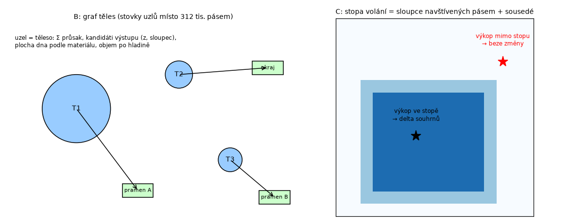

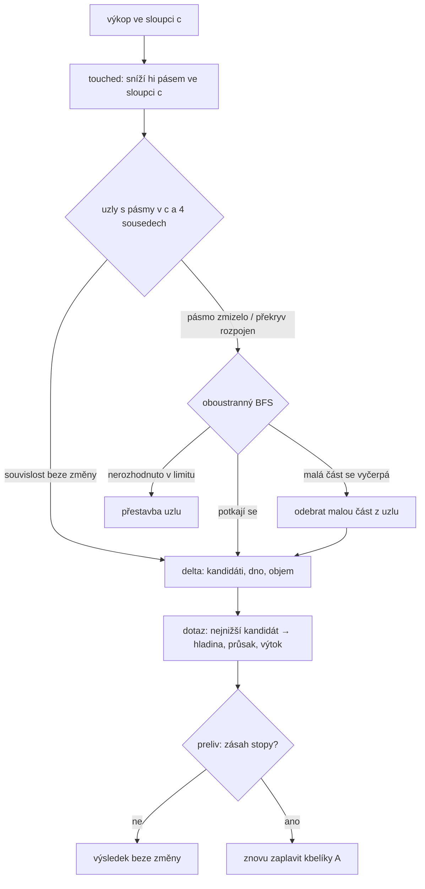

**Výsledky podzemí** (svět E52, povrch 64 / blok, 6 volání, 20 výkopů 1 m nad tělesy, shoda s čerstvým plným řešením
po každém výkopu):

| varianta | plné řešení | výkop průměr | výkop max | paměť navíc | neshod |
|---|---|---|---|---|---|
| base (E55 auto) | 1651 ms | 1704 ms | 1860 ms | 0 | 0 |
| A | 1708 ms | 1678 ms | 1837 ms | 4,8 MB | 0 |
| B | 1018 ms | 1016 ms | 1223 ms | 20,5 MB | 0 |
| C | 1742 ms | 1706 ms | 1858 ms | 0,1 MB | 0 |
| A+B | 996 ms | 996 ms | 1060 ms | 25,3 MB | 0 |
| A+C | 1767 ms | 1719 ms | 1837 ms | 4,9 MB | 0 |
| **B+C** | 1104 ms | **1,0 ms** | 10,3 ms | 8,9 MB | 0 |
| **A+B+C** | 945 ms | **0,9 ms** | 8,8 ms | 13,7 MB | 0 |

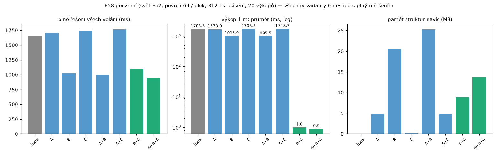

- **Proč A samo nepomůže:** v `auto` stojí většinu času BFS celého tělesa (kvůli dnu), výpočet objemu a převod
  vyloučených sloupců, ne halda v prelivu.
- **Proč C samo nepomůže:** přeskočí 80 ze 120 přepočtů, ale každý výkop zasáhne obří těleso a jeho plné řešení stojí
  většinu času.
- **Proč B samo nepomůže:** výkop přestaví zasažený uzel celý (BFS + objem), ~1 s.
- **Proč B+C ano:** výkop změní jen pásma jednoho sloupce. Delta je O(pásma sloupce + kandidáti 5 sloupců), dotaz
  je O(počet kandidátů u minima).

### 3.9 Povrch s A, B, C (E58)

| mapa | route (halda) | route A | samotný flood → A | B graf pánví | výkop C (E51b) | výkop C+A | plný route po výkopu |
|---|---|---|---|---|---|---|---|
| 128² | 378 ms | 344 ms | 131 → 98 ms | 44 ms | 2,8 ms | 2,6 ms | 379 ms |
| 256² | 1400 ms | 1211 ms | 613 → 476 ms | 167 ms | 12,5 ms | 11,6 ms | 1352 ms |
| 512² | 5656 ms | 4884 ms | 2570 → 1834 ms | 590 ms | 54,7 ms | 44,6 ms | 5695 ms |

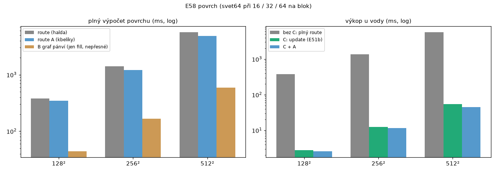

- **A:** výsledek bit po bitu stejný (fill, eff, to i po výkopech). Flood je 1,3–1,4× rychlejší, celý route 1,1–1,16×,
  výkop 1,07–1,23×.
- **B, graf pánví:** sestup D8 → pánve → hrany přelivů → priority-flood nad stovkami uzlů (829 / 1617 / 3464 pánví).
  Je 9× rychlejší než route.
  - **Není ale přesný:** chybí ε spád na rovinách, takže ho nejde použít pro D8.
  - Jezera route / B: 1878 / 1818 buněk při 128², Δ fill max 0,06–0,24 buňky.
  - Hodí se jako rychlý odhad tůní (náhled, LOD), ne jako stav.
- **C je už hotové (E51b):** výkop 2,8 / 12,5 / 54,7 ms proti plnému route 0,38 / 1,35 / 5,7 s, tedy 100–135×.
  - **Negativum:** C proti plnému route se liší o 0,000625 l/s eff (512²) a 0,13 buňky fill (128²) na pár buňkách.
    Je to stará vlastnost E51b okna, ne nového kódu.

## 4. Zvolená varianta: podzemí A+B+C (doporučení, Jan rozhodne)

- **Proč:**
  - Výkop **0,9 ms průměr, 8,8 ms max** místo 1,7 s (**~1900×**). Plné řešení 0,95 s místo 1,65 s.
  - **0 neshod** s plným řešením ve všech polích: průsak, výtok, hladina, typ a sloupec výstupu, objem, režim tělesa.
  - Platí při povrchu 16 / 32 / 64 na blok: výkop 3,2 / 1,8 / 0,9 ms (max 22 / 8,9 / 8,8 ms), 0 neshod.
  - Delší test: 100 výkopů (jiný seed, 98 zásahů tělesa) → 1,3 ms průměr, 9,4 ms max, 0 neshod.
  - +14 MB paměti. A přidává přesnou stopu prelivu: zaplavuje se znovu jen při zásahu jeho stopy, ne při každém zásahu
    tělesa. B+C bez A je skoro stejně rychlé (1,0 ms), protože se preliv po výkopech nespouštěl.
- **Jak je sestavená** (`blueprint-studie/scripts/alg58/ug58.gd`, `bq58.gd`):
  1. **Jednou při startu:** pro každé těleso, kam vede tůň, BFS → uzel:
     - pásma
     - Σ průsak (`leakf`)
     - kandidáti výstupu, setříděné klíče (z · 10⁶ · 2²² + index)
     - příspěvky dna po pásmech (plocha propustná / nepropustná, průsak dnem)
     - objem po hladině (výsledek `_result` se uloží pro hladinu L)
  2. **Dotaz (tůň posílá q l/s):**
     - nejnižší platný kandidát (bez vyloučených sloupců tůně) → hladina L, výstup
     - z dna podíl f
     - f = 0 → preliv přes kbelíky (A) se stopou
     - jinak průsak min(Σ dno, q), výtok q − průsak, objem a časy plnění z uloženého výsledku pro L
  3. **Výkop:** `touched` sníží pásma sloupce. Pro uzly se pásmy v 5 sloupcích:
     - kontrola souvislosti, oboustranný BFS do `p58_bfs_max`
     - delta kandidátů, dna a objemu
     - preliv se zneplatní jen při zásahu stopy
  4. **Přesnost:**
     - shoda kandidátů v toleranci → přesný BFS
     - rozpad tělesa nerozhodnutý v limitu → přestavba uzlu
     - tabulka časů plnění (události) je po deltě označená jako zastaralá a dopočítá se při dotazu
- **Server znovu (E57 s vítězem).** Zátěž = úprav / min × (povrch + 5 % × podzemí) / 60 000 ms, podíl jednoho
  jádra. Povrch 128² = 2,6 ms (E54), 512² = 44,6 ms (E58 C+A). Podzemí base = 1704 ms, A+B+C = 0,9 ms. Četnosti
  úprav jsou odhad.

  | hráči × úprav / min | 128² + base | 128² + A+B+C | 512² + base | 512² + A+B+C |
  |---|---|---|---|---|
  | 10 × 4 | 5,9 % | 0,2 % | 8,7 % | 3,0 % |
  | 50 × 4 | 29 % | 0,9 % | 43 % | 15 % |
  | 50 × 20 | **146 %** | 4,4 % | **216 %** | 74 % |

  S A+B+C je úzké hrdlo povrch ve velkém rozlišení, ne podzemí.

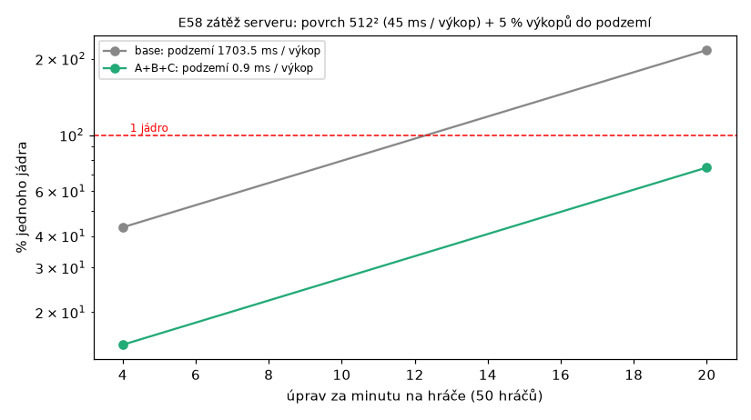

## 5. Srovnání

- **Paměť (svet64):** slovník 4002 MB → pole 575 MB → funkce 288 MB (+14 MB pro A+B+C).
- **Plné řešení podzemí:** slovník 155 s → pole 36 s → funkce 0,6–1,7 s → A+B+C 0,95 s.
- **Výkop v podzemí:** 1,7 s (E55) → 0,9 ms (E58 A+B+C).
- **Povrch:** plný 0,38–5,7 s → lokální 2,6–45 ms.

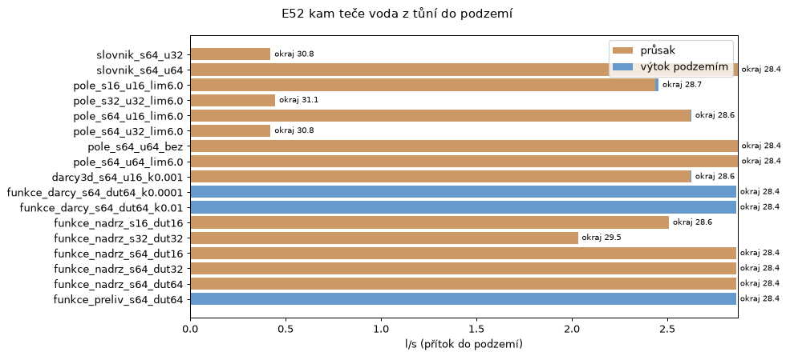
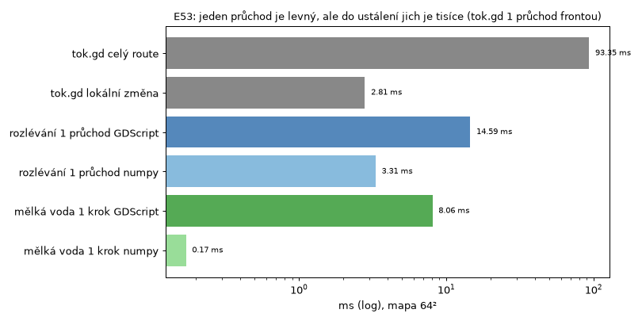

## 6. Co nefungovalo a proč (souhrn)

- **Buňky ve slovníku:** paměť (4 GB).
- **Hrubá mřížka:** mění výsledek (tenké vrstvy).
- **Darcy 3D:** drahý, bez průsakové plochy nefyzikální oběh.
- **Plošné metody:** na skutečném terénu se neustálí, lokální změna trvá sekundy.
- **A samo a C samo:** neřeší správnou část času (BFS obřího tělesa).
- **B na povrchu:** rychlé, ale nepřesné (ε spád) → jen odhad.
- **Měřeno v GDScriptu na 1 jádře boxu.** C# a vlákna budou jinde. Pořadí variant by se nemělo změnit, absolutní čísla
  ano.

Zdroje: `blueprint-studie/ZDROJE.md` [20] priority-flood, [31] Manning, [32] Hjulström, [33] Darcy / FV / CG,
[34] Mei 2007, [36] kbelíková fronta, [37] hierarchie prohlubní.

## Dodatek: materiály podle skutečnosti (E59, jen návrh)

Hodnoty propustnosti v tabulce materiálů jsou zatím herní odhady. V E59 jsem je porovnal se skutečnými hodnotami: hydraulická vodivost K podle Freeze & Cherry 1979, vydatnost Sy podle Johnsona 1967 a půdy podle Rawlse 1982. Ve hře je 1 den 10 minut, takže čas běží 144× rychleji. Pro každý materiál jsem spočítal, jak dlouho voda prosakuje 1 m:

$$t_{1\,m} = \frac{S_y \cdot 1\,\mathrm{m}}{K \cdot i},\qquad t_{\text{reálně}} = \frac{t_{1\,m}}{144}$$

| materiál | K (m/s) | 1 m reálně |
|---|---|---|
| písek | 1e-4 | 18 s |
| hlína | 3.7e-6 | 5 min |
| vápenec | 3e-8 | 77 min |
| jíl | 1e-10 | 16 dní |
| žula | 1e-12 | 402 dní |

Rozpětí je 13 řádů, takže se to hodí do tří režimů:

- **okamžitě:** ustálený stav, jak ho počítají varianty výše
- **událost:** halda E51
- **prakticky nepropustné**

Návrh je v `sdilene/materialy_voda_navrh.json`. Sdílenou tabulku zatím neměním, o převzetí ještě rozhodnu.

## Dodatek 2: noční doladění (E60) a reálné materiály ve hře (E61)

- **Povrch po výkopu je 2,8–4,1× rychlejší a výsledek je stejný bit po bitu.** Přepočítávám jen buňky, kterým se něco změnilo, a halda je v packed polích. Na 512² to dělá 41,8 → 10,2 ms na výkop. Pro 50 hráčů × 20 úprav za minutu to znamená 70 % → 17 % jednoho jádra.
- **Graf pánví je přesný.** Shoduje se s priority-flood bez ε v každé buňce. Rozdíl proti hře (1818 / 1878 buněk tůní) dělá jen ε spád: roviny se zvednou o ε na krok a od ~10 kroků vypadají jako tůň.
- **Reálné materiály (E61).** Do hry jsem převzal propustnost podle skutečné hydraulické vodivosti. Déšť teď víc vsakuje do trávy a hlíny: odtok z mapy klesl na polovinu (683 → 320 buněk) a kaluží je asi čtvrtina (9,4 → 2,6 m³).
- **Nová slabina.** S novými materiály se hlavní podzemní těleso přepnulo do režimu přeliv a nejrychlejší varianta A+B+C na tom ztrácí. V režimu přeliv musí po výkopu znovu zaplavit celé těleso: 3,4 s místo 1 ms. Graf těles (B) zatím umí jen režim nádrž. Tohle je další úkol.
