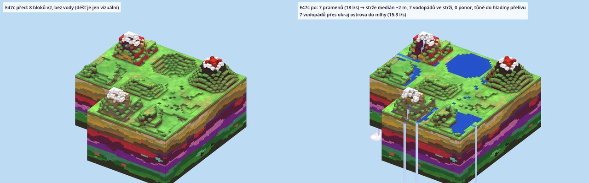
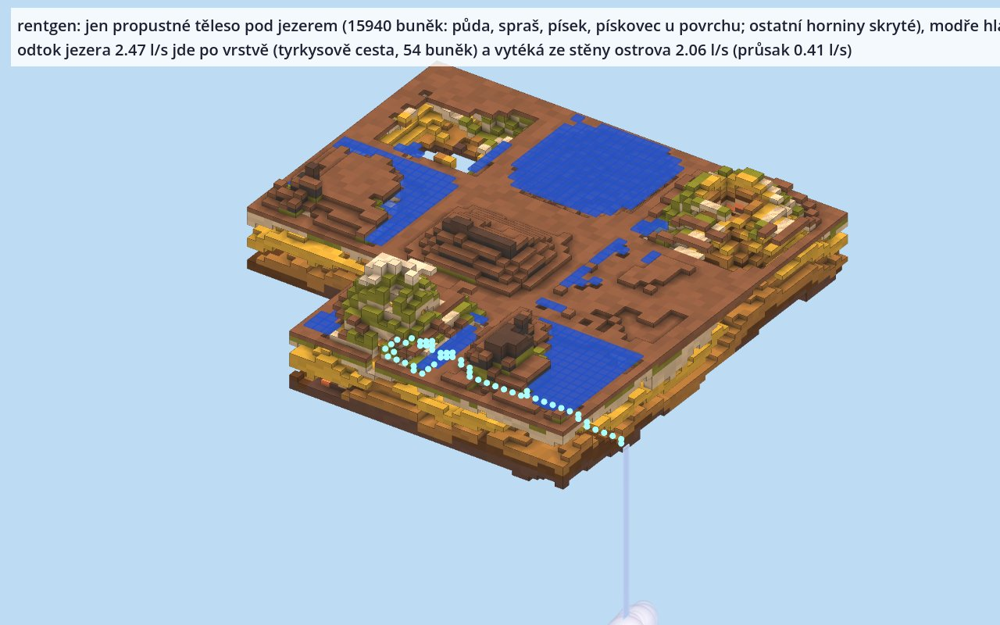

# Voda

Zpět na [osnovu](index.md).

Stav: model pramenů, koryt, tůní a podzemí je **ve zkoušce** (E47b, E47c, E47d). Propustnost prohlubně Jan 19:48 schválil. Krasová vyvěračka čeká na pravidlo.

## Shrnutí

Déšť je jen vizuální a vodu do terénu nedává. Vodu dávají prameny: zvláštní buňky se stálým průtokem (sníh a vrcholy, styk propustné vrstvy s nepropustnou na svahu, krasová vyvěračka). Když je pramen uzavřený v dutině, odkud se voda nemůže šířit, neteče nic – žádný tlak ani prosakování. Po otevření teče znovu.

Voda teče vygenerovaným korytem. Když se terén u vody nezmění, nic se nepočítá. Po zásahu (výkop, hráz, nový pramen) se tok přepočítá lokálně po proudu až do ustálení a nové koryto se uloží. V E47c byla změna u sucha 0 sloupců a 0,2 ms, hráz 585 sloupců a 20 ms, vždy shodná s plným přepočtem.

Tůně se plní předpočítanými událostmi, ne pravidelnými tiky. Pro každou výškovou vrstvu je čas = objem / (přítok − odtok). Propustnost jámy je odtok za čas. Po naplnění jde odtok podzemím a zbytek přeteče nejnižším okrajem. Když je odtok větší nebo roven přítoku, tůň se nenaplní (ponor). Příklad, který Jan zadal: zdroj 1 za čas, jáma objemu 8, odtok 0,5 → plná za 16 t; test prošel.

Strže mají typicky hloubku kolem 2 m (v E47b medián 2,00 m, p90 3,8 m). Na některých materiálech tok zmizí do podzemí. Přes útes vznikne vodopád. Ostrov je plovoucí: voda na okraji mapy padá do mlhy a dál se nesimuluje.

Podzemní voda (Jan 20:00, E47d) nesměřuje k nejbližšímu okraji, ale sleduje propustnou vrstvu (propustná hornina, kras nebo dutina). Dutinu zaplní jako podzemní jezero. Uzavřená čočka se naplní a pak přeteče nejnižším výstupem, například do tůně 4 × 4 nebo pramenem ve svahu. Ve světě sledu 46 pod jezerem dutina ani čočka nebyly, proto je studie ukazuje na ukázkových blocích. Ve světě odtok jezera šel vrstvou 54 buněk a vytékal ze stěny ostrova.

## Hlavní rozhodnutí a výsledky zkoušek

- Propustnost prohlubně a vzorec plnění **schváleny** Janem 19:48.
- E47b+c: 7 pramenů (18 l/s); 7 vodopádů ve strži (max 4,1 m); 85 % vody přepadá po povrchu okraje, 2,5 l/s vyvěračkami ve stěně; jezero 162 m³ plné za 28,5 h (10 událostí). Krasová vyvěračka v testu 0.
- E47d testy: čočka plná za 38,4 t, pak tůň 4 × 4 za 48 t; dutina 27 buněk jako jezero. Uzavřená čočka po naplnění dál vodu nepřijímá. Ve světě odtok 2,47 l/s, výtok ze stěny 2,06 l/s.
- Starší buněčná simulace vody v `voda-studie/` (tiky přes všechny buňky) je jiný model; ostrovní voda v blueprint-studii běží z pramenů a událostí.

## Zdroje a snímky

- [`DENIK.md`](../DENIK.md) – A/2 E47b+c, E47d a nápady 19:14–20:00
- [`blueprint-studie/README.md`](../blueprint-studie/README.md), [`PROP.md`](../blueprint-studie/PROP.md)
- skripty: `blueprint-studie/scripts/voda/` (`prameny.gd`, `tok.gd`, `strze.gd`, `podzemi.gd`)
- původní snímky: `blueprint-studie/shots/47b_*`, `47d_*`, GIF `47b_vodopad.gif`
- starší studie: [`voda-studie/`](../voda-studie/)

*E47b: prameny, strže a tok na ostrově (`blueprint-studie/shots/47b_iso.png`).*

*E47d: podzemní voda sleduje propustnou vrstvu (`blueprint-studie/shots/47d_vrstva.png`).*
