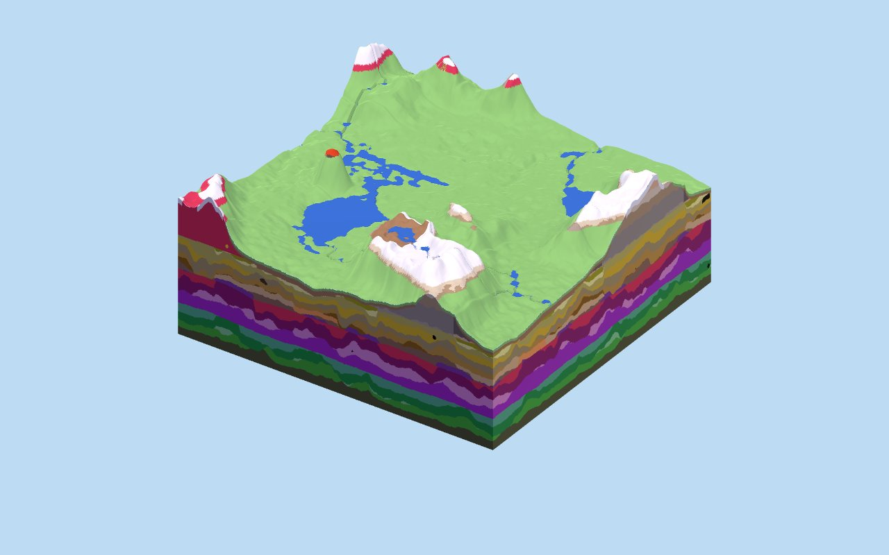

# Výkon a mobil

Zpět na [osnovu](index.md).

Stav: požadavek na telefony je **rozhodnutý** (Jan 20:07–20:09). Čísla níže jsou z měření na boxu, ne z telefonu. Návrhy optimalizací v deníku C jsou **hypotézy**.

## Shrnutí

Jan 20:07: hra má běžet i na telefonech. Jan 20:09: generování je zatím primárně na klientovi (i na telefonu), server ukládá a validuje. K tomu patří menší dosah detailu a LOD, jednodušší vzhled, voda jen jako animace podle předpočítaných časů, vykreslování Godot Compatibility a cíl 30 snímků za sekundu na středním telefonu.

Měření E50 (`blueprint-studie/shots/bench_svet64.txt`, 18. 11. 2026 20:37, Europe/Berlin) je z boxu: Intel Xeon, 8 jader, Godot 4.7.2, GDScript na jednom vlákně. Svět 8 × 8 bloků po 64 × 64 × 256 buňkách (67,1 milionu buněk):

| fáze | čas | RSS po fázi |
|---|---|---|
| hrubý svět (terén, počasí, eroze a řeky, biomy, dlaždice) | 546 ms | 131 MB |
| detail 64 bloků (navázání, vrstvy, minerály, dutiny) | 335,02 s | 361 MB |
| z toho vrstvy | 174,08 s | |
| z toho minerály | 52,27 s | |
| z toho dutiny | 103,14 s | |
| voda (mřížka, prameny, povrch, podzemí) | 179,04 s | 3566 MB |
| **celkem generování** | **514,61 s** | peak 4021 MB |

Nejpomalejší blok trval 10,47 s (zvrásněná hora). Hrubý svět je stejně levný jako v E49. Detail je proti E49 asi 22× pomalejší (v E49 průměr bloku 239 ms, tady medián 4,17 s). Podzemní voda drží většinu času vody i skok paměti (po detailu 361 MB, po podzemí 3,6 GB).

Render izometrie se měřil zvlášť, na už vygenerovaných datech: síť 522 242 + řezy 34 992 trojúhelníků, vykreslení a uložení 1,3 s. Jde o OpenGL na xvfb, ne o telefon.

Odhad pro telefon z tohoto měření v `PROP.md` ještě není dopsaný (v plánu bylo: odhad z GDScriptu na jednom jádru Xeonu, pak C# a vlákna, a podle fází rozhodnout, co optimalizovat napřed). V deníku C je jako návrh C# nebo GDExtension: benchmark skály ukázal asi 10× (983 ms na 65–120 ms na blok). Stavba bloků ve vlákně, sekce a LOD jsou taky návrhy, ne hotové řešení. Všechna starší čísla z prototypu jsou ze softwarového vykreslování (llvmpipe), dokud se nezměří na Janově grafice.

E91 (2026-11-20 07:55) zkusilo průhlednost překážek v izometrii. Nejlepší je zahodit pixely v shaderu: válec 3 m kolem paprsku od postavy ke kameře se sítem (dither) a v podzemí řez nad úrovní postavy. Postava za kopcem je vidět ze 67 %, v chodbě ze 100 %. Přepnutí stojí 0,45 ms (jen uniformy), snímek na software GPU je dražší o 3–14 % (na hraně šumu). Řez sítí na CPU dá skutečné víko, ale přestavba trvá ~200 ms. Skrytí celých bloků nepomůže. Je to hypotéza, Jan nerozhodl.
## E93: benchmark pro telefon (2026-11-20 08:33)

Pro telefon vznikla samostatná scéna `bench_telefon` a Android APK, jsou v `/workspace/willage-ideas/telefon-e93/` mimo git a návod je v `blueprint-studie/shots/e93/NAVOD_TELEFON.md`.
Na boxu se logika (generování, voda E68, výkopy) změřila s omezeným CPU. Jedno jádro je stejně rychlé jako osm, protože všechno běží v jednom vlákně.
`cpulimit` 50 % dal zhruba 2× a 25 % zhruba 3,3–4×. Přes Geekbench 6 vychází střední telefon asi 1,6–1,9× pomaleji než box a slabý asi 4,4–4,6× pomaleji.
Odhad pro střední telefon: voda 3,9–5,0 s a výkop 1,1–1,5 s. Scéna má 269 tis. trojúhelníků a 173 draw calls. Draw calls jsou pod limitem 500 pro GLES, trojúhelníků je víc než v ukázce Androidu pro 30 fps.
Čísla a zdroje [73]–[80] jsou v `PROP.md` (E93 výsledky). Skutečné měření dodá až telefon.

## Zdroje a snímky

- [`DENIK.md`](../DENIK.md) – A/3 požadavek 20:07–20:09; C/7 návrhy optimalizací
- [`blueprint-studie/shots/bench_svet64.txt`](../blueprint-studie/shots/bench_svet64.txt)
- [`blueprint-studie/shots/bench_svet64_render.txt`](../blueprint-studie/shots/bench_svet64_render.txt)
- [`blueprint-studie/PROP.md`](../blueprint-studie/PROP.md) – plán E50
- [`skala-studie/`](../skala-studie/) – benchmark C#

*E50 po vygenerování (`blueprint-studie/shots/50_svet64_iso.png`). Časy fází jsou v tabulce výše, ne v tomto snímku.*
