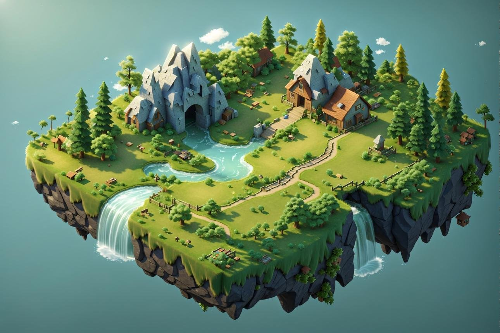
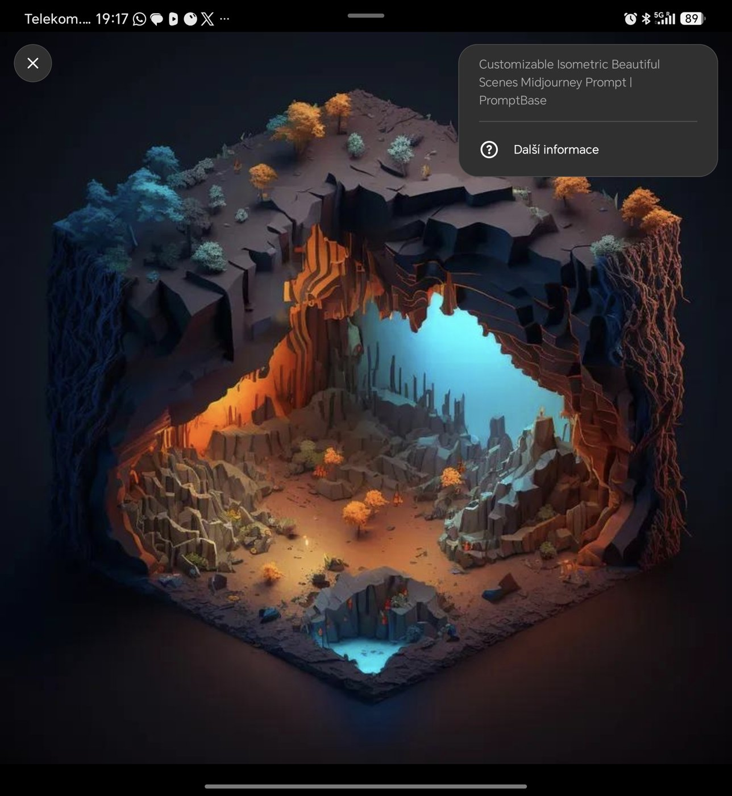
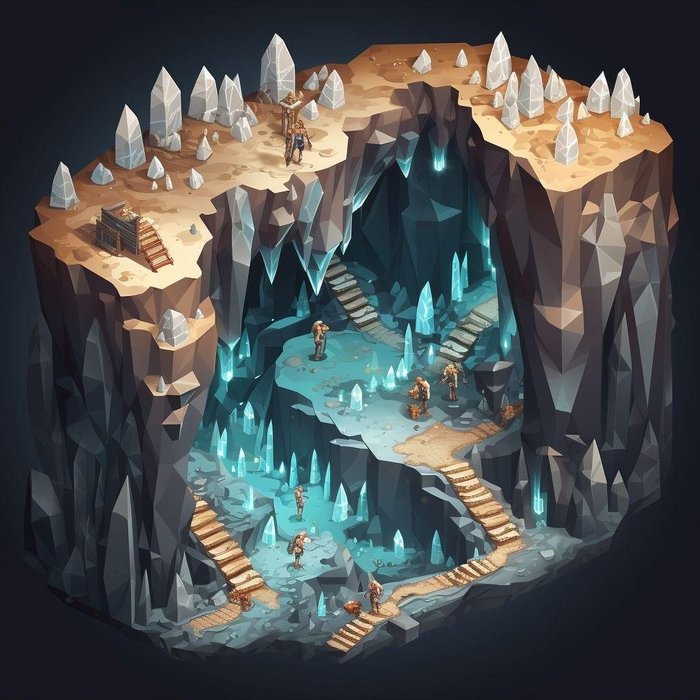
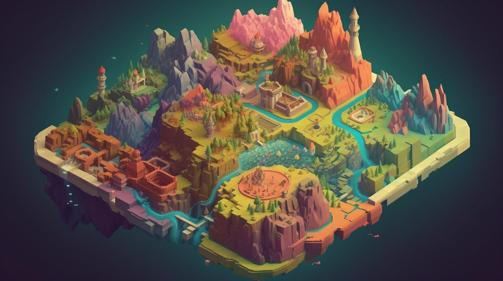
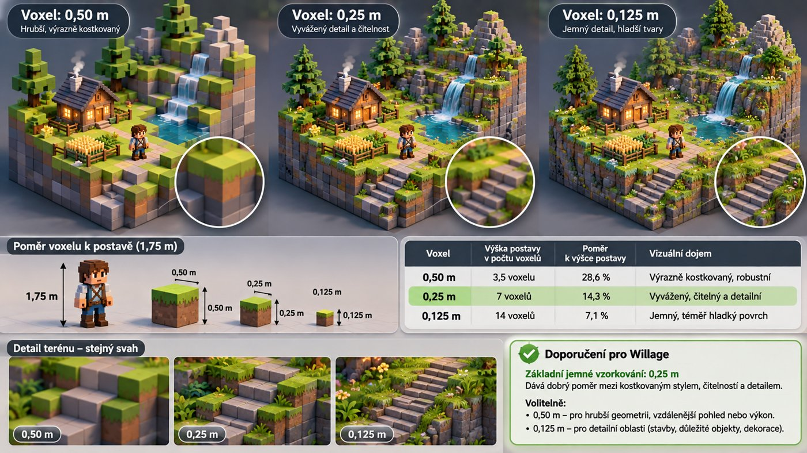

# Vzhled: referenční obrázky

Zpět na [osnovu](index.md).

Stav: **hypotéza**. Jsou to náměty, které se Janovi 19. 11. 2026 líbily designově. Jde o obrázky z generátorů a z internetu, ne o náš render. Skutečný vzhled ukáže až test v izometrii v Godotu.

## Co si z nich bereme

- **Plovoucí ostrov** s vodopády přes okraj: přesně koncept osobního ostrova.
- **Řez blokem s jeskyní:** pohled do podzemí při kopání. Stěny řezu jsou vrstvy hornin z `bs[k]`, nerovnost podle tvrdosti materiálu, svislé žebrování a světlo dělá shader.
- **Krystalový důl** se schody: těžba, minerály a krystaly v hornině.
- **Low-poly krajina** bez kostiček: hladký terén z funkcí, kostky jen tam, kde se kopalo.
- **Srovnání voxelů 0,5 / 0,25 / 0,125 m:** podpora rozhodnutí pro jednotku 0,25 m (Jan 2026-11-19 20:12).

