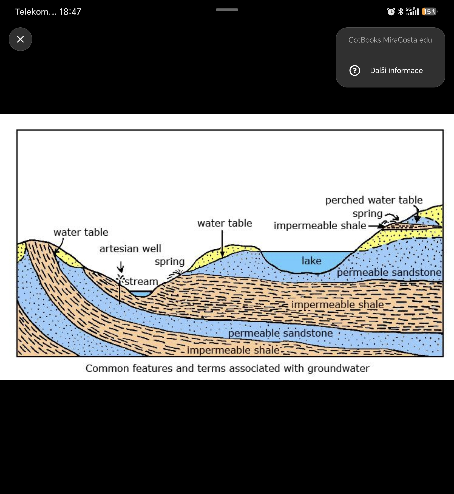

# 01 – Základní principy a vstupní data (kostra k rozhodnutí)

Stav: **kostra**, 2026-11-20 14:20 SEČ. Každý bod obsahuje současný stav, varianty z větví s naměřenými čísly, doporučení a otázku pro Jana. Pole **Platí:** je zatím prázdné. Vyplní se až po Janově rozhodnutí v chatu (Jan t712u). Do té doby nic z tohoto souboru neplatí jako pravidlo.

Rozsah (Jan t710u): jen **datový model světa**. Vykreslování, LOD, průhlednost, shadery, draw calls a velikost modelů jsou prezentační vrstva, která data jen čte (viz `00-mapa-vetvi.md` §5). Datový model nesmí záviset na tom, jestli bude pohled 2D, nebo 3D.

Značení: „rozhodnuto (datum)“ = Jan už rozhodl. ⚠ = novější měření to zpochybňuje. K1–K12 = konflikty z mapy větví. Body jsou seřazené podle tématu. Pořadí, ve kterém je navrhuju s Janem procházet (nejdřív to, na čem závisí nejvíc ostatních), je v `README.md`.

---

## 1.1 Pojmy: ostrov, blok, segment, buňka

**Současný stav (před rozhodnutím).** „Blok“ měl tři významy (K1). Dnešní „blok“ v kódu (ve studiích „blok blueprintu“) má 8 × 8 × 32 m (16 × 16 × 64 buněk), podle nových pojmů je to **segment**. Je jednotkou vkládání, receptu, seedu, rotace, sousedů i formátu WVB1 [1][2]. „Blok vesnice 128 m“ byl Janova preference z 2026-11-19 19:56 [3] a od 2026-11-20 11:48 je rozhodnuto „generovat celý blok 128 m“ [4]. E96 ho ale složilo z 16 × 16 bloků po 8 m [5]. Ostrov má podle konceptu začínat na 4 blocích a mít nejvýš ~16 [1]. TODO uvádí „4 × 4 bloky = 512 × 512 m“ [3].

**Varianty**

| | A: blok = 8 m (stav kódu) | B: blok = 128 m, uvnitř segmenty 8 m (E96) | C: blok = 128 m, uvnitř segmenty 16/32 m (návrh E96 §3) |
|---|---|---|---|
| co hráč vkládá | blok 8 m | blok 128 m (výřez) | blok 128 m |
| ostrov 4 → 16 bloků | 16 × 16 → 32 × 32 m | 256 × 256 → 512 × 512 m | jako B |
| WVB1 / E88 | platí beze změny | nutná nová verze (dims) | nová verze |
| čísla | ostrov START 4 s načtení [6] | 138–142 s načtení, 2,5 GB [5] | neměřeno |

**Doporučení (před rozhodnutím).** Zavést tři slova: **blok** (128 m, jednotka vkládání a vlastnictví), **segment** (vnitřní dělení bloku pro výpočet a ukládání, dnes 8 m) a **ostrov** (sada bloků). „Dlaždice“ nechat pro svět výprav. Pravidla vkládání (rotace, sousedé, recept) přesunout ze segmentu 8 m na blok 128 m. Velikost segmentu řešit v 1.11 podle výkonu, ne jako princip.

**Otázka pro Jana.** Je blok 128 m jednotka, kterou hráč vkládá a otáčí, a ostrov se skládá z 4 až 16 takových bloků? Nebo je 128 m celý ostrov?

**Platí:** *rozhodnuto (2026-11-20 14:34–14:39, Jan t713u, t714u); doplněno (2026-11-20, Jan t741u–t743u); doplněno (Jan 2026-11-21 00:19, buňka 0,25 m)*

| Pojem | Co to je | Velikost (výchozí) |
|---|---|---|
| **Ostrov** | jednotka ukládání: proměnný počet bloků, roste dynamicky po jednom bloku, nese i data přes hranice bloků | – |
| **Blok** | jeden stavební dílek, ze kterého se ostrov skládá. Hráč ho vkládá, zrcadlí a otáčí | 128 × 128 m (512 × 512 buněk) |
| **Segment** | vnitřní část bloku. Jednotka výpočtu, ukládání a načítání. Segmenty vykreslují buňky | parametr, výchozí 8 m (32 × 32 buněk). 16 a 32 m jsou kandidáti, doladí se v bodě o výkonu (1.11) |
| **Buňka (voxel)** | nese materiál a vodu | 0,25 m |

- **Pravidlo:** velikost bloku, segmentu i buňky jsou parametry a v buňkách musí být mocninou 2. Blok se musí beze zbytku dělit na segmenty a segment na buňky. Blok 100 m tedy nejde, 64, 128 nebo 256 m ano.
- **Proč:** indexy jdou bitovými posuny, přehledy a LOD se půlí až na jednu buňku, quadtree slouží pro načítání a slučované vykreslování, a velikosti sedí na 2D tilesety 16/32/64 px (Jan t714u).
- **Důsledek:** dnešní „blok“ 8 m v kódu (`BS` 16, WVB1 `dims`, `veg.gd`, E88) je od teď segment. Vkládání, zrcadlení, rotace, recept a sousedé patří bloku. „Dlaždice“ zůstává pro svět výprav.
- **Data a zobrazení (Jan t715u, 2026-11-20):** datový model je v metrech a o pixelech nic neví. ~~Se zobrazením ho spojuje jen pravidlo **buňka 0,5 m = 1 dlaždice (tile)**. Segment 8 m = 16 × 16 dlaždic, blok 128 m = 256 × 256. Zobrazení převádí jedním faktorem (např. 1 m = 64 px, tedy dlaždice 32 px).~~ ⚠ překonáno rozhodnutím 2026-11-21 00:19.
- **rozhodnuto (Jan 2026-11-21 00:19):** datová buňka (materiál, voda, kopání, simulace vody, rozdíl / překryv) je sjednocená na **0,25 m**, stejně jako viditelný voxel a dlaždice. Pravidlo zobrazení je **buňka 0,25 m = 1 dlaždice (tile)**. Segment 8 m = 32 × 32 dlaždic, blok 128 m = 512 × 512, sloupec 128 m = 512 buněk. Plná buňka vody je 0,25³ m³ = **15,625 l**. Důvod: výřez okna je malý (pevný zoom 64 dlaždic), delší jsou jen vstupní výpočty. Zobrazení převádí jedním faktorem (např. 1 m = 64 px, tedy dlaždice 16 px). Výměna tilesetu ani přechod mezi 2D a 3D data nemění.
- **Hierarchie ukládání (Jan t741u–t743u):** ostrov → blok → segment → buňka. Ostrov je také jednotka ukládání: roste dynamicky po jednom bloku a nese data, která jdou přes hranice bloků.
- **Poznámka – ostrov a svět:** tyto dva pojmy se nesmějí zaměňovat. **Svět** (1.4) zůstává vygenerovaný zdroj blueprintů. **Ostrov** je to, co hráč skládá z bloků a kde se ukládají i data přesahující hranici bloku.

---

## 1.2 Jednotky a mřížky

**Současný stav**
- *rozhodnuto (2026-11-19 20:12):* herní jednotka a kopací buňka 0,25 m, postava 1,75 m = 7 jednotek. Hierarchie: 1 m hrubý svět, 0,5 m řídicí mřížka geologie (vnitřní mřížka funkce, ne datová buňka), 0,25 m kopání, terén sám rozlišení nemá [3].
- *rozhodnuto (2026-11-19 20:40):* kopání zůstává po 0,25 m [3].
- *rozhodnuto (2026-11-20 ~11:04, t699u):* 1 jednotka scény = 1 m, převod na `jednotky.gd` postupně, jeden tvar l → m³, stavby a stromy v metrech [7]. Hotovo na `e94-metry` (otisky beze změny ve 40 commitech, l → m³ bez změny otisků) [8].
- *rozhodnuto (2026-11-20 03:26):* mřížku 0,25 m počítat z funkcí [3]. ⚠ E85: 65–108× pomalejší (442–784 ms na segment 8 m) a jiných 7,8 % buněk [9]. ~~E84 doporučuje nechat definici 0,5 m [9].~~ ⚠ překonáno rozhodnutím 2026-11-21 00:19: datová buňka je 0,25 m (1.1). Měření E85 platí (vzorek 0,25 m na celý segment).
- Hra dnes pořád kope po 0,5 m (stav kódu, úkol implementace). Mřížka 0,25 m je zatím jen v `prekryv78` [9].
- K2: `U` = 0,5 m v geologii (řídicí mřížka funkce, ne datová buňka), `hj` = 0,25 m [8].

**Varianty jemné mřížky 0,25 m**

⚠ překonáno rozhodnutím 2026-11-21 00:19: datová buňka je 0,25 m (1.1). Tabulka a časy zůstávají jako měření z doby, kdy definice byla 0,5 m.

| | A: zjemnění buněk 0,5 m (dnes) | B: vzorek funkcí 0,25 m (Jan 03:26, `p85_jemne`) | C: definice 0,5 m, 0,25 m jen překryv hráče (E80, E84) |
|---|---|---|---|
| čas na segment 8 m | 6–8 ms | 442–784 ms | 6–8 ms |
| odhad na blok 128 m (× 256) | ~2 s | ~1,9–3,3 min | ~2 s |
| věrnost funkci | 7,8 % buněk jinak | přesná | jako A, rozdíl jen u výkopu |
| závislost na otočení | ne | musí se počítat v souřadnicích původu (E86) | ne |

**Doporučení.** ~~Jednotky: **metr** pro fyziku a vodu, **buňka 0,5 m** jako definice terénu, **0,25 m** jen pro kopání a překryv. Jedno jméno pro každou jednotku (`m`, `b05`, `b025`) a zrušit `U` v textech. Pro jemnou mřížku varianta C: zachová rozhodnutí o kopání 0,25 m a nestojí minuty na blok. Variantu B vrátit, jen až bude generátor v rychlejším jazyce.~~ ⚠ překonáno rozhodnutím 2026-11-21 00:19: datová buňka je 0,25 m (1.1). Metr zůstává jednotkou fyziky. `U` / řídicí mřížka 0,5 m je vnitřní mřížka geologické funkce, ne datová buňka.

**Otázka pro Jana.** ~~Necháme definici terénu po 0,5 m a jemných 0,25 m jen tam, kde hráč kope? Tím se mění tvoje rozhodnutí z 03:26 „0,25 m z funkcí“.~~ ⚠ překonáno rozhodnutím 2026-11-21 00:19: buňka 0,25 m platí pro definici i kopání.

**Platí:** *rozhodnuto (2026-11-20 20:09–20:14, Jan t799u, t800u)*; mění rozhodnutí 2026-11-20 03:26 „0,25 m z funkcí všude“

- **Procedurální svět:** terén se negeneruje celý dopředu, generuje se z funkce světa podle potřeby.
- Pohled je izometrický, výhled je omezený. Generuje a vykresluje se jen **zorné pole plus pár polí okraje** kvůli plynulému pohybu a dokreslování.
- Vykresluje se jen to, co je **obnažené vzduchem**. U otevřené průhledné vody se vykreslí i dno.
- Generuje se jen **slupka 2–3 buněk** pod povrchem (hloubka je parametr). V ní se buňka **0,25 m počítá přímo z funkce světa** (varianta B), protože jde jen o tenkou vrstvu, ne o celý blok. Sjednocení datové buňky na 0,25 m (2026-11-21 00:19, 1.1) toto pravidlo nemění: pořád se vzorkuje jen slupka, ne celý sloupec.
- Hlubší buňky se **donačtou až při odkrytí** (kopání, voda). Uložená data obsahují jen to, co už bylo vygenerované nebo změněné.
- **Podzemní voda** se počítá jako funkce (propustnost a hladina z funkce světa) bez uložených buněk. Kde se vzduchem obnaží, vykreslí se.

---

## 1.3 Výška sloupce

**Současný stav.** V dnešním kódu má sloupec 64 buněk × 0,5 m = 32 m a pevně je zapsaný v WVB1 (`dims` 16, 16, 64) [2], v E88 [10] i v `jednotky.gd` (BH 64) [8]. Povrch může mít nejvýš 61 buněk = 30,5 m [8]. E96 kvůli tomu snížilo reliéf funkce z × 3 (7–50 m) na × 1 (16–30 m) a vrchol hory je uříznutý [5]. Charakter krajiny (kompaktní / vyvážená / velkolepá) Jan nerozhodl (Blok 5) [3].

**Varianty**

| | 32 m (dnes v kódu) | 64 m | 128 m |
|---|---|---|---|
| buněk 0,5 m ve sloupci (tehdejší buňka) | 64 | 128 | 256 |
| buněk 0,25 m ve sloupci (výpočet) | 128 | 256 | 512 |
| hora nad loukou | ~10 m (E94) | ~40 m | ~100 m |
| paměť buněk bloku 128 m (u8, 0,5 m, výpočet) | 4 MB | 8 MB | 16 MB |
| paměť buněk bloku 128 m (u8, 0,25 m, výpočet = × 8) | 32 MB | 64 MB | 128 MB |
| index buňky 0,25 m na segment 8 m | 17 bitů | 18 bitů | 19 bitů |

Paměť je výpočet, ne měření. Při buňce 0,5 m: 256 × 256 × výška × 1 B. Při buňce 0,25 m osminásobek (512 × 512 × výška). Skutečná paměť E96 byla 2,5 GB RSS, hlavně kvůli scéně, a měřila se při buňce 0,5 m [5].

**Doporučení.** 64 m. Vejde se hora z E90/E96 bez ořezu. Ukládá se jen definice a překryv (1.11), takže výška stojí hlavně při generování. 128 m až po rozhodnutí o charakteru krajiny.

**Otázka pro Jana.** Zvětšíme sloupec na 64 m? Nebo nejdřív rozhodneme charakter krajiny?

**Platí:** *rozhodnuto (2026-11-20, Jan t716u, t717u)*

- **Výška sloupce** je celá výška bloku od dna ostrova po nejvyšší bod: podloží, vrstvy, jeskyně, podzemní voda i hory.
- Je to **parametr jako výčet mocnin 2: 32 / 64 / 128 m**, výchozí **128 m** (512 buněk po 0,25 m).
- **Neutrální úroveň terénu je v polovině výšky.** Při 128 m je pod ní 64 m pro podloží a kopání a nad ní 64 m pro hory.
- **Proč:** vejde se i největší hora a hezky se vykreslí (Jan t717u).
- **Důsledek – velikost dat (odhad, ne měření):** buňka u8 (materiál). Vzduch nad terénem se neukládá, takže pevné buňky jsou zhruba po neutrální úroveň a do výšky hor.

  Čísla níž jsou výpočet při buňce 0,25 m (osminásobek dřívějších hodnot počítaných při 0,5 m). Není to měření.

  | výška | buněk ve sloupci (0,25 m) | segment 8 m (32 × 32) plný sloupec | segment, jen pod neutrální úrovní | blok 128 m (256 segmentů), jen pod neutrální úrovní |
  |---|---|---|---|---|
  | 32 m | 128 | 128 kB | 64 kB | 16 MB |
  | 64 m | 256 | 256 kB | 128 kB | 32 MB |
  | 128 m | 512 | 512 kB | 256 kB | 64 MB |

  Jsou to nekomprimované buňky v paměti při generování. Na disk a na server jde jen definice + překryv (1.10), který na výšce skoro nezávisí. Voda jen v buňkách, kde je. Index buňky v segmentu 8 m (32 × 32 × 512) má při sloupci 128 m 19 bitů (při sloupci 32 m 17 bitů).
- **Důsledek – co změnit při stavbě modelu:** 32 m (64 buněk po 0,5 m) je dnes natvrdo ve WVB1 (`dims` 16, 16, 64), v E88 / WTI1 (souřadnice 16 × 16 × 64, index 17 bitů) a v `jednotky.gd` (`BH` 64). Musí to být parametr podle tohoto výčtu, při buňce 0,25 m a sloupci 128 m tedy 512 buněk.

---

## 1.4 Zdroj pravdy o terénu: funkce světa, šablony a hora

**Současný stav**
- Terén jsou funkce ve světových metrech (`geo_fn`: povrch, hranice vrstev na řídicí mřížce 0,5 m — to je vnitřní mřížka funkce, ne datová buňka, viz 1.1 — materiál bodu). Buňky jsou z nich vzorky [9]. Princip „funkce jsou jediný zdroj pravdy, buňky, voda a vykreslení jsou odvozené“ je v TODO jako návrh (ChatGPT 2026-11-19) [3].
- Povrch dnes dávají **šablony povrchu** (recepty louka, kopec, hora, písčina; ve studiích „šablony blueprintu“) na segment 8 m (v kódu „blok“). Okraje se dorovnávají na sousedy, sousedé se nikdy nemění (*rozhodnuto 2026-11-17*) [1].
- *rozhodnuto (2026-11-20 11:48):* blok 128 m z funkce světa místo šablon [4].
- K6/K7: hora a funkce světa existují ve více verzích.

**Varianty povrchu**

| | A: šablony na segment 8 m + dorovnání (dnes) | B: funkce světa `h_m` (E90/E96) | C: B + masiv jako funkce (E87) |
|---|---|---|---|
| švy | 0 skok; hora má na každém švu sedlo (20 m) [11] | 0 skok, bez sedel | 0 skok, pořadí vložení 0 neshod [11] |
| závislost na pořadí vložení | 1,9 % buněk (záměr) [9] | jen geologie | 0 u masivu |
| svahy | 26 % bodů nad 45° (kvantování) [12] | p50 9°, p95 28° (× 4 / × 1) [5] | hladší, bez teras [11] |
| negativa | hora malá (9 m) | tůně 22 % plochy [5] | stěna 5–6 m vedle nížiny [11] |
| parametry | – | E90 × 8 / × 3; E96 × 4 / × 1 | U, nezávislé na E90 |

**Doporučení.** Jedna funkce světa pro povrch i masiv (B + C sloučit do jedné funkce v metrech s jedním nastavením). Šablony povrchu nechat jako **recept**, který funkci jen moduluje (typ bloku řídí geologii a jemný tvar, jako cesta `base_hm` v E49). `p94_hora_k` a omezovač sklonu E92 zrušit: řeší totéž hůř a mění vodu. Svět výprav a ostrov musí brát stejnou funkci.

**Otázka pro Jana.** Má povrch bloku dávat jedna funkce světa a recept (louka, hora…) jen upravovat geologii a detail? Nebo chceš šablony zachovat jako hlavní tvar?

**Platí:** *rozhodnuto (2026-11-20 15:09–15:12, Jan t718u, t719u); doplněno (2026-11-20, Jan t744u–t748u, t749u, t761u–t762u)*

Jde o dvě oddělené věci:

1. **Herní svět**
   - Generuje se jako celek z funkce světa.
   - Tvar terénu dává jen funkce: žádné šablony povrchu a žádné ruční zvedání hor. `p94_hora_k` a omezovač sklonu E92 se ruší. Hory dělá svět, i masiv E87 má být součástí funkce světa.
2. **Blueprint**
   - Blueprint je **otisk jedné oblasti herního světa o velikosti jednoho bloku** (128 m).
   - Vesnický ostrov se skládá z blueprintů: vložení, zrcadlení, otočení, posun výšky a napojení na sousedy (dříve rozhodnuto: sousedé se nemění, přizpůsobuje se nový blok).
3. **Testovací pipeline** (jeden krok navíc v generování světa)
   - Vygenerovat svět 3 × 3 bloky (384 × 384 m), rozřezat ho na 9 blueprintů a ty náhodně poskládat do ostrova (náhodné pořadí, otočení a zrcadlení).
   - Lze spustit celé (test světa i Willage zároveň), nebo zvlášť: jen svět, nebo jen ostrov z hotových blueprintů, podle fáze testování.

Pojmy: **blueprint** = otisk světa o velikosti bloku. To, čemu se ve studiích říkalo „šablona blueprintu“ (louka, kopec…), je dnes **šablona povrchu / recept** a pro tvar terénu se už nepoužívá. Vložený blueprint na ostrově je **blok**.

- **Doplněno (Jan t744u–t749u, t761u–t762u):**
  - Herní svět je **velká mapa ze spojité funkce**. Vlastní bloky nemá; na blueprinty se dělí řezáním.
  - Segmenty uvnitř blueprintu vzorkují svou část funkce do buněk 0,25 m a ukládají výsledná data, ne funkci. Při vložení se buňky jen otočí nebo zrcadlí. Od té chvíle se data segmentu mění kopáním a vodou. Funkce zůstává zdrojem pro regeneraci a pro namátkovou kontrolu na serveru (1.10).
  - **Procedurální ostrov (Jan t801u–t803u, 2026-11-20 20:17–20:21):** svět je ze seedu, parametrů a verze generátoru plně opakovatelný. Ostrov zůstává procedurální, má jen jeden vstup navíc: **seznam vložení v pořadí**. Každé vložení nese souřadnice blueprintu ve světě, zrcadlení, otočení, výškový posun a režim napojení boků (Auto/Blend/Keep). Funkce bloku je funkce světa přepočtená do nové polohy, prolnutí švů je funkce sousedů (ti se při vložení nemění, proto stačí pořadí).
  - Vložení nese i **seed a verzi generátoru svého světa**, aby šel vložit i blueprint z jiného světa (připravenost do budoucna).
  - **Ukládá se jen rozdíl proti funkci:** změněné buňky terénu, vrstvy nad terénem (stavby, cesty, změny rostlin) a voda tam, kde se liší od výchozí funkce. Nezměněné buňky se neukládají, ani když už byly vygenerované (viz 1.2). Tím se mění předchozí bod „segmenty ukládají výsledná data“.
- Svět má maximální velikost **4096 × 4096 m** (32 × 32 bloky po 128 m, mocnina 2, parametr). Začíná na výchozí velikosti **3 × 3 bloky** (nastavitelný parametr, Jan t749u) a při potřebě se dogenerovává, ale jen do tohoto maxima (Jan t761u–t762u). Nové části uvnitř maxima navazují plynule.
  - **Rozlišení rozšiřování:** rozšiřovat svět znamená nové blueprinty z funkce. Rozšiřovat ostrov znamená, že hráč vloží další blueprint jako blok. Ten blueprint může pocházet z jiného místa světa a být otočený, takže sousedé na ostrově se napojují dorovnáním okrajů, ne funkcí.

---

## 1.5 Determinismus, seed, pořadí a verze generátoru

**Současný stav**
- Blok = f(definice, seed, sousedé položení před ním). 12/12 bitově, 2 procesy stejně [9].
- *rozhodnuto (2026-11-17):* sousedé se nemění, pořadí vložení výsledek mění záměrně (1,9 % buněk u švů, s E82 dvakrát víc) [3][9].
- Hash = f(definice, překryv), ne f(historie). Na stejné buňce rozhoduje pořadí (vykopat → zasypat ≠ zasypat → vykopat) [9].
- Otisk vody hashuje surové float64. Shoda je jen na stejné platformě, telefon a .NET nejsou změřené [9][10].
- *rozhodnuto (2026-11-20 03:26):* nová verze generátoru přepočítá i staré bloky [3]. ⚠ K4: E80 změřilo, že se změní okolí výkopů (313 z 1 787 buněk) a 32 položených buněk skončí ve skále [9]. Podle E88 je každý přepínač terénu nová verze [10].

**Varianty verze generátoru**

| | A: přepočítat vše (Jan 03:26) | B: blok drží svou verzi (E80) | C: přepočítat jen bloky bez změn hráče |
|---|---|---|---|
| konzistence světa | jedna verze | víc verzí vedle sebe | skoro jedna |
| zásah do hráčových výkopů | ano (měřeno) | ne | ne |
| cena | ostrov 16 segmentů 8 m ~10–19 s; 128 m neměřeno [10] | 0 | malá |
| kód | jen nejnovější generátor | všechny verze navždy | nejnovější + staré pro dotčené |

**Doporučení.** Pro buňky a překryv bitový determinismus: f64, žádný float32, řazené slovníky, celočíselné hashe [9]. Vodu hashovat po zaokrouhlení (1/4096 buňky, 1e-6 l/s) [10]. U verze generátoru varianta C. Výjimkou budou opravy chyb, kde se přepočítá vše a konflikty se hráči ohlásí.

**Otázka pro Jana.** Při nové verzi generátoru přepočítat jen bloky, do kterých hráč nezasáhl, a ostatní nechat na staré verzi?

**Platí:** **Odloženo (2026-11-20, Jan t726u):** neřešit, dokud nemáme jeden funkční generátor.

- **Doplněno (2026-11-20 20:17–20:21, Jan t801u–t803u):** protože se ukládá jen rozdíl proti funkci, je **determinismus povinný**. Stejný seed, parametry a verze generátoru musí dát bitově stejný svět na všech zařízeních a na serveru. Uložené změny i každé vložení blueprintu proto nesou verzi generátoru. Jak přepočítat svět při nové verzi, zůstává odložené.

---

## 1.6 Materiály a sdílená tabulka

**Současný stav (K10)**
- `sdilene/materialy_voda.json` v4 obsahuje 13 základních materiálů a `horniny_voda.json` 63 hornin (id 20–107). Mají propustnost `perm` = (log10 K + 9)/6, pórovitost, zadržení, odpor, pevnost (`load`, `cantilever`), erozi (`ero_v`, `sed_v`), režim a čas průsaku pro čas × 24 [13].
- Rozpustnost a hustota jsou jen u 5 hornin (E75) [13].
- `tezba-studie/data/horniny_tezba_navrh.json` (T01, návrh) má 83 položek s hustotou, Mohsem, UCS, vzácností a výtěžkem [14].
- `mat.gd` ve hře má 13 id, barvy a skóre rarity. `poradi_hornin.json` má 65 id [15].
- `materialy_voda_navrh.json` (E59) je nepřijatý návrh, nahradila ho v4 [13].
- Kopie `/workspace/willage-ideas/sdilene/` je zastaralá: ještě čas × 144 a bez rozpustnosti.
- Vegetace zná jen základní id (`SURFACES` v `veg.gd`) [16].

**Varianty**

| | A: dnešní stav (více souborů) | B: jedna tabulka materiálů, pole po skupinách (voda, těžba, pevnost, vzhled) | C: B + generovaná z jednoho zdroje pro GDScript i C# |
|---|---|---|---|
| zdroj id | 3 seznamy | 1 | 1 |
| riziko rozjetí | už nastalo | malé | nejmenší |

**Doporučení.** B, později C. Jedno `MaterialId` (u8, rezerva do 255), jeden soubor `sdilene/materialy.json` s poli voda / těžba / pevnost / rarita / vzhled (barva jen pro prezentaci). Hustota pro všechny materiály z T01. Mlhu a ložiskový jíl ponechat jako speciální id. Starou kopii ve willage-ideas zrušit, nebo synchronizovat skriptem.

**Otázka pro Jana.** Sloučíme vodní, těžební a herní vlastnosti do jedné tabulky materiálů s jedním číslem id?

**Platí:** *rozhodnuto (2026-11-20, Jan t727u)*

- Zatím **jedna tabulka**, případně několik propojených tabulek. **Jeden materiál = jedno číselné id.** Další parametry se k němu přidávají novými sloupci nebo vedlejšími tabulkami se stejným id.
- Grafová nebo vektorová databáze pro vztahy (tavení, co na čem roste, podobnost materiálů) je možnost pro později. Teď ne.
- **Návrh tabulky:** [`materialy.csv`](materialy.csv), 78 materiálů. Sloučené seznamy: `sdilene/materialy_voda.json` + `horniny_voda.json` (voda, eroze) [13], `tezba-studie/data/horniny_tezba_navrh.json` (hustota, tvrdost, vzácnost, nástroj) [14], `mat.gd` (herní třídy, barvy, skóre rarity) a `poradi_hornin.json` (horniny, barvy) [15], `veg.gd` (povrchy pro vegetaci) [16], `mineraly_hostitele.json` a `tridy.gd` (minerály, převod na herní třídu) [26].
  - Sloupce: id, název, skupina (soil / rock / ore / water / other), propustnost 0–1 = (log10 K + 9) / 6, K v m/s (Darcy), propustnost buňky v l/s herního času (přibližné, spočtené z K, viz 1.8.1), pórovitost, odpor povrchu, eroze (kritická rychlost proudu `ero_v` a třída), hustota kg/m³, tvrdost (Mohs, třída, nejslabší nástroj), vzácnost (+ skóre rarity), vegetace (podle `veg.gd` přes herní třídu), barva hex, poznámka.
  - Hodnoty jsou z dat. Doplněné odhady mají `~` a zdroj [23]–[25]. „–“ znamená, že se na materiál nevztahuje.
  - Zachovaná pravidla: písek vodu neudrží a trochu zpomalí, tráva hodně zpomalí, jíl a pevná skála vodu drží, pórovitá hornina trochu prosakuje [27]. **Propustnost vápence je 0,246** (skutečná hodnota, E61, Jan 2026-11-19 04:39) [28]. Staré pravidlo „vápenec nepropustný / perm 0“ z 2026-11-17 19:18 [27] se ruší (Jan t732u, viz 1.8).
  - Voda není materiál, ale stav buňky. V tabulce je jen id 250 (dutina s vodou z `tridy.gd`).
- **Konflikty mezi starými seznamy** (k vyřešení při stavbě tabulky):
  1. Stejné id, jiný materiál: 2 hlína / ornice, 3 písek / štěrk, 4 jíl / zvětralá břidlice, 5 vápenec / jeskynní vápenec, 7 čedič / diabas, 10 sníh / věčný sníh. Barvy těchto id se v `mat.gd` a `poradi_hornin.json` liší.
  2. Id 0 má v `poradi_hornin.json` dva klíče (`cloud_line`, `map_ceiling`). Klíč `lignite` má vrstva 53 i minerál 105. Vrstva 53 chybí ve vodní i těžební tabulce.
  3. Hra zná jen 13 herních tříd. `tridy.gd` mapuje 78 id na třídy hrubě: všechny rudy a drahokamy včetně uhlí → „měděná ruda“, černé uhlí a kimberlit → čedič. Vegetace a rarita proto horniny nevidí.
  4. Nosnost: `mat.gd LOAD` (vápenec −1 = neomezeně) proti `load` ve vodní tabulce a v `poradi_hornin.json` (vápenec 80).
  5. Hustota byla jen u 5 hornin ve vodní tabulce, úplná je jen v návrhu T01. Zlato má 3200 kg/m³ jako rudnina, ne jako kov.
  6. Kopie `/workspace/willage-ideas/sdilene/` je zastaralá (čas × 144, bez rozpustnosti) a `materialy_voda_navrh.json` (E59) je nahrazený v4.

---

## 1.7 Geologie

**Současný stav**
- Vrstvy jsou uspořádané funkce mocností ve sloupci (20 vrstev), mají klíny a vyklínění. Regionální základ je ve světových souřadnicích [11].
- *rozhodnuto (2026-11-20 03:26):* v definici vrstev zakázat vrstvy < 25 cm (Jan: „v blueprintu“, tehdy ve smyslu receptu bloku). Implementace `p85_vrstvy` má tenkých vrstev 17 426 → 0 a mění 0,65 % buněk. Po ořezu povrchem ale zůstane 775 tenkých zbytků [9].
- *rozhodnuto (2026-11-20 01:55, 03:26):* vápenec k hladině v ~50 % bloků (mince), i pro jeskynní a hluboký vápenec a dolomit, vršek 2 m. ⚠ Ve výchozím podzemí E58 kras skoro nevzniká (2 ze 63 bloků „ano“), v E67 ano [9].
- Jádro hory: E87 masiv přes švy (viz 1.4) [11].
- Útvary (žíly, pegmatity, skarny, kras): dnes `cavity_one` po buňkách, jen v bloku. E84 navrhuje strom SDF z hashe světové mřížky (+51 ms na blok, útvar 176–296 B, přes šev funguje) [9].
- Přenesený výřez: vrstvy na švu skáčou o 1,8–2,7 m (E86) [11].

**Varianty útvarů**

| | A: `cavity_one` (dnes) | B: SDF z hashe světa (E84 R1) | C: B + intervaly pro vodu (E84 R2) |
|---|---|---|---|
| přes šev | ne | ano | ano |
| čas na segment 8 m (měřeno při buňce 0,5 m) | 38 ms | 89 ms | 355 ms stavba |
| stálost mezi rozlišeními | 56–75 % | 50–68 % (pravda je v SDF) | přesná v intervalech |

**Doporučení.** Geologie = funkce světa (vrstvy, masiv, útvary SDF). Bloky z ní jen vzorkují. Minimum 25 cm uplatnit v definici a zbytky po ořezu povrchem tolerovat. Mince vápence zapnout spolu s rozhodnutím o podzemí (1.8). Klín u švu výřezu řešit v 1.11 / přenosu.

**Otázka pro Jana.** Mají útvary (žíly, kras, jádro hory) být funkce celého světa, které jdou přes švy bloků (E84 + E87)?

**Platí:** *rozhodnuto (2026-11-20, Jan t732u); doplněno (2026-11-20, Jan t750u–t760u, t761u–t763u)*

- **Útvary** jsou **funkce celého světa** (varianta B). Jdou přes švy bloků i segmentů. Měření: ~89 ms na segment [9].
- Přístup **„jeden útvar na blok“** se ruší.
- **Vrstvy se přizpůsobují tvaru terénu.**
- Chybějící vrstvy končí **vyklíněním**: vrstva se do strany zužuje, až zmizí. Neskončí svislou stěnou.
- Minimální mocnost vrstvy je nově 0,5 m (2 buňky); dřívější zákaz vrstev < 25 cm se ruší, viz 1.7.1.

### 1.7.1 Skladba vrstev

**Platí:** *rozhodnuto (2026-11-20, Jan t750u–t760u); doplněno (2026-11-20, Jan t761u–t763u)*

- **Zdrojový seznam:** pořadí hornin v `poradi_hornin.json` (64 úrovní, 0 = spodek, 40 = úroveň nížiny / ornice, 41–63 pahorky až obloha) [15]. Jako vrstvy se používají jen úrovně **0–40** (ornice a pod ní). Úrovně **41–63** jsou pásma / tvary krajiny (patří k profilu terénu 1.13), ne vrstvy. Poznámka: v `materialy.csv` bude potřeba pásma krajiny (id 57–74) později odstranit nebo přemapovat.
- **Hrubé členění na pásma**, každé s mocností (parametr):

  | Pásmo | Úrovně | Horniny |
  |---|---|---|
  | svrchní | 37–40 | ornice, spraš, štěrk, zvětralé jíly |
  | sedimenty | 26–36 | vápence, dolomit, pískovec, břidlice, uhlí, sádrovec |
  | krystalinikum | 13–25 | ruly, žuly, svory, fylity, kvarcit |
  | spodní kůra a plášť | 0–12 | gabro, amfibolit, granulit, peridotit, magnetit |

- **Mapa složení** pokrývá celou maximální plochu světa (1.4). Obsahuje jen hrubé řídicí body s hodnotami (koncentrace zástupců pásem). Umístění i hodnoty bodů se generují ze seedu světa, takže každý svět je jiný (Jan t763u). Mezi body se složení plynule interpoluje, bez deformace (např. na severu jiné složení než na jihu).
- V každém pásmu se na daném místě vyberou **1–3 zástupci** (výchozí počet, parametr). Světové funkce zástupců berou přítomnost a mocnost z mapy složení, takže složení se po světě mění plynule: některé vrstvy vyklíní a zmizí, jiné se objeví. Bloky se proto přirozeně liší a blueprint přebírá složení svého místa ve světě.
- **Mocnost vrstvy:** minimum 0,5 m (2 buňky; nahrazuje dřívější zákaz vrstev < 25 cm), maximum 1/4 výšky od povrchu po spodní okraj.
- **Deformace**, která vrstvu zvedne výš (např. vápenec a jíl, mince E82), je dovolená.
- Pně, žíly, kontakty a dómy (kimberlit, pegmatit, skarn, sůl) se berou jako **útvary podle varianty B**, ne jako vrstvy.
- **Švy na ostrově:** blueprinty bloků mohou pocházet z různých míst, takže pořadí vrstev na švu nemusí souhlasit. Vrstvy se do sebe zaklíní nebo napojí na úseku **1/16 bloku** (8 m při bloku 128 m); délka se škáluje s velikostí bloku. Toto je napojení podzemních vrstev a je nezávislé na napojení povrchu (Blend 1–4 buňky), viz 5.2 (Jan 2026-11-21 00:24).

---

## 1.8 Voda jako data

**Současný stav**
- Voda je odvozený stav. Zdrojem jsou prameny (uložené, `p76_prameny`), materiály a geometrie. Neukládá se, po načtení se přepočítá [3].
- Povrch: priority-flood + D8, tůně a eroze jsou plněné událostmi. Podzemí: pásma z funkcí a tělesa, výchozí E58, režim E67 `pretok` je volitelný (K9). Hladina podzemí je plocha `gw` (E74) [17].
- E68 orchestrátor: jedna bilance, kola do ustálení (max 64), otisk. Bilance ≤ 1e-12 l/s [3].
- *rozhodnuto (2026-11-20 01:49):* neobsazený pramen zvedá hladinu tělesa, obsazování pramenů je zapnuté [3].
- *rozhodnuto (2026-11-19 22:19):* 1 herní den = 1 h (`cas_hry.gd`, faktor 24). První dutina krasu za 13,8 reálného dne [3].
- *rozhodnuto (t699u):* jeden převod l → m³ (`/ 1000`, E94). Otisky se nezměnily [8].
- Jednotky: průtok l/s, objem m³, výška m. WVB1 navrhuje vodu jako u16 pevnou čárku (1/65535 buňky) [2].
- K12: `voda-studie` (buňky a tiky) je jiný model.

**Varianty podzemí**

| | E58 (výchozí) | E67 `pretok` |
|---|---|---|
| kras (E75/E82) | skoro ne (2/63) | 19 z 30 ostrovů |
| výtok z okrajů vrstev | ne | ano (Jan 2026-11-19 15:54 „voda na krajích bloku měla vytékat z vrstev“) |
| plný výpočet (E77, různé nástroje, jen orientačně) | ~2,7 s (`voda_e66`) | 0,85 s (`tools/e67.gd`) [17] |
| mince vápence | skoro bez účinku | funguje, ale i v blocích „ne“ |

**Doporučení.** Podzemí sjednotit na E67 jako výchozí: odpovídá Janovu zadání o okrajích a kras v něm funguje. Čas na stejném ostrově je potřeba změřit znovu. Před přepnutím ale vyřešit K5 (1.9). Model „prameny → povrch + podzemí → bilance → události“ zapsat jako princip. `voda-studie` označit jako archiv. Otisk vody zaokrouhlovat (viz 1.5).

**Otázka pro Jana.** Přepneme výchozí podzemí z E58 na E67 (výtok z okrajů vrstev, kras funguje)?

**Platí:** *rozhodnuto (2026-11-20, Jan t732u); doplněno (2026-11-20, Jan t765u–t785u)*

- **Voda je obsah buňky.** Ukládá se v **m³ na buňku**, s jedním převodem z litrů [8].
- **Povrchová voda** používá priority-flood + D8 [17].
- **Výchozí model podzemí je E67** [17].
- **Čas:** 1 herní den = 1 h [3].
- **Na okraji ostrova** voda padá jako vodopád do mlhy a dál se nesimuluje [21].
- **Kras** vzniká ze dvou zdrojů: z generátoru (mince E82) a přirozeně erozí E75 během hry [9]. Kras během hry se ukládá cestou offsetu, stejně jako eroze, ne jako změna materiálu na vzduch v překryvu buněk (4.1). Jan 2026-11-21 00:24: „Zkusíme jít cestou offsetu.“ Ověří se v kroku 7.
- **Déšť je událost** (plocha × intenzita × doba), ne trvalý stav.
- **Prameny** jsou nasazené na mapě ze seedu. Pramen je zvláštní typ buňky, která sama vytváří vodu. Síla pramene určuje, kolik pramenných buněk pokrývá výtok.
  - Když ho hráč ucpe nepropustným materiálem, přestane téct; po otevření teče znovu.
  - Když ho hráč vykope, stane se předmětem, který lze přenést a položit jinde, kde znovu vytváří vodu (hra má přednost před realitou, volba Jana, t776u–t778u).
  - Pramen má **jmenovitý výkon** (např. 10 l/s), ale skutečně vydá nanejvýš to, co okolí propustí: součet toků přes jeho stěny podle pravidel 1.8.1. Příklad: skála s jednou polopropustnou buňkou 1 l/s dá 1 l/s; po vykopání okolí plných 10 l/s; úplně ucpaný pramen dá 0.
  - **Výchozí je jednoduchý model:** spád z pramene do sousedů je 1 a nevyužitý výkon se nevydá.
  - **Tlakový model je pod přepínačem:** nevydaný výkon se hromadí jako tlaková výška (strop např. ve výšce oblasti doplňování) a přičítá se ke spádu podle 1.8.1, takže pramen tlačí silněji přes okolí a po otevření vytryskne mohutněji (jako artéská studna). Pramen pak má jednu navíc hodnotu — tlakovou výšku. Výpočet okolí je u obou modelů stejný, liší se jen spád (t779u–t782u).
  - **Žádná zvláštní „tlaková“ eroze:** průsak v pórech erozi nespouští ani pod tlakem. U volného výtoku (otvor, trhlina, koryto) platí běžná povrchová eroze (Manning, práh `ero_v`), takže silný proud může odnést měkký materiál (hlínu, písek) kolem otvoru, ale ne skálu.
- **Mince E82:** u jeskynního a hlubokého vápence a dolomitu semínko 50/50 rozhodne, jestli se vrstva zvedne až 2 m pod hladinu podzemní vody. Tím je propustná a může v ní vznikat kras [9].
- **Jíl nad zvednutou vápencovou vrstvou vyklíní** (ztenčí se a místy chybí), takže tam voda prosakuje do vápence a kras vzniká přirozeně.
- **Propustnost vápence = 0,246** (skutečná hodnota). Staré pravidlo „vápenec 0“ se ruší [27][28].
- Vsakování a průsaky viz 1.8.1.
- Eroze viz 1.8.2.

### 1.8.1 Vsakování a průsaky

**Platí:** *rozhodnuto (2026-11-20, Jan t765u–t768u); doplněno (2026-11-20, Jan t769u–t775u)*

- **Propustnost materiálu** je zadaná jako **propustnost buňky** X, v **l/s herního času**: průtok buňkou **při spádu 1**. Fyzikální hodnota K × plocha stěny **0,0625 m²** (stěna buňky 0,25 m) platí přímo na herní sekundu (čistě K × A, bez dalšího násobitele). Buňka je krychle, takže stačí jedno číslo na materiál. Příklady při spádu 1: písek K 1e-4 ≈ 0,00625 l/s, plná buňka 15,625 l za 2 500 herních s ≈ 104 reálných s; tráva / hlína K 1e-5 ≈ 0,000625 l/s, za 25 000 herních s ≈ 17 reálných min. Dřívější příklady (plocha 0,25 m², X 0,025 l/s, plná buňka 125 l) platily pro buňku 0,5 m. Zrychlení 24× (1 herní den = 1 h) se týká jen převodu na reálný čas: herní sekunda trvá 1/24 reálné sekundy. Při změně časového měřítka se tok upraví sám (t773u).
- **Skutečný tok** = X × spád, svisle i do stran. Spád je Darcyho hydraulický spád a **zahrnuje výšku vody nad buňkou**: svisle (výška vody + tloušťka vrstvy) / tloušťka vrstvy; bočně skutečný spád hladiny.
- Mezi dvěma materiály se bere **menší z obou hodnot**. Počítá se za běhu a neukládá se. Dosavadní výchozí „pomer“ (jen spodní buňka nebo soused) i volitelný harmonický průměr z E70 se při zpracování dokumentu nahradí minimem.
- **Dolní limit** je limit průtoku rozhraní v l/s (E71), ne volný objem buňky pod ní.
- **E72:** 8 m je vzdálenost, na kterou se slučují drobné výtoky / prameny, ne dosah průsaku.
- **Zavěšená voda** se drží nad jílem a nepropustnou skálou.
- **Eroze:** rychlost průsaku v pórech erozi nespouští. Eroze je jen u povrchového / volného toku; pravidla viz 1.8.2.
- **Přednostní cesty:** soustředění vody do prostřední buňky (Geminiho „dynamická“ varianta) se **zamítá**. Přednostní cesta smí být později vlastností buňky (např. trhlina s vyšší propustností).
- **Čas je událostový** (herní čas, 1 herní den = 1 h).
- Sloupec `propustnost_l_s_herni` v [`materialy.csv`](materialy.csv) má přibližné hodnoty X při spádu 1, spočtené z K skriptem [`prepocet_propustnost_l_s.py`](prepocet_propustnost_l_s.py). Skript i tabulka zatím násobí plochou stěny 0,25 m² (buňka 0,5 m); po sjednocení buňky se hodnoty mají přepočítat na 0,0625 m² (čistě × 1/4).
- **Artéská voda** (přidat, jen pokud to model zvládne; ověřit při zpracování, t774u–t775u): propustná vrstva sevřená mezi dvěma nepropustnými, doplňovaná výše (tam, kde vystupuje na povrch), nese vodu pod tlakem. Tlaková výška se rovná výšce oblasti doplňování.
  - **Výpočet:** tlak v sevřené vrstvě je jen funkce / algoritmus (odvozený z geologie B a výšky doplňování). Neukládá se jako voda v buňkách.
  - **Materializace:** teprve když hráč vrstvu obnaží (prokope se do ní), stane se voda skutečným obsahem buněk. Stoupne až k tlakové výšce (nad povrch, pokud je výška vyšší — jako artéská studna) a dál teče podle běžných pravidel (X × spád včetně výšky vody).
- Janův referenční obrázek podzemní vody (hladina podzemní vody, zavěšená voda, pramen, jezero, potok, artéská studna) [29]. Ostatní jevy na obrázku už pokrývá stávající model (E67, zavěšená voda, prameny E74, geologie B).

  

**Rozdíly oproti současnému kódu** (opravit při zpracování dokumentu):

- Svislá kapacita (`ug67._caprem`) má spád natvrdo 1; výška vody nad buňkou se do spádu nepočítá.
- Kapacita se násobí `p71_cas` / `cas_hry.FAKTOR` (= 24). Tento násobitel se zruší; tok má být čistě K × A v l/s herního času.
- Spojení dvou materiálů je výchozí „pomer“ (K / perm spodní buňky nebo souseda), volitelně harmonický průměr; má být minimum obou.
- Boční tok se dělí zbytkem po svislé kapacitě vahou perm × výška překryvu, ne jako X × skutečný spád hladiny.

### 1.8.2 Eroze

**Platí:** *rozhodnuto (2026-11-20, Jan t783u–t785u)*

- Eroze začne, když rychlost proudu překročí `ero_v` materiálu na povrchu. Rychlost v korytě je z Manningova vzorce (z průtoku, sklonu a průřezu koryta); v tůni je to průtok / průřez. Pod `sed_v` se materiál usazuje. Posun výšky **smí být kladný** (usazování, náplavy, delty) i záporný (odnos); viz 4.1 (Jan 2026-11-21 00:24).
- Odnesené množství za sekundu = průtok × (rychlost / práh)^k, výchozí k = 1,5 (parametr). Rychlejší tok nad prahem odnáší materiál rychleji, takže tlakový výtok rychle rozšiřuje otvor.
- V dnešním kódu je `e51_k = 0` (jen průtok); při zpracování dokumentu se změní na 1,5.
- Čas běží jako události v herních sekundách; kopání nebo položení odpočet vynuluje.
- Kras E75 se rozpouští podle průtoku, ne podle rychlosti.
- Průsak v pórech erozi nespouští (viz 1.8.1 a prameny v 1.8).

---

## 1.9 Přepočet vody po změně: lokální, plný, synchronní, asynchronní

**Současný stav**
- Po výkopu se dělá lokální přepočet (E64 + E68). Plný výpočet je referencí.
- ⚠ K5: lokální ≠ plný v pěti nálezech. E83: pořadí bez `p79`. E85: `p79` sám nestačí. E94: 162 neshod při vyšší hoře, i na main. E95: S5 110 `eff`, ve hře 43 `fill` / 38 `to`, blok 128 m 102 / 60. Výchozí test `voda_e66` má 0 neshod, takže chybu nezachytí [8][9][18].
- E95 (studie, nerozhodnuto): vlákno sníží blokování 652 ms → 0,15 ms. Fronta = synchronní výsledek otisk po otisku. Sloučení má stejný konec, ale mezistavy závisí na čase. Pevné převzetí po 30 ticích nestačí [18].
- Škálování podzemí: 16 m 2,1–4,8 s, 64 m 23–46 s, 128 m 90–228 s do výsledku. Povrch na 128 m 10–34 ms [18]. E96 výkop 27–41 s [5].

**Varianty**

| | A: synchronně (dnes) | B: vlákno, fronta | C: vlákno, sloučení | D: B/C + přepočet jen dotčeného tělesa |
|---|---|---|---|---|
| zaseknutí hry | 0,65–1,2 s (16 m) | < 1 ms | < 1 ms | < 1 ms |
| determinismus mezistavů | ano | ano | ne | podle B/C |
| 128 m s podzemím | hra stojí minuty | voda za 1,5–3,8 min | ~2 s mezi výkopy, konec stejný | neměřeno, cíl sekundy |

**Doporučení.** Princip: **voda se přepočítává mimo herní smyčku a převezme se v deterministickém tiku** (B). Výsledek lokálního přepočtu musí být bitově roven plnému výpočtu, s testem na celém bloku 128 m a s vyšší horou. Nejdřív opravit K5, pak D (okno jen dotčeného tělesa), pak teprve přepnout na 128 m. Sloučení (C) jen pro klienta, server bere frontu.

**Otázka pro Jana.** Platí pravidlo „lokální přepočet = plný výpočet, jinak je to chyba“ a opravíme to před dalšími studiemi? Bereme frontu ve vlákně s převzetím v tiku jako cíl?

**Platí:** *rozhodnuto (2026-11-20, Jan t734u, t735u); doplněno (2026-11-20, Jan t776u–t778u)*

- **Pravidlo:** výsledek lokálního přepočtu musí být stejný jako výsledek plného výpočtu.
- **Dnešní problém, který to řeší:** lokální přepočet, který vidí jen výřez, se liší od plného výpočtu, protože přeliv a podzemní tok jdou přes okraj výřezu (pozorováno v 5 větvích) [8][9][18].
- **Řešení:** kombinace varianty 1 a varianty 3.
  - **Varianta 1:** lokální přepočet rozšíří výřez na celé povodí, které výkop zasáhl.
  - **Varianta 3:** běží asynchronně na pozadí (jako v E95), takže kopání na něj nečeká [18].
- **Prodleva (debounce):** každý výkop znovu nastaví odpočet. Přepočet začne až po pauze v kopání a zpracuje všechny výkopy od posledního běhu najednou, přes sjednocení jejich povodí.
- **Horní strop:** při souvislém kopání začne přepočet nejpozději po stropu.
- Kopání během běžícího výpočtu ten výpočet nezahodí; nové výkopy se zařadí do fronty na další běh.
- **Parametry:** výchozí prodleva 2 s reálného času, strop 10 s.
- **Testovací scénář „dva hráči“:** hráč A upravuje koryto potoka níž po proudu, zatímco hráč B pramen ucpe nebo vykope.
  - Voda nesmí zmizet naráz: zastaví se jen přítok. Po prodlevě (debounce) vznikne událost „přítok skončil“ a voda v korytě postupně odtéká od pramene dolů, jako vodní události v herním čase.
  - Tůně po cestě zůstanou, dokud se nevšaknou nebo nevypaří.
  - Hráč A si toho všimne až po čase daném délkou toku a rychlostí proudu.
  - Přepočet pokrývá celé zasažené povodí, včetně segmentů a bloků jiných hráčů.

---

## 1.10 Kontrakt klient / server

**Současný stav**
- *rozhodnuto (2026-11-17 18:12, potvrzeno 2026-11-18 20:09):* generuje a simuluje klient, server ukládá a validuje [19].
- *rozhodnuto (2026-11-17 20:39):* validátor při každém vložení [19].
- *rozhodnuto (2026-11-17):* materiál se zachovává. Výnos kopání je 1 blok + šance na nález (17:53) [1].
- WVB1 (návrh, čeká): celé pole buněk, deflate, SHA-256, `gen_ver`, zásobník gen-v3 a `stack_hash`, rudy proti cíli ze serveru [2].
- E88 (návrh, neprojednáno s Willage-backend): definice + překryv místo pole (WTI1), blok bez změn ~400–450 B, hashe buněk bitově, voda bez hashe, server ověřuje strukturu, zachování materiálu a dno/obvod (`p85_okraj`) [10].
- *rozhodnuto (2026-11-20 03:26):* zákaz prokopání dna a okraje ostrova [3].
- ⚠ K1/K3: obojí počítá s blokem 16 × 16 × 64.

**Varianty**

| | WVB1 (pole) | WTI1 (definice + překryv, E88) |
|---|---|---|
| segment 8 m bez změn (měřeno při buňce 0,5 m) | 1,4–2,2 kB | ~400–450 B |
| chodba 70 m | 13–17 kB (4 bloky) | 244 B |
| server zná geometrii | ano | jen se snímkem buněk (volitelný) nebo s portem generátoru |
| závislost na determinismu | malá | velká (1.5) |

**Doporučení.** Jako směr pro jednání s Willage-backend vzít WTI1. Hlavičku (rozměry, výška sloupce, velikost segmentu) parametrizovat podle 1.1 a 1.3 a nepsat ji natvrdo. Vodu serveru neposílat, jen horní meze. Návrh poslat backendu až po 1.1–1.5.

**Otázka pro Jana.** Ukládat a posílat jen definici + změny hráče (WTI1) místo celého pole buněk? A smí se to projednat s Willage-backend?

**Platí:** *rozhodnuto (2026-11-20, Jan t736u, t737u)*

- **Základ:** klient generuje a simuluje, server ukládá, načítá a validuje [19]. Základem je formát **WVB1**: vrstva materiálu u8, volitelná vrstva vody, komprese deflate, SHA-256, kontrola zachování materiálu a port generátoru do C# ověřený testovacími vektory [2].
- **Změny vůči WVB1:**
  1. **Výška sloupce** není natvrdo 32 m, ale výčet **32 / 64 / 128 m** (viz 1.3).
  2. Data se ukládají a posílají **po segmentech**. Velikost segmentu je parametr **8 / 16 / 32 m**; optimální hodnota se změří, až bude dokument hotový.
  3. **Voda v buňce** je celé číslo litrů (pevný krok 1 l), rozsah 0–15,625 l u buňky 0,25 m, v 1 bytu. (Dříve 0–125 l u buňky 0,5 m.) Důvody: deterministické SHA-256 napříč zařízeními a velikost; simulace počítá v celých litrech. Záloha: 2 byty (krok ~2 ml), pokud by 1 l byl příliš hrubý. 15,625 l není celé číslo litrů; krok 1 l a kódování v 1 B tímto rozhodnutím o velikosti buňky nemění, zaokrouhlení potřebuje potvrzení.
- **Přenos dat** je kombinovaná varianta: server ukládá a posílá **hotová data segmentu** (komprimované buňky). Generátor si server nechává jen pro **namátkovou kontrolu**: občas znovu vygeneruje segment ze seedu + změn a porovná hash. Je to pojistka proti chybám i podvádění.
- Kontrolu generátorem na serveru lze **vypnout přepínačem**; server pak jen ukládá a kontroluje bilanci materiálu.
- **Změněno (2026-11-20 20:17–20:21, Jan t801u–t803u):** nahrazuje odrážku „Přenos dat“ výše. Server ukládá a posílá **seed a parametry světa, verzi generátoru, seznam vložení blueprintů a rozdíl proti funkci** (změněné buňky, vrstvy nad terénem, odchylky vody), ne hotová data segmentů. Formát WVB1 slouží pro balík změn segmentu. Namátková kontrola generátorem na serveru zůstává a jde vypnout.
- **Zamítnuté varianty:** jen hotová data bez jakékoli kontroly. *Původně zamítnutá varianta „jen seed + změny“ je tímto přijata.* Důvod zamítnutí (bitově přesný generátor i na serveru) platí jen při zapnuté namátkové kontrole.

---

## 1.11 Cílová platforma a datový rozpočet výkonu

Jen datová strana: generování, voda, kopání, paměť, CPU. Vykreslování je v prezentační vrstvě.

**Současný stav**
- Logika běží v jednom vlákně GDScriptu, rozhoduje jedno velké jádro. Střední telefon je ~1,6–1,9× pomalejší než box, slabý 4,4–4,6×. Odhad podle Geekbenche, telefon neměřen (Jan má spustit APK) [20].
- Ostrov START (16 m): generování 0,9 s, voda 2,5 s, výkop ~0,7 s. Odhad pro střední telefon: voda 3,9–5,0 s, výkop 1,1–1,5 s [20].
- Blok 128 m (E96, box): generování 58–61 s, plná voda 49–53 s, výkop 27–41 s, logika bez scény 345 MB RSS. Odhad pro střední telefon: načtení 3,7–4,5 min, výkop 43–78 s [5].
- Testovat na celém bloku 128 m (Jan t708u) [4].

**Varianty rozpočtu (návrh cílů, ne měření)**

| | přísný | střední | volný |
|---|---|---|---|
| zaseknutí hlavního vlákna výkopem | < 16 ms | < 33 ms | < 100 ms |
| voda po výkopu viditelná do | 1 s | 5 s | 30 s |
| první hratelné okolí po startu | 2 s | 5 s | 15 s |
| logika bloku 128 m v paměti | 128 MB | 256 MB | 512 MB |

**Doporučení.** Střední rozpočet pro střední telefon. Dnes ho plní jen asynchronní voda na 16 m. Pro blok 128 m vychází postup z E96: nejdřív 3 × 3 segmenty u startu (~2 s), zbytek na pozadí, uložená definice místo generování při každém startu, podzemí jen kolem výkopu. Pokud to v GDScriptu nestačí, otázka C# / GDExtension pro generátor a vodu.

**Otázka pro Jana.** Jaký telefon je cíl a jaký rozpočet (tabulka)? Spustíš bench APK z E93?

**Platí:** **Přeskočeno (2026-11-20, Jan t738u).**

---

## 1.12 Objektová vrstva: vegetace, stavby, cesty

Jen data. Velikost modelů je prezentace (`p94_meritko_veg`, Jan 11:39).

**Současný stav**
- *rozhodnuto (2026-11-17):* rostliny, cesty a stavby jsou samostatná vrstva nad terénem, ne buňky bloku [1].
- Vegetace (`veg.gd`): záznam `{druh, lx, ly, lz, posun, natočení, měřítko}`, deterministicky ze seedu bloku (účel „VEG“). Druh smí jen na povrch ze seznamu `SURFACES` (tráva, hlína, písek, skála) [16].
- Hustota je pravděpodobnost na **sloupec** podle receptu (louka, kopec, hora, písčina). Stromy jen na sudé mřížce [16]. ⚠ E94: hustota na sloupec se mění s velikostí buňky, má být na m² [8]. ⚠ E87: recept `hora_vyzdvizena` chybí, blok je bez vegetace [11]. E96: rostliny v tůních a korytech se nevysadí [5].
- Stavby mají půdorys v metrech (domek 3,5 m = 7 buněk při tehdejší buňce 0,5 m), cesty po buňkách 0,5 m [8].
- Vegetace není ve WVB1 ani E88 [10].

**Varianty umístění vegetace**

| | A: na sloupec bloku (dnes) | B: body na m² ve světových souřadnicích (hash světa) |
|---|---|---|
| závislost na buňce | ano | ne |
| přes šev, po otočení | po bloku (otáčí se s ním) | spojitá; u výřezu v souřadnicích původu |
| pravidlo povrchu | materiál horní buňky | materiál v bodě + voda (ne v tůni) |

**Doporučení.** B. Objekt = typ + pozice v metrech + natočení + seed. Pravidlo výskytu = materiál povrchu, sklon, voda a recept (hustota na m²). Ve vrstvě objektů se ukládají jen změny hráče (vykácení, výsadba), stejně jako překryv terénu. Stavby a cesty: půdorys v metrech, kotva na buňku 0,5 m. ⚠ kotva 0,5 m je z doby před sjednocením buňky (2026-11-21 00:19); datová buňka je 0,25 m (1.1).

**Otázka pro Jana.** Má vegetace být objektová vrstva ve světových metrech (hustota na m², pravidlo podle materiálu a vody) a ukládat se jen změny od hráče?

**Platí:** *rozhodnuto (2026-11-20, Jan t739u, t740u); změněno (2026-11-20, Jan t741u–t743u)*

- **Vrstvy jsou oddělené:** terén (materiály a voda), rostliny, stavby, cesty a později případně další. Blok nese jen materiály terénu.
- **Rostliny** lze umístit jen na vhodný materiál. Základní vegetace se generuje s blokem ze seedu a ukládají se jen změny vůči seedu (vykácení, výsadba, stav růstu). Měřítko velikosti vegetace je zatím 0,5.
- **Cesty** jsou vrstva nad terénem: hráč vybere stavby k propojení a volitelné průchozí body a hra najde trasu.
- **Terén (s vodou) a rostliny** se ukládají po segmentech a otáčejí a zrcadlí se spolu s blokem, protože pocházejí z blueprintu (viz 1.10).
- **Stavby a cesty** jsou seznam na ostrově s pozicemi v souřadnicích ostrova (ne světa z 1.4) a smějí přecházet hranice bloků. Staví se jen na už položený terén.
- Při vložení bloku se z blueprintu kopírují jen terén a vegetace, nikdy stavby. Sousedé se při vložení nemění, takže stavba na hranici se nerozbije.
- Pokud by blueprint někdy nesl stavby (např. ruiny), započítají se jen ty, které leží celé uvnitř bloku.
- Položený blok se nesmí dodatečně otočit, pokud přes jeho hranici přechází stavba (otáčení je ostatně jen při vkládání).
- Toto uspořádání může v budoucnu přinést výhodu; v nejhorším zůstane nevyužitou částí struktury (Jan t743u).

---

## 1.13 Profil a členitost terénu

**Pojem.** „Profil“ znamená **členitost (zvrásněnost) terénu**, tedy jak hrbolatý a hornatý je povrch. Nejde o obrys ostrova shora (Jan t720u). Obrys a spodek ostrova zůstávají otevřené v pododdílu 1.13.1.

**Současný stav.** Funkce světa E90/E96 má reliéf × 4 / × 1 (blok 128 m 16–30 m, vrchol uříznutý sloupcem 32 m) a sklon p50 9°, p95 28°. Tůně zabírají 22 % plochy (ploché louky se schodem 0,5 m) [5]. Charakter krajiny (Blok 5) Jan dřív nerozhodl [3].

**Platí:** *rozhodnuto (2026-11-20 15:13–15:18, Jan t720u, t721u)*

- Členitost terénu je **nastavitelná parametry funkce světa**:
  - **převýšení reliéfu** (m): jak vysoké jsou kopce a hory,
  - **vlnová délka** (m): jak daleko od sebe jsou tvary,
  - **drsnost**: podíl drobných nerovností na velkých tvarech,
  - **podíl ploch** rovin / pahorkatin / hor,
  - **strop přirozeného sklonu** (°).
- Hodnoty jsou vstupní data světa (spolu se seedem), ne konstanty v kódu.
- **Pojmenované profily** (např. nížina, pahorkatina, hornatina) lze přidat později jako hotové sady parametrů.
- **Poznámka:** testovací svět 3 × 3 (velká hora, kopec, nížina, vodní plocha) – hledání hodnot odloženo na později (Jan t722u).
- Sopky (počet a rozteč jako parametry světa) viz 1.14.

### 1.13.1 Obrys, bok a spodek ostrova

**Téma (původní kostra).** Půdorys ostrova shora a tvar spodku a okrajů z boku: útesy, kužel pod ostrovem, vodopády z okraje do mlhy.

**Současný stav (z paměti a studií)**
- Ostrov na začátku je zhruba kruhový, 4 připravené bloky, zbytek je mlha. Mlha je zvláštní materiál: nedá se v ní kopat ani stavět a mizí jen vložením nového bloku. Odemkne se vždy jen jeden blok sousedící s ostrovem [1].
- Ostrov je plovoucí. Okraj mapy je okraj ostrova, voda tam přepadá do mlhy a dál se nesimuluje. Chybějící slot je stěna [21].
- E96: na bloku 128 m 4 vodopády přes okraj (20,2 l/s, nejvyšší 19 m). Svět studie má kolem ostrova prstenec mlhy / příkopu [5].
- Dno ostrova (z = 0) je plné. *rozhodnuto (2026-11-20 03:26):* zákaz prokopání dna i okraje ostrova (`p85_okraj`: díry ve dně 703 → 0) [3][9].
- E67: podzemní voda vytéká z vrstev na okraji bloku (Jan 2026-11-19 15:54). E80: díra dnem ani chodba bokem vodu z ostrova nevypustí, model otevřené dno ani bok nezná [9].
- E66b: Jan chtěl skrýt texturu na boku dlaždice ostrova (prezentace) [22].
- Spodek ostrova (kužel, skála pod ostrovem) dnes v datech není. Ostrov končí plochým dnem sloupce. Po rozhodnutí 1.3 je dno 64 m pod neutrální úrovní.

**Varianty (k rozhodnutí, obrys a spodek)**

| | A: hranol (dnes) | B: hranol + kužel / skalní spodek pod ostrovem | C: B + útesy na okraji z funkce světa |
|---|---|---|---|
| bok ostrova | svislá stěna sloupců | svislá stěna, pod ní zužující se spodek | útes podle geologie, vodopády ze stěn |
| data | jen sloupce bloku | spodek jako funkce vzdálenosti od okraje ostrova (mimo kopání) | totéž + okrajový pás bloku |
| závislost na tvaru ostrova | ne | mění se při vložení nového bloku | mění se při vložení |

**Doporučení.** Spodek ostrova je funkce půdorysu (vzdálenost od okraje ostrova), ne data bloku. Blueprint ho nenese a po vložení bloku se přepočítá. Okraj zůstává nekopatelný. Voda z okraje padá do mlhy (dnešní model) a výtok vrstev na boku (E67) se kreslí jako vodopád ze stěny. Vzhled spodku (kužel, skála) je prezentace, datově stačí tvar.

**Otázka pro Jana.** Jak má ostrov vypadat z boku: svislá stěna, nebo útesy a zužující se skalní spodek (kužel)? Má spodek patřit k datům (kolize, voda), nebo jen k vykreslení?

**Platí:** *rozhodnuto (2026-11-20 20:29–20:34, Jan t805u–t807u)*

- **Bok a spodek ostrova nepatří do dat.** Jsou čistě prezentace a buňky se pro ně negenerují.
- Z boku se vykreslí jen **jednoduché bloky s vlastní texturou** do hloubky **5 m pod nejnižší okrajovou buňkou ostrova** (minimum funkce na okraji). Hloubka je parametr.
- Ve stejné výšce jsou **oblaka**, ve kterých se spodek ostrova ztrácí.
- **Voda z okraje** dál padá do oblak a dál se nesimuluje.
- Okraj a dno zůstávají nekopatelné (dřívější rozhodnutí 03:26, `p85_okraj`).

---

## 1.14 Sopka

**Téma.** Největší hora testovacího i herního světa je zároveň sopka (Jan t721u). Samostatný bod: kráter, láva / magma jako materiál, vliv na geologii, vodu a teplotu, aktivita v čase.

**Platí:** *rozhodnuto (2026-11-20 19:3x–19:53, Jan t786u–t793u)*

- **Aktivita:** sopka je ve výchozím stavu **neaktivní**. Události ji umí **probudit** a zase **uspat**. Probuzená sopka je zdroj lávy, který se chová obdobně jako pramen (1.8): je to zvláštní buňka v kráteru se jmenovitým výkonem.
- **Tvar:** něco mezi stratovulkánem a štítovou sopkou. Mírnější úpatí, strmější vrchol, na vrcholu kráter. **Sklon je parametr**, výchozí přibližně 17°.
- **Velikost (parametry):**
  - větší sopka: výška kolem 40 m nad okolím, průměr úpatí kolem 2 bloků (256 m),
  - nižší sopka: výška kolem 20 m, průměr úpatí kolem 1 bloku (128 m),
  - velikost každé sopky vybere seed v rozsahu mezi nižší a větší, takže se ve světě objeví obě.
- **Strop výšky:** vrchol sopky je vždy **aspoň 5 m pod horním okrajem sloupce** (1.3). U výchozího sloupce 128 m to je nejvýš 123 m, tedy 59 m nad neutrální úrovní 64 m.
- **Počet a rozmístění:** pro celý svět platí dva parametry:
  - **počet sopek** (výchozí 2),
  - **přibližná rozteč** mezi nimi (výchozí kolem 3 bloků, 384 m).
  Polohy určí seed. Sopka je součást funkce světa a může přesahovat přes hranice bloků (blueprint z ní vyřízne jen svůj díl).
- **Vnitřek:** *upřesněno (2026-11-20 19:54–19:56, Jan t794u–t796u)*
  - **průduch** (vent, materiál id 75) je svislý útvar uprostřed sopky, od kráteru **až k nejnižšímu bodu sloupce** (dno, z = 0) (Jan t797u); těleso sopky tedy prochází celým sloupcem,
  - kolem průduchu jsou **kuželovité vrstvy lávy a popela**, vnořené do sebe jako slupky, se sklonem podle svahu (útvary podle 1.7),
  - celé těleso sopky funguje podle principu **skalního jádra** (E87), ale běžné vrstvy z 1.7.1 neohýbá: **propíchne se jimi**. Vrstvy u sopky končí nebo se jen mírně zvednou a pod jejím tělesem nepokračují.

---

## Zdroje

1. `devlog/koncept.md`, `teren-bloky-bunky.md` (main 0e8aa00).
2. `navrhy/format-bloku-wvb1.md` (main).
3. `TODO.md` (main 0e8aa00): Měřítko, Model světa, Voda, Rozhodnutí Jana.
4. Chat s Janem 2026-11-20 11:48 (t707u) a t708u; PROP E96 plán (`e96-blok128`).
5. `blueprint-studie/PROP.md` „E96 výsledky“, větev `e96-blok128` 64dbbcd.
6. PROP E93 a E95 (načtení ostrova START), `zkusebni-vse` 7e2a06f, `e93-telefon` 7cbcf68.
7. Chat s Janem 2026-11-20 (t699u, k E89).
8. PROP E89 (`e89-jednotky` e8fff3c), E94 a E94b (`e94-metry` 96f2310).
9. PROP E78–E85 (`zkusebni-vse` 7e2a06f; větve e78-prekryv … e85-blok2-rozhodnuti).
10. `navrhy/navrh-terrainsource-kontrakt.md` (`e88-kontrakt-navrh` 72e9ff3).
11. PROP E86, E87 (`e86-otoceni-90` c458886, `e87-jadro-hory` ff97a9f).
12. PROP E92 (`e92-meritko` ffd6e44).
13. `sdilene/materialy_voda.json`, `horniny_voda.json`, `materialy_voda_navrh.json` (main).
14. `tezba-studie/data/horniny_tezba_navrh.json`, `tezba-studie/README.md` (main).
15. `godot-prototyp/scripts/mat.gd`, `blueprint-studie/data/poradi_hornin.json` (main).
16. `godot-prototyp/scripts/veg.gd` (main).
17. `devlog/voda.md`, `devlog/voda-algoritmy.md`, PROP E58, E67, E74, E77 (main).
18. PROP E95 (`e95-async-voda` 597342d).
19. `devlog/architektura.md` (main).
20. PROP E93 (`e93-telefon` 7cbcf68), `shots/e93/cpu_limit_souhrn.json`.
21. `devlog/voda.md`, `blueprint-studie/README.md` (E47b/c okraj ostrova), main.
22. `blueprint-studie/PROP.md` „E66b podzemní těleso, bok ostrova“ (main).
23. Freeze & Cherry 1979: Groundwater, kap. 2, tab. 2.2 (rozsahy K), https://fc79.gw-project.org/english/chapter-2/ (citováno i v `blueprint-studie/ZDROJE.md` [38]).
24. Hjulströmův diagram (kritická rychlost eroze podle zrnitosti), https://en.wikipedia.org/wiki/Hjulstr%C3%B6m_curve.
25. Lignit: hustota ~1100–1300 kg/m³, měkký, https://en.wikipedia.org/wiki/Lignite.
26. `blueprint-studie/data/mineraly_hostitele.json`, `godot-prototyp/scripts/teren/tridy.gd` (main).
27. `DENIK.md` 2026-11-17 19:18 „Jedna tabulka vlastností vody… vápenec nepropustný“, `voda-studie/README.md` (tabulka chování materiálů).
28. `DENIK.md` E61 (2026-11-19 04:50, pokyn Jana 04:39): `materialy_voda.json` v4, vápenec perm 0,246.
29. Schéma podzemní vody (hladina podzemní vody, zavěšená voda, pramen, jezero, potok, artéská studna), GotBooks.MiraCosta.edu.
