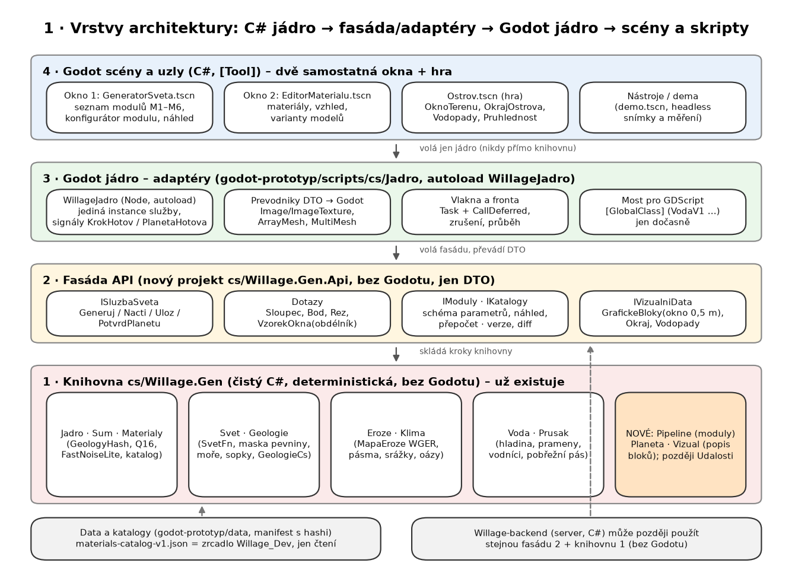
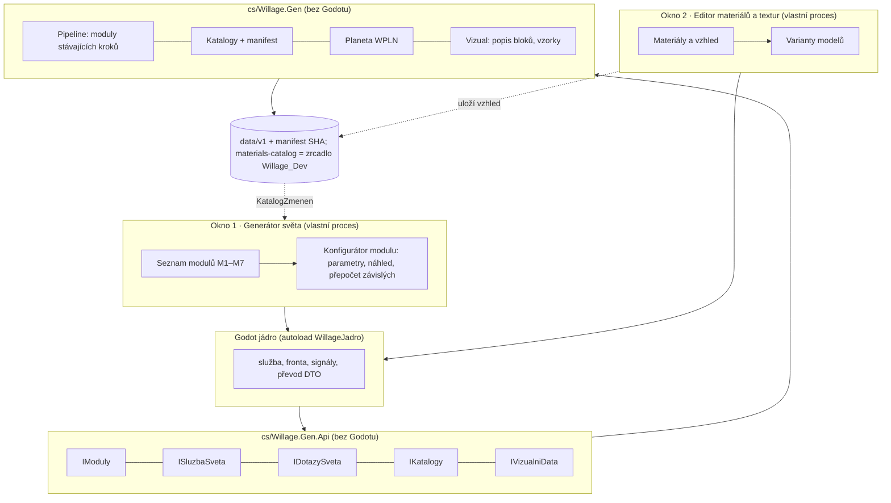
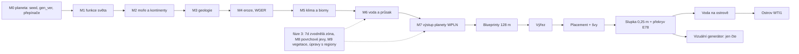
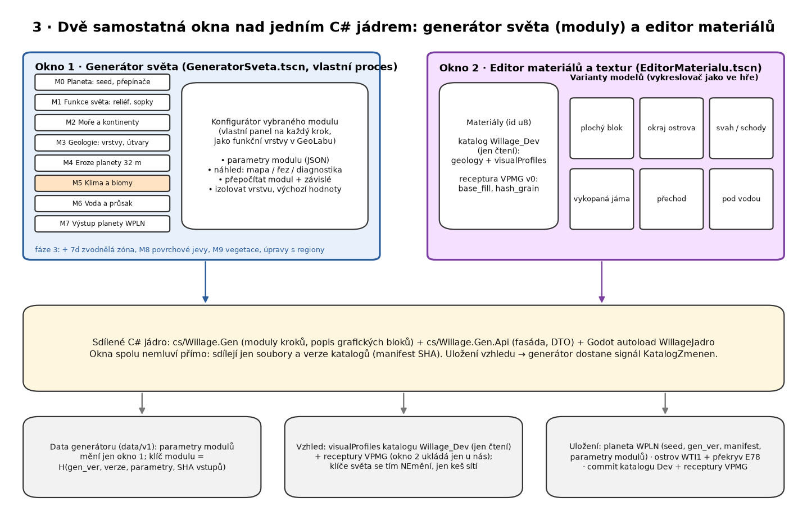
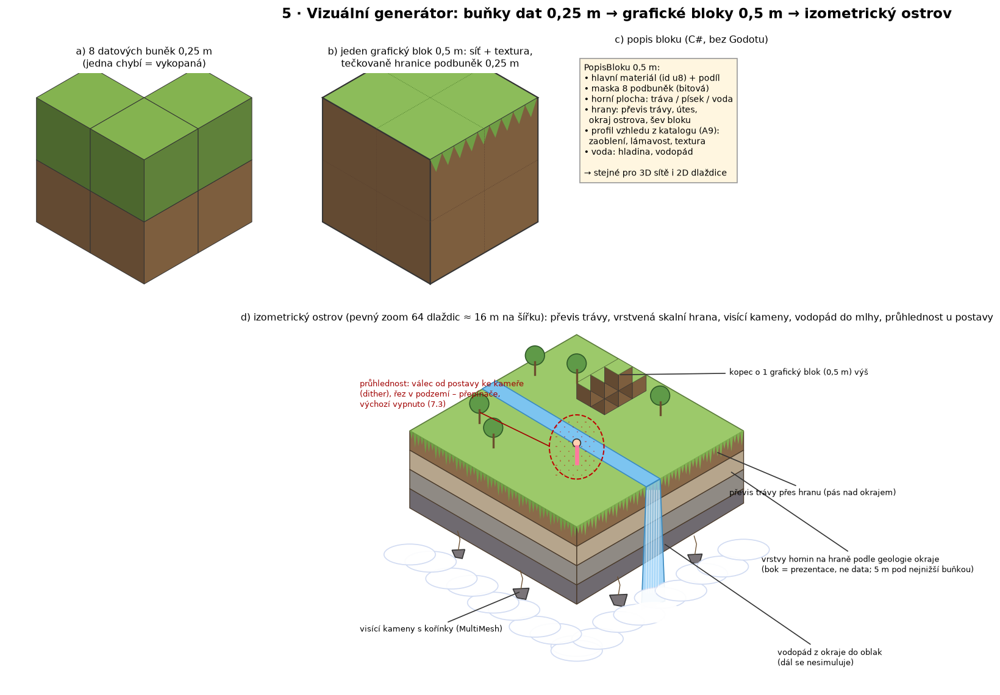
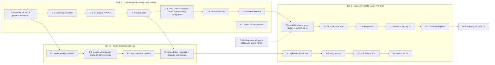

# 05 – Implementační plán: generátor světa po modulech, editor materiálů a vizuální generátor

Stav: **revize 2 po odpovědi Jana**, 2026-11-26 16:10 SEČ (revize 1 ze 14:30). Jde pořád jen o plán: nic se tu neimplementuje a nic dalšího se nerozhoduje. Zadání Jana z 13:47 („než se pustíš do implementace, chci vědět, jak to chceš postavit“), obrázky podle doplnění z 13:50, revize podle odpovědi z 15:58 ([pt981u]).

Navazuje na `04-implementace-generatoru.md` (kroky 1–14), kapitoly `01`–`03` a reporty v `reporty/`. Výchozí bod je `main` `e2d55d2` (tag `gen-v1-prusak`: klima 7 + 7b a průsak sloučené, testy 228/228). Krok 7c (hladina podle klimatu) běží na větvi `gen-v1-krok07c-hladina-klima` a tento plán do něj nezasahuje.

### Rozhodnutí Jana k revizi 1 (2026-11-26 15:58, [pt981u])
„Hele asi souhlasím, nejdřív bych ten generátor postavil na tom co máme a až pak přidával vylepšení. Generátor světa a generátor textur/editor materiálu chci odděleně, klidně jako samostatná okna. U grafického editoru bude několik variant modelu na kterých se to bude reprezentovat. Generátor světa bych asi postavil po modulech. To znamená tak jak máme teď rozvržené kroky tak bych pro ně vytvořil konfigurátory. Jako to dělalo Lovable tam byli ale zvlášť jednotlivé funkční vrstvy.“

- Doporučení 1–12 z revize 1: **obecně souhlas**.
- **(a) Nejdřív to, co máme.** Generátor se nejdřív postaví nad stávajícími kroky a teprve potom přijdou vylepšení. Pořadí kroků je proto přeházené: fáze 1 = obalení stávajících kroků bez nových funkcí (kapitola 8).
- **(b) Dvě samostatná okna.** Generátor světa a editor materiálů / generátor textur jsou oddělené, klidně jako samostatná okna (samostatné scény a procesy).
- **(c) Varianty modelů.** Editor materiálů ukazuje materiál na několika vzorových modelech: plochý blok, okraj ostrova, svah, vykopaná jáma a další.
- **(d) Moduly.** Generátor světa je postavený po modulech: každý stávající krok má vlastní konfigurátor (panel s parametry, náhledem a přepočtem závislých), podobně jako funkční vrstvy v Lovable GeoLabu.
- Dále: text plánu 04 o „maximálním světě 4096 m“ je upřesněný (planeta je torus 31 360 × 15 616 m, viz krok 1 v `04`). Oprava hladiny podzemní vody u pobřeží (u břehu jen strop na hladině moře 60 m) patří do kroku **7d**.

**Pravidla, kterými se plán řídí (Jan):** nový kód jen v C# (Godot .NET); generování a logika v C# knihovně bez Godotu, do Godotu přes fasádu a adaptéry; v Godotu jedno jádro, ze kterého berou scény a skripty; žádné monolity, skutečné uzly viditelné v editoru; malé kroky, každý na vlastní větvi, s PROP před experimentem, s reportem a Janovým schválením; laditelné parametry; determinismus; rozhodnutí až po Janově souhlasu.

Obrázky (zdroj `obrazky/plan05/kresli_plan05.py`, jen ilustrace):

| # | soubor | co ukazuje |
|---|---|---|
| 1 | [`obrazky/plan05/01-vrstvy-architektury.png`](obrazky/plan05/01-vrstvy-architektury.png) | vrstvy: knihovna C# → fasáda → Godot jádro → dvě okna a hra |
| 2 | [`obrazky/plan05/02-tok-dat-generatoru.png`](obrazky/plan05/02-tok-dat-generatoru.png) | tok dat modulů od parametrů planety po ostrov a vykreslení |
| 3 | [`obrazky/plan05/03-propojeni-abc.png`](obrazky/plan05/03-propojeni-abc.png) | dvě samostatná okna nad jedním jádrem, sdílená data a uložení (revize 2) |
| 4 | [`obrazky/plan05/04-dratovy-model-editoru.png`](obrazky/plan05/04-dratovy-model-editoru.png) | drátěné modely: generátor s konfigurátorem na každý modul, editor materiálů s variantami modelů (revize 2) |
| 5 | [`obrazky/plan05/05-vizualni-generator.png`](obrazky/plan05/05-vizualni-generator.png) | buňky 0,25 m → grafické bloky 0,5 m → izometrický ostrov |

---

## 1. Co už existuje (nebudu to navrhovat znovu)

| Oblast | Co je hotové | Kde | Pozn. |
|---|---|---|---|
| Knihovna C# bez Godotu | `cs/Willage.Gen`: `Jadro` (zrcadlo `GeologyGridConstants`, `GeologyHash` z Willage_Dev), `Sum` (FastNoiseLite 1.1.0, `GodotSum`, `StableHash`), `Materialy` (katalog, propustnost, koeficient průsaku 0–255), `Svet` (`SvetFn`, maska pevniny, moře, pánve, masiv, sopky, mapy biomů a hornin), `Geologie` (`GeologieCs : IGeologie`, útvary SDF, mince E82 spojitá, nitro sopky), `Eroze` (mapa planety 32 m, priority-flood, stream power, WGER, vodníci), `Klima` (pásma 7b, srážky se stínem, biomy, oázy, odtok), `Voda` (hladina, prameny, profil sloupce, průsak: dutina, pobřežní pás) | main `e2d55d2` | testy `cs/Willage.Gen.Testy`, nástroje `cs/Willage.Gen.Nastroje` |
| Skládání světa | `KonfiguraceSveta.Sestav` → `SvetKrok06` (geologie, mapa eroze, klima, vodníci, oázy) | `Eroze/KonfiguraceSveta.cs` | roste s každým krokem, hrozí monolit (riziko R1) |
| Keš a uložení | klíč keše mapy eroze (seed, parametry, data, svět), soubor WGER v2; klíč klimatu `MapaKlimatu.KlicKlimatu` | `Eroze/SouborMapy.cs`, `Klima/MapaKlimatu.cs` | `DataSveta.SouborySveta` nezahrnuje všechny datové soubory (riziko R2) |
| Laditelná data | `godot-prototyp/data/v1/*.json` (klima s pásmy, moře, eroze, voda, průsak, hostitelé), `sum_hornin_v1.csv`, `klima_presety.csv`, `teren/poradi_hornin.json`, `materialy_v1.csv`, `materials-catalog-v1.json` (zrcadlo Willage_Dev, jen čtení) | `godot-prototyp/data` | návrh jedné tabulky `docs/sjednoceni/materialy.csv` (78 id, 1.6) |
| Godot .NET | `WillagePrototyp.csproj` (net9.0, odkaz na `Willage.Gen`), fasáda `scripts/cs/most/VodaV1.cs` (`[GlobalClass]`), most `GeologieGd` jen jako reference | `godot-prototyp/scripts/cs/` | Godot 4.7.2 headless na boxu |
| Hra (GDScript, stará) | uzly `Main`, `World`, `Island` (@tool), `CameraRig`, `Placement`, `Digging`, `WaterFlow`, `UI`, `DevPanel`; mesher kostek, duální mřížka povrchu, tráva C, kawaii toon + obrysy, `tunable_params.gd` + `param_registry.gd` + ladicí okno | `godot-prototyp/` | jen vzor; nový kód se píše v C# |
| GeoLab (Lovable) | časová osa geologických událostí (sedimentace, vrásnění, zlom) s `id`, `seed`, `algorithmVersion`, `enabled`, `dependsOn`, rozsahem `Extent`, inverzní deformace, izolace události, řez, diagnostika, přenosné jádro bez UI | `External data/V1/src` | vzor pro model událostí editoru (ne kód) |
| Studie prezentace | E90 LOD (zrušeno 7.2), E91 průhlednost (válec + dither, řez; přepínače vyp, 7.3), E92 měřítko, E93 telefon (neměřeno na telefonu), E94 metry, E96 blok 128 m; skála (Surface Nets, hybrid D), tráva C, napojení (duální mřížka), 2D tileset, reference okraje | větve `e9x-*`, složky `skala-studie`, `trava-studie`, `napojeni-studie`, `tileset2d-studie`, `reference/` | nic z E89–E96 není v main |
| Kontrakty | návrh E88 (Source/Transform/Placement/Instance, WTI1), překryv E78, WVB1 | `navrhy/`, větve `e88-*`, `e78-*` | s Willage-backend neprojednáno |
| Role Willage-backend | merge do `main`, vlastník `Willage_Dev` (konstanty, hash, katalog materiálů); do Willage_Dev píše jen on | – | na VM chybí .NET, testy pouštíme my |

---
---

## 2. Jak rozumím zadání (po revizi 2)

- **A – generátor světa po modulech (okno 1).** Celý řetězec geologie → eroze → klima a biomy → voda → hotová planeta → blueprinty (bloky 128 m) → výřezy → ostrov. **Každý stávající krok je modul s vlastním konfigurátorem**: parametry, náhled, izolace vrstvy, přepočet sebe a závislých. Je to obdoba funkčních vrstev v GeoLabu, ale nad naší funkcí světa. Předherní úpravy s regiony (7b) a nové kroky přijdou až ve fázi 3.
- **B – editor materiálů a generátor textur (okno 2, samostatné).** Vzhled materiálu (A9: barva, textura, zaoblení, lámavost, vrstvení, převis) se ukazuje na **několika variantách modelů** (plochý blok, okraj ostrova, svah, vykopaná jáma, přechod, pod vodou). Fyzika materiálů je zrcadlo z Willage_Dev a jen se čte. Původní „konfigurátor katalogu terénu“ se tím rozdělil: generátorová data (pásma klimatu, pořadí hornin, šum hornin, moře, eroze, voda, průsak) edituje konfigurátor příslušného modulu v okně 1, vzhled edituje okno 2.
- **C – vizuální generátor.** Převod dat na obraz. Data 0,25 m, grafický blok 0,5 m, uvnitř je vidět 0,25 m (Jan 2026-11-22), pevný zoom 64 dlaždic, bez LOD (7.2), kawaii toon 3D s ručně malovanými texturami ve stylu Wakfu, převis trávy, vrstvená skalní hrana, visící kameny, vodopády do oblak, průhlednost a řez (7.3, výchozí vypnuto). Jeho jádro (popis grafických bloků a základní vykreslovač) vznikne jako první pro okno 2, protože varianty modelů vykresluje stejný kód jako hra.

---

## 3. Architektura (jak to chci postavit)



### 3.1 Vrstvy
1. **Knihovna `cs/Willage.Gen`** (existuje, čistý C#, bez Godotu, deterministická). Přibudou jen nové jmenné prostory, žádný přepis:
   - `Pipeline/` – **moduly** stávajících kroků (3.3) s klíčem keše a schématem parametrů.
   - `Katalogy/` – manifest datových souborů (SHA, schéma), validace, verze a diff.
   - `Planeta/` – stav planety, soubor WPLN, potvrzení.
   - `Vizual/` – popis grafických bloků 0,5 m a syntetické vzorky pro varianty modelů (7).
   - Až ve fázi 3: `Udalosti/` (úpravy s regiony), `Vyrez/` a `Bunky/` (kroky 8 a 9 plánu 04).
2. **Fasáda `cs/Willage.Gen.Api`** (nový projekt, bez Godotu, jen DTO):
   - `IModuly`: seznam modulů, schéma parametrů, stav (z keše / počítá se / čeká), `Prepocitej(modul, zavisle: true)`, `Izoluj(modul)`, náhledy (mapa vrstvy, řez, diagnostika).
   - `ISluzbaSveta`: `Generuj`, `Nacti/Uloz` (WPLN), `PotvrdPlanetu`.
   - `IDotazySveta`: `Sloupec`, `Bod`, `Rez`, `Mapa`, `VzorekOkna`.
   - `IKatalogy`: načtení, validace, návrh verze, diff, dotčené moduly.
   - `IVizualniData`: grafické bloky okna, varianty modelů, okraj, vodopády.
   Fasádu může později použít i server Willage-backendu.
3. **Godot jádro** (`godot-prototyp/scripts/cs/Jadro/`): autoload `WillageJadro` (Node). Drží službu, počítá na pozadí (`Task` + `CallDeferred`, zrušení, průběh), posílá signály `ModulHotov`, `PlanetaHotova`, `KatalogZmenen` a převádí DTO na `Image`/`ImageTexture`, `ArrayMesh`, `MultiMesh`. Stávající `VodaV1` zůstane jako dočasný most pro GDScript.
4. **Dvě samostatná okna a hra** (C#, skutečné uzly, `[Tool]` kde dává smysl náhled v editoru):
   - **Okno 1** `nastroje/GeneratorSveta.tscn`: seznam modulů, konfigurátor vybraného modulu, náhled a řetěz přepočtu.
   - **Okno 2** `nastroje/EditorMaterialu.tscn`: materiály, vzhled, mřížka variant modelů.
   - **Hra** `Ostrov.tscn` (fáze 3).
   Každé okno je samostatná hlavní scéna spouštěná jako vlastní proces (`godot --path godot-prototyp res://nastroje/GeneratorSveta.tscn`). Okna spolu nemluví přímo, sdílejí jen jádro a soubory (verze katalogů s SHA). Když okno 2 uloží vzhled, okno 1 pozná změnu souboru a dostane `KatalogZmenen`.



### 3.2 Pravidla stavby
- Žádná logika v uzlech Godotu; uzel jen zobrazuje a posílá příkazy jádru.
- Skládání světa převezme `Pipeline` z malých modulů. Dnešní `KonfiguraceSveta.Sestav` zůstane jen jako tenký obal pro staré testy.
- Každý modul má vlastní parametry (record z JSON, laditelný), vlastní `VerzeAlgoritmu`, vlastní testy a dnešní přepínač (`VseKrok06`, `KlimaKrok07`, `SopkaNepropustna`, …) se schématem vypnuto = svět beze změny.
- Determinismus: integer hashe se solí podle účelu (A5), řazené klíče, výsledek nezávislý na počtu vláken (testy 1 a 8 vláken jako dnes).

### 3.3 Moduly okna 1 = stávající kroky (fáze 1, bez nových funkcí)


| Modul | Krok plánu 04 | Stávající kód | Data (soubory manifestu) | Náhledy v konfigurátoru | Izolace (jako GeoLab) |
|---|---|---|---|---|---|
| **M0 Planeta** | 1 | `ParametrySveta` (seed, `gen_ver`, klima planety, start, přepínače) | – | souhrn, otisk | – |
| **M1 Funkce světa** | 2 | `SvetFn`: mapa biomů, reliéf, masiv, sopky, mapa hornin | `klima_presety.csv`, `teren/poradi_hornin.json` | výška, biomy, horniny, sopky; řez povrchu | jen reliéf bez moře |
| **M2 Moře a kontinenty** | 6b–6d | `MaskaPevniny`, `MoreSklon`, `Panve`, ostrovy v průlivech | `more_v1.json` | maska pevniny, podíl moře, pánve, šev torusu | rozdíl výšky proti M1 |
| **M3 Geologie** | 3, 5 | `GeologieCs`, útvary, mince E82, nitro sopky | `poradi_hornin.json`, `sum_hornin_v1.csv`, `utvary_hostitele.json`, `mineraly_hostitele.json`, `materialy_v1.csv` | svislý řez vrstev, materiál pod kurzorem, útvary | jen vrstvy / jen útvary |
| **M4 Eroze** | 6 | `ErozePlanety`, `MapaEroze` (WGER), jezera, vodníci | `eroze_v1.json` | mapa eroze, toky, jezera, vodníci | mapa posunu eroze |
| **M5 Klima a biomy** | 7, 7b | `MapaKlimatu`, pásma, srážky, `Oazy`, `HydrologieKlimatu` | `klima_v1.json` | teplota, srážky, biomy, aktivní a suchá koryta, oázy; tabulka pásem | jen klima (bez vlivu na vodu) |
| **M6 Voda a průsak** | 4, 6e–6g, průsak | `PodzemniVodaFn`, `Prameny`, `RegionalniHladina`, `PobrezniPas`, `PrusakDutina` | `voda_v1.json`, `prusak_v1.json`, `materials-catalog-v1.json` | hladina, prameny, vodníci, řez s hladinou, pobřežní pás | jen prameny / jen hladina |
| **M7 Výstup planety** | 7b (část) | nový obal: otisky, potvrzení, WPLN | manifest | diagnostika, otisk, velikost | – |

- **Konfigurátor modulu** se staví **generovaně ze schématu parametrů**: atributy rozsah, jednotka, popis a skupina na stávajících recordech parametrů. Vlastní prvek dostane jen to, co se do formuláře nevejde (tabulka pásem klimatu, pořadí hornin). Nebude se ručně psát sedm různých panelů.
- **Nápovědy k parametrům** (Jan 16:50, [pt982u]): co daná veličina dělá a k čemu slouží, jako vyskakovací okno nebo jednotný návod. V první verzi se nedělají, ale schéma parametrů (G-2) má od začátku pole `napoveda` (krátký popis + volitelný odkaz do návodu), aby se nápovědy daly doplnit bez změny formátu.
- **Klíč modulu** = H(`gen_ver`, verze algoritmu, kanonické parametry modulu, SHA jeho souborů z manifestu, klíče vstupních modulů). Změna v M5 tedy přepočítá M5–M7, ale ne M1–M4 (eroze zůstává pozůstatkem minulosti, Jan 12:26). Dnešní klíče (`SouborMapy.KlicKese`, `MapaKlimatu.KlicKlimatu`) se zapojí beze změny hodnot, aby staré soubory WGER zůstaly platné.
- Eroze je globální (priority-flood na torusu, mapa 32 m: 5,1 s na 8 vláknech, krok 6). Přepočet je proto zatím po modulech pro celou planetu. Částečný přepočet podle regionu je až ve fázi 3.



---

## 4. Jak se části propojí



- **Společný datový model:** jedno `MaterialId` (u8) všude (1.6). Fyzika (K, pórovitost) je zrcadlo z Willage_Dev a jen se čte. Generátorová data jsou dnešní JSON a CSV v `data/v1` a mění je **jen konfigurátory modulů v okně 1**. Vzhled má vlastní tabulku `vzhled_materialu_v1.json` se stejným id (A9) a mění ji **jen okno 2**.
- **Manifest katalogů** `manifest_katalogu_v1.json`: všechny soubory, které generátor čte (dnes 13), jejich SHA-256, verze schématu a role (fyzika / generátor / vzhled). Z manifestu se skládají klíče modulů a ověřuje se, že potvrzená planeta má stejná data. Opraví to dnešní neúplný klíč (`DataSveta.SouborySveta` zahrnuje jen 3 soubory).
- **Klíče keše:** svět podle 3.3. Vizuální keš (sítě segmentu 8 m, náhledy variant) má klíč H(obsah vzorku, verze vzhledu, verze vykreslovače) a do světa nepatří, takže změna vzhledu nikdy nepřepočítá svět.
- **Uložení:**
  - *planeta* `WPLN` v1 (Deflate jako WGER): magie, verze, `gen_ver`, seed, SHA manifestu (volitelně přibalené kopie generátorových souborů), kanonické parametry všech modulů, klíče modulů, příznak potvrzení. Ve fázi 3 přibude seznam úprav s regiony. Odvozené mapy (WGER, klima) se ukládají vedle jako keš.
  - *ostrov*: WTI1 (E88) s vloženími a překryvem E78, s odkazem na klíč M7 planety.
  - *katalog vzhledu*: verze `vN` + diff. Potvrzená planeta si drží svou verzi manifestu (O4).

---

## 5. Okno 1 – generátor světa po modulech


```
GeneratorSveta (Control, jen propojuje)
├─ HorniLista            planeta (seed), gen_ver, Přepočítat vše, Potvrdit planetu, Uložit WPLN
├─ SeznamModulu          M0–M7 se stavem (z keše / upraveno / čeká), výběr modulu
├─ KonfiguratorModulu    generovaný ze schématu parametrů vybraného modulu
│  ├─ Parametry          pole, posuvníky, přepínače; vlastní prvky jen pro tabulky (pásma, pořadí hornin)
│  └─ Akce               Přepočítat modul + závislé, Izolovat vrstvu, Výchozí hodnoty, Uložit sadu
├─ NahledModulu          SubViewport: mapa vrstvy modulu (TextureRect) nebo 3D výřez
├─ PohledRezu            řez úsečkou: vrstvy, hladina (zvodnělá zóna šrafou od 7c/7d)
├─ Diagnostika           čísla modulu (podíl moře, řeky, vodníci, pásma, čas, otisk)
└─ RetezPrepoctu         M0 → … → M7 se stavem a časy
```

Postup: vybrat modul → upravit parametry → klíče ukážou, které moduly jsou neplatné → přepočet na pozadí po modulech (náhled se obnovuje průběžně) → kontrola diagnostiky a řezů → **Potvrdit planetu** (zamkne parametry, uloží WPLN) → dál už jen herní změny (kroky 9–11 plánu 04).

Ve fázi 3 přibudou nové moduly (M8 povrchové jevy, M9 vegetace), každý s vlastním konfigurátorem, a **úpravy s regiony** (editor 7b: výběr více bloků 128 m s měkkým okrajem, pořadí, seed, zapnuto, podle modelu událostí GeoLabu). Regionální úprava pak vstupuje do klíče modulů, které mění.

---

## 6. Okno 2 – editor materiálů a textur

```
EditorMaterialu (Control, jen propojuje)
├─ HorniLista            verze katalogu vzhledu, Validovat, Diff, Uložit
├─ SeznamMaterialu       78 id, barva, filtr podle skupiny (soil / rock / ore / …)
├─ ParametryVzhledu      barva, textura, zaoblení, lámavost, vrstvení na boku, převis trávy, styl přechodu
├─ FyzikaJenCteni        K, pórovitost, skupina (zrcadlo Willage_Dev)
└─ MrizkaVariant         VariantaModelu × N (SubViewport + ortografická izometrická kamera)
```

- **Varianty modelů** jsou malé **syntetické deterministické vzorky buněk 0,25 m** v knihovně (`Vizual/VzorkyVariant`). Vykreslí je **stejný vizuální generátor jako hru** (popis grafických bloků → síť), takže editor je zároveň zkušebna vykreslovače. Výchozí sada (O-N4):
  1. plochý blok,
  2. okraj ostrova (vrstvy na boku, převis trávy, visící kameny, oblaka),
  3. svah a schody (po 0,25 / 0,5 m),
  4. vykopaná jáma (chybějící podbuňky 0,25 m uvnitř grafického bloku),
  5. přechod s jiným materiálem (např. písek, duální mřížka povrchu),
  6. pod vodou / mokrý (dno průhledné vody).
  Později přibude osamocený kámen a shluk 2–6 buněk (skála, studie D). Nová varianta = nový vzorek, editor se nemění.
- **Validace:** všech 78 id má profil, platné odkazy na textury, rozsahy parametrů. Diff ukáže změněné materiály. Klíče světa se tím nemění, zneplatní se jen vizuální keš.
- Výchozí hodnoty vzhledu se převezmou z toho, co už máme (barvy `materialy.csv`, `mat.gd`, `poradi_hornin.json`, textury Gemini a toon shader prototypu). Nic se nevymýšlí znovu.

---

## 7. C – vizuální generátor



1. `VzorekOkna`: obdélník zorného pole (pevný zoom 64 dlaždic ≈ 16 m) + okraj, slupka 2–3 buněk 0,25 m (2.3). Pro varianty modelů místo něj nastoupí syntetický vzorek. Do kroku 9 plánu 04 se vzorkuje přímo z funkce, potom ze slupky s překryvem.
2. **Popis grafických bloků** (C#, `Willage.Gen.Vizual`, bez Godotu): blok 0,5 m = 2 × 2 × 2 buňky. Nese hlavní materiál a podíl, bitovou masku 8 podbuněk, typ horní plochy, hrany (převis trávy, útes, okraj ostrova, šev bloku), odkaz na profil vzhledu a vodu (hladina, vodopád). Je to jediný most mezi daty a obrazem, takže 2D dlaždice zůstávají možné.
3. **Godot vykreslovač** (C#): síť po segmentech 8 m z popisu bloků (zkosení a podbuňky podle profilu), toon shader s triplanární ručně malovanou texturou a obrysy (navazuje na `terrain_toon.gdshader`, skálu D a duální mřížku povrchu), tráva C jako MultiMesh.
4. **Okraj ostrova jako samostatný uzel** (A15): pásy hornin do 5 m pod nejnižší okrajovou buňkou (1.13.1, bok je jen prezentace), převis trávy, visící kameny s kořínky, oblaka, vodopády z výtoků na okraji.
5. **Průhlednost a řez:** port E91 do C# beze změny chování, dva přepínače, výchozí vypnuto (7.3).

Uzly hry (`Ostrov.tscn`, fáze 3): `CameraRig` (ortografická izometrie, zoom 64) · `OknoTerenu` → `SegmentTerenu` × N · `PovrchVody` · `OkrajOstrova` · `Vodopady` · `Vegetace` · `Pruhlednost`.

---

## 8. Plán kroků (revize 2: nejdřív to, co máme)

Každý krok: vlastní větev z předchozího schváleného kroku, PROP do `reporty/` před experimentem, malé commity, report s čísly a obrázky, čekání na Janovo ano. Merge do `main` dělá Willage-backend po Janově ano; testy na main pouštím já (na VM chybí .NET). Odhad je v hodinách práce agenta.

**Fáze 1 – generátor světa nad stávajícími kroky, bez nových funkcí.** Kritérium celé fáze: **všechny dnešní otisky a testy beze změny** (228/228 na main).
**Fáze 2 – editor materiálů (samostatné okno) a jádro vizuálního generátoru.** Může běžet souběžně s G-5 až G-7.
**Fáze 3 – vylepšení**, až po fázi 1, každé zvlášť s Janovým ano.



| Krok | Cíl | Vstupy → výstupy | Testy a měření | Odhad |
|---|---|---|---|---|
| **7c** *(běží)* | hladina podle klimatu a šrafa zvodnělé zóny podle svého PROP | PROP `krok07c-prop.md` | dle PROP | – |
| **G-1** | moduly M0–M7 jako obal stávajících tříd, pipeline, `manifest_katalogu_v1.json`; `KonfiguraceSveta.Sestav` zůstane tenkým obalem | dnešní třídy → `Pipeline/`, `Katalogy/` | **otisky beze změny**, 228/228; klíč modulu se mění jen při změně jeho vstupu (test na každý soubor manifestu); 1 a 8 vláken shodně | 4–6 h |
| **G-2** | schéma parametrů: atributy rozsah, jednotka, popis, skupina a prázdné pole `napoveda` (nápovědy až později, Jan 16:50) na stávajících recordech; JSON tam a zpět | `ParametrySveta`, `ParametryMore`, `ParametryEroze`, `ParametryKlimatu`, `ParametryVody`, průsak → schéma | načtení → uložení dá bajtově stejná data (nebo kanonicky shodná); každý parametr má rozsah a jednotku | 2–3 h |
| **G-3** | fasáda `Willage.Gen.Api` (`IModuly`, `ISluzbaSveta`, `IDotazySveta`, `IKatalogy`) + soubor planety WPLN | moduly → DTO, soubor | CLI přes fasádu dá stejné otisky; uložit → načíst = bitově stejné; změněný manifest se pozná | 3–4 h |
| **G-4** | Godot jádro `WillageJadro`: fronta na pozadí, signály, převod map na textury | fasáda → autoload | headless: generace bez blokování hlavního vlákna (< 1 ms), zrušení, otisk shodný s CLI | 3–4 h |
| **G-5** | okno 1: kostra (`SeznamModulu`, `KonfiguratorModulu` generovaný ze schématu, `RetezPrepoctu`, potvrzení, uložení) | G-2, G-4 → `nastroje/GeneratorSveta.tscn` | snímky; změna parametru → přepočet jen dotčených modulů; čas celé planety (~5–6 s) | 4–6 h |
| **G-6** | náhledy a izolace M1 funkce světa, M2 moře, M3 geologie (řez) | G-5 | snímky náhledů, shoda náhledu s nástroji `Willage.Gen.Nastroje` | 4–5 h |
| **G-7** | náhledy M4 eroze, M5 klima (tabulka pásem), M6 voda a průsak (řez s hladinou) | G-6 + nástroj řezu (z 7c) | snímky, shoda s reporty kroků 6–7 | 4–5 h |
| **S-0** | spike: běží Godot .NET s `Willage.Gen` na Androidu (APK z E93) | – | sestavení, spuštění, čas vzorku segmentu na telefonu (Jan spustí) | 2–3 h |
| **E-1** | popis grafických bloků 0,5 m z buněk 0,25 m | `VzorekOkna` → popisy | jednotkové testy masek, hran, převisu a okraje; determinismus; čas na okno 16 m | 3–4 h |
| **E-2** | `vzhled_materialu_v1.json` (A9) předvyplněný z dnešních barev a textur, validace | 78 id → profil | všechna id mají profil; změna vzhledu nemění žádný klíč světa (test) | 2–3 h |
| **E-3** | syntetické vzorky šesti variant modelů | – → `Vizual/VzorkyVariant` | deterministické, popis bloků každé varianty má očekávané hrany (okraj, převis, jáma) | 2–3 h |
| **E-4** | okno 2 + základní vykreslovač (toon, triplanární textura, obrysy) | E-1 až E-3, G-4 → `nastroje/EditorMaterialu.tscn` | snímky všech variant pro 5 materiálů; trojúhelníky a čas sítě; uložení vzhledu → signál v okně 1 | 6–8 h |
| **7d** | zvodnělá zóna šířením průsaku od zdrojů (moře, řeky, prameny, oázy, vodníci); **oprava hladiny u pobřeží: u břehu jen strop na hladině moře 60 m** (Jan [pt981u]); hladina ze spádu jen pro umístění pramenů (t977u) | `PrusakDosah`, `PobrezniPas`, 7c → výstup M6 | řezy poušť a mírné pobřeží; „díra se zaplní jen v zóně“; pevninská hladina u břehu nikde pod 60 m kvůli mořskému dnu; vypnuto = beze změny | 3–5 h |
| **7e** | M8 povrchové jevy jako funkce (písek, duny, sníh, led, zamrzání; jen světová část) s vlastním konfigurátorem | M5, M6 | nezávislost reliéfu, determinismus | 4–6 h |
| **7f** | M9 vegetace jako funkce s vlastním konfigurátorem | M1–M8 | hustota na m², žádný holý biom, nic v tůních | 3–5 h |
| **U-1** | úpravy s regiony (editor 7b): výběr více bloků s útlumem, první sada typů (O6), pořadí, izolace | okno 1 | determinismus, vypnutá úprava = beze změny, šev torusu bez skoku | 6–8 h |
| **U-2** | částečný přepočet podle regionu (klima, voda, vegetace; eroze celá) | U-1 | bitově shodné s plným přepočtem, čas | 4–6 h |
| **V-1…V-4** | vykreslovač ostrova (okno 64), okraj ostrova, průhlednost E91 v C#, bench na telefonu | E-4 | snímky proti referenci okraje, vypnuté přepínače = stejný snímek, fps a paměť (Jan na telefonu) | 2–8 h každý |

Po U-2 pokračuje plán 04 krokem 8 (výřezy) a dál; krok 14 (prezentace) se rozpadá na E-1, E-4 a V-1 až V-4. Volitelně ve fázi 3: náplavy, delty a mořské usazeniny (TODO z kroku 6).

---

## 9. Rizika

| # | Riziko | Dopad | Co s tím |
|---|---|---|---|
| R1 | `KonfiguraceSveta.Sestav` a `SvetKrok06` rostou s každým krokem (monolit) | těžké úpravy, okno neví, co přepočítat | G-1 je nahradí moduly, obal bez změny otisků |
| R2 | klíč keše nezahrnuje všechny soubory | stará mapa eroze po změně katalogu | manifest se SHA (G-1) |
| R3 | C# na Androidu v Godotu 4.x je méně vyzrálý než desktop; Jan chce telefon i jen C# | celý směr | spike S-0 souběžně s fází 1 |
| R4 | eroze je globální (5 s na planetu) | pomalá odezva konfigurátoru M1–M4 | přepočet na pozadí s průběžným náhledem; změny M5–M6 erozi nepřepočítají |
| R5 | determinismus napříč vlákny a platformami | rozdílné planety na telefonu a serveru | testy 1 / 8 vláken, golden vectors |
| R6 | 2D / 3D (7.1) | přepracování vykreslovače | popis bloků nezávislý na rendereru |
| R7 | trojúhelníky při 0,25 m na telefonu (E93: 269 tis. ještě s 0,5 m) | fps | síť po grafických blocích 0,5 m, slučování ploch, V-4 |
| R8 | rozjetí katalogu s Willage_Dev | jiná fyzika na serveru | fyziku jen číst, změny jako návrh backendu |
| R9 | souběžné větve konfliktují v `DENIK.md`, `TODO.md` a seznamu testů | zdržení merge | zápis do vlastních oddílů, seznam testů po souborech |
| R10 | generovaný konfigurátor je pro složité parametry nepohodlný | UX | vlastní prvky jen pro tabulky (pásma, pořadí hornin) |
| R11 | dvě okna nad stejnými soubory (souběžný zápis) | rozbitý katalog | každé okno píše jen své soubory; zápis atomicky (dočasný soubor + přejmenování), SHA v manifestu |

---

## 10. Otevřené body a co musí být rozhodnuto před kterým krokem

| Bod | Odkud | Před krokem | Doporučení |
|---|---|---|---|
| 7c hladina podle klimatu | běží | 7d | dokončit podle PROP. Oprava hladiny u pobřeží patří podle Jana do 7d; co z ní 7c už obsahuje, se v 7d převezme a doplní o strop 60 m |
| 7d zvodnělá zóna + strop u pobřeží | t977u, [pt981u] | fáze 3 (první krok) | hned po fázi 1 |
| Povrchové jevy (písek, duny, sníh, led, zamrzání) | TODO, plán 04 krok 7 | krok 8 | 7e jako modul M8; tání a zamrzání během hry až v kroku 11 |
| Vegetace jako funkce | plán 04 krok 7 | krok 8 | 7f jako modul M9 |
| Náplavy, delty, mořské usazeniny | TODO (krok 6) | krok 8 (nepovinné) | volitelně ve fázi 3 |
| Četnost artéské vody | odloženo | krok 10 | nechat odložené |
| 6.1 zápis Platí, 6.3 backend, 1.5 přepočet při nové verzi, 1.11 rozpočet | A.3 v `04` | krok 13 / V-4 | beze změny; WPLN nese `gen_ver` a manifest |
| 7.1 2D, nebo 3D | odloženo | E-4 | O2 (souhlas: 3D, 2D zůstává možné) |
| E83, E86, E87, E91, E92/E94/E96, E93 | TODO | krok 13 / krok 8 / U-1 / V-3 / E-4 / S-0 | jako v revizi 1: E86 řeší režimy švu 5.2; E87 jako parametry úprav s regiony; E91 už rozhodnuto 7.3; E93 Jan spustí APK |
| ~~Rozpor „maximální svět 4096 m“ × planeta torus~~ | `04` krok 1–2 | – | **opraveno v revizi 2:** 4096 m je výchozí `SvetMaxM` pro mapy a výřezy kolem startu, planeta od kroku 6 je torus 31 360 × 15 616 m (`SvetMaxM` se zvětší na 31 360 + 512 m) |

---

## 11. Otázky pro Jana

### 11.1 Revize 1 – odpovědi (15:58, [pt981u])
| # | otázka | výsledek |
|---|---|---|
| O1 | co je „konfigurátor katalogu terénu“ | **změněno:** generátorová data edituje konfigurátor modulu v okně 1, vzhled samostatné okno 2 (editor materiálů a textur); katalog bloků později |
| O2 | 2D / 3D | souhlas: 3D v ortografické izometrii, popis bloků nechává 2D otevřené |
| O3 | grafický blok 0,5 m se zářezem 0,25 m | souhlas (ukáže to varianta „vykopaná jáma“) |
| O4 | potvrzená planeta drží svou verzi katalogu | souhlas |
| O5 | region = výběr bloků s útlumem | souhlas, fáze 3 |
| O6 | první typy úprav (zvednutí/snížení, pohoří, pánev, pevnina/moře, pásmo klimatu, příp. řeka) | souhlas, fáze 3 |
| O7 | geologické události GeoLabu až po kroku 8 | souhlas |
| O8 | okno nejdřív jako vývojový nástroj | souhlas |
| O9 | přepočet po modulech pro celou planetu, částečný až U-2 | souhlas |
| O10 | data zůstanou v `godot-prototyp/data` + manifest | souhlas |
| O11 | návrh fasády poslat Willage-backendu jen k připomínkám | souhlas |
| O12 | pořadí | **změněno:** nejdřív fáze 1 (obal stávajícího), pak fáze 2, vylepšení až ve fázi 3 |

### 11.2 Nové otázky (revize 2), u každé moje doporučení
1. **N1 – Jeden Godot projekt, nebo samostatné projekty?** *Doporučení:* jeden projekt `godot-prototyp` se dvěma samostatnými hlavními scénami v `nastroje/` (vlastní procesy a okna) a hrou jako třetí scénou. Sdílí C# jádro a data a nic se neduplikuje.
2. **N2 – Rozdělení modulů M0–M7** podle tabulky 3.3 (funkce světa, moře a kontinenty, geologie, eroze, klima, voda a průsak, výstup)? *Doporučení:* ano. Pořadí odpovídá výpočtu v kódu (moře je součást povrchu před geologií).
3. **N3 – Konfigurátor generovaný ze schématu parametrů** a vlastní prvky jen pro tabulky? *Doporučení:* ano. Nový parametr se pak v panelu objeví sám.
4. **N4 – Sada variant modelů** (plochý blok, okraj ostrova, svah a schody, vykopaná jáma, přechod materiálů, pod vodou; později kámen a shluk)? *Doporučení:* ano, šest variant pro začátek.
5. **N5 – Edituje okno 2 jen vzhled, nebo i herní sloupce tabulky materiálů** (název, rarita, nástroj)? *Doporučení:* zatím jen vzhled a ostatní jen ukazovat. Herní sloupce až s jednou tabulkou materiálů (1.6).
6. **N6 – Pořadí ve fázi 3:** 7d → 7e → 7f → úpravy s regiony → částečný přepočet, a souběžně vykreslovač ostrova V-1 až V-4? *Doporučení:* ano.

---

## Zdroje
- `docs/sjednoceni/04-implementace-generatoru.md` (kroky 1–14, 7b, příloha A), `01-principy-a-vstupy.md` (1.6, 1.13.1), `02-model-sveta-a-generovani.md` (2.1, 2.3), `03-otevrene-body.md` (7.1–7.3), `kontext/vykreslovani.md`, `kontext/namety-gpt-2026-11-23.md` (A9, A13, A15).
- Reporty `reporty/krok04.md`, `krok05-prop.md`, `krok06-prop.md` (čas eroze 5,1 s), `krok07b-prop.md`, `prusak-*-prop.md`; PROP 7c na větvi `gen-v1-krok07c-hladina-klima`.
- `TODO.md` (otázky E83–E96, povrchové jevy), `DENIK.md`.
- Kód `cs/Willage.Gen` (`Eroze/KonfiguraceSveta.cs`, `Eroze/SouborMapy.cs`, `Data/DataSveta.cs`, `Svet/SvetFn.cs`), `godot-prototyp/scripts/cs/most/VodaV1.cs`, `godot-prototyp/README.md` (uzly scény).
- Odpověď Jana k revizi 1 (2026-11-26 15:58, [pt981u]).
- GeoLab `External data/V1` (`AGENTS.md`, `src/geology/events/types.ts`, `timeline.ts`).
- Studie `skala-studie`, `trava-studie`, `napojeni-studie`, `tileset2d-studie`, `reference/okraj-ostrova-2026-11-22.jpg`.
