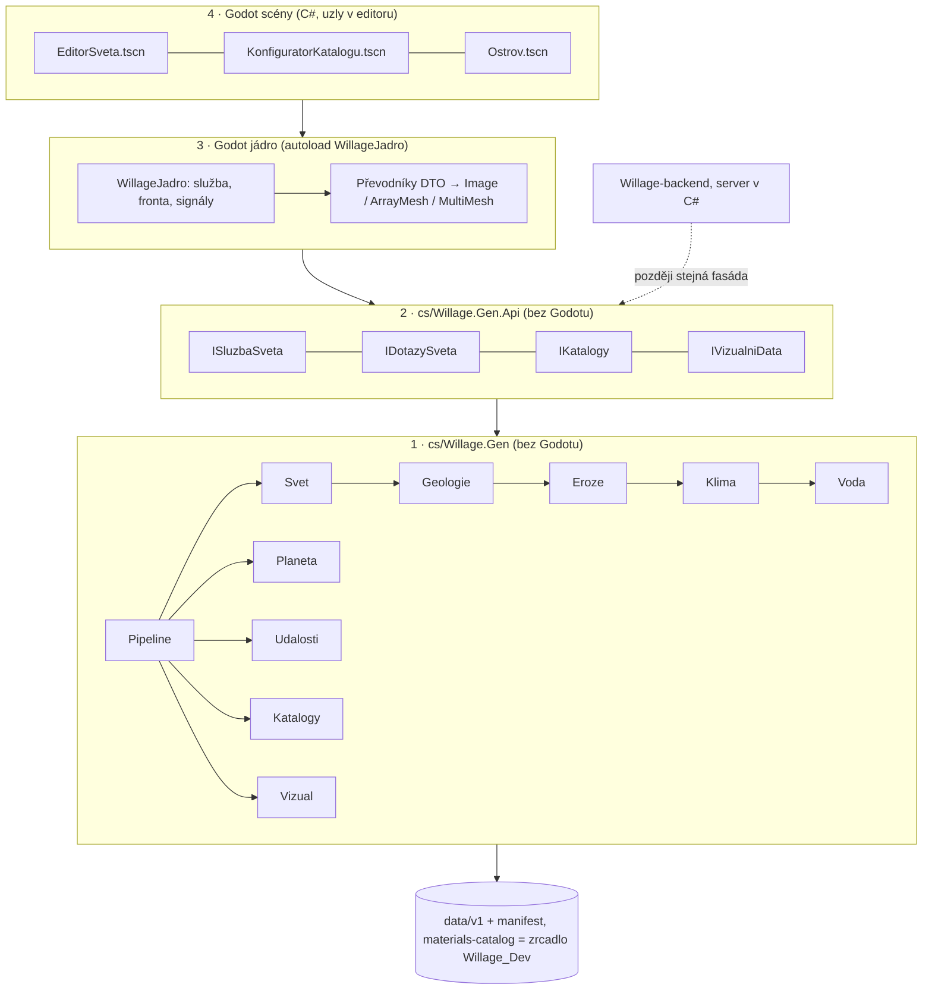
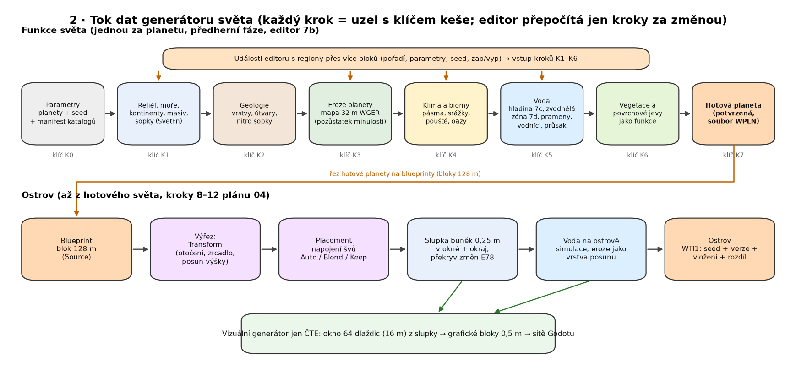
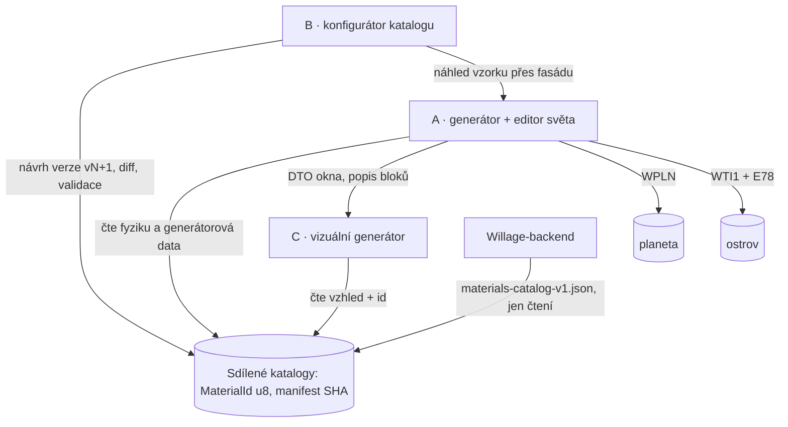
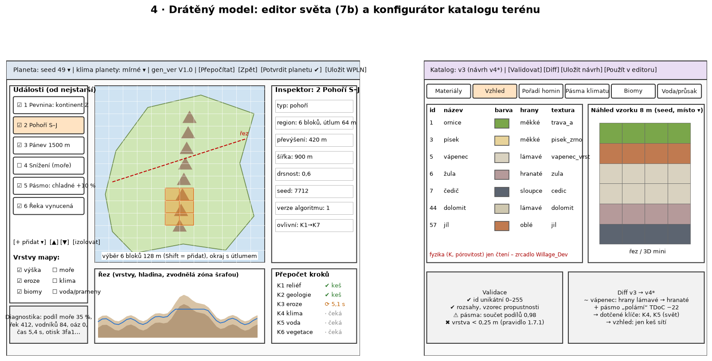
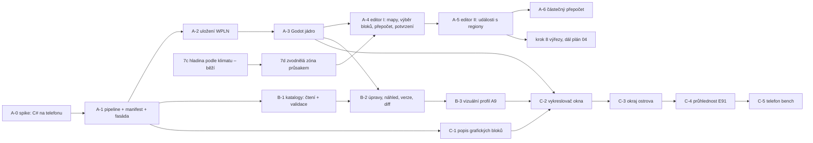

# 05 – Implementační plán: generátor světa, editor světa, konfigurátor katalogu terénu a vizuální generátor

Stav: **návrh k ladění s Janem**, 2026-11-26 14:30 SEČ. Jde jen o plán, nic se tu neimplementuje a nic se nerozhoduje. Na zadání Jana z 13:47 („připrav implementační plán, než začneš implementovat, chci vědět, jak to chceš postavit“) a doplnění z 13:50 (ilustrační obrázky).

Navazuje na `04-implementace-generatoru.md` (kroky 1–14), kapitoly `01`–`03` a reporty v `reporty/`. Výchozí bod je `main` `e2d55d2` (tag `gen-v1-prusak`: klima 7 + 7b a průsak sloučené, testy 228/228). Krok 7c (hladina podle klimatu) teď běží na větvi `gen-v1-krok07c-hladina-klima` a tento plán do něj nezasahuje.

**Pravidla, kterými se plán řídí (Jan):** nový kód jen v C# (Godot .NET); generování a logika v C# knihovně bez Godotu, do Godotu přes fasádu a adaptéry; v Godotu jedno jádro, ze kterého berou scény a skripty; žádné monolity, skutečné uzly viditelné v editoru; malé kroky, každý na vlastní větvi, s PROP před experimentem, s reportem a Janovým schválením; laditelné parametry; determinismus; rozhodnutí až po Janově souhlasu.

Obrázky (zdroj `obrazky/plan05/kresli_plan05.py`, jen ilustrace):

| # | soubor | co ukazuje |
|---|---|---|
| 1 | [`obrazky/plan05/01-vrstvy-architektury.png`](obrazky/plan05/01-vrstvy-architektury.png) | vrstvy: knihovna C# → fasáda → Godot jádro → scény |
| 2 | [`obrazky/plan05/02-tok-dat-generatoru.png`](obrazky/plan05/02-tok-dat-generatoru.png) | tok dat od parametrů planety po ostrov a vykreslení |
| 3 | [`obrazky/plan05/03-propojeni-abc.png`](obrazky/plan05/03-propojeni-abc.png) | propojení A / B / C přes katalogy, klíče keše a uložení |
| 4 | [`obrazky/plan05/04-dratovy-model-editoru.png`](obrazky/plan05/04-dratovy-model-editoru.png) | drátěný model editoru světa a konfigurátoru katalogu |
| 5 | [`obrazky/plan05/05-vizualni-generator.png`](obrazky/plan05/05-vizualni-generator.png) | buňky 0,25 m → grafické bloky 0,5 m → izometrický ostrov |

---

## 1. Co už existuje (nebudu to navrhovat znovu)

| Oblast | Co je hotové | Kde | Pozn. |
|---|---|---|---|
| Knihovna C# bez Godotu | `cs/Willage.Gen`: `Jadro` (zrcadlo `GeologyGridConstants`, `GeologyHash` z Willage_Dev), `Sum` (FastNoiseLite 1.1.0, `GodotSum`, `StableHash`), `Materialy` (katalog, propustnost, koeficient průsaku 0–255), `Svet` (`SvetFn`, maska pevniny, moře, pánve, masiv, sopky, mapy biomů a hornin), `Geologie` (`GeologieCs : IGeologie`, útvary SDF, mince E82 spojitá, nitro sopky), `Eroze` (mapa planety 32 m, priority-flood, stream power, WGER, vodníci), `Klima` (pásma 7b, srážky se stínem, biomy, oázy, odtok), `Voda` (hladina, prameny, profil sloupce, průsak: dutina, pobřežní pás) | main `e2d55d2` | testy `cs/Willage.Gen.Testy`, nástroje `cs/Willage.Gen.Nastroje` |
| Skládání světa | `KonfiguraceSveta.Sestav` → `SvetKrok06` (geologie, mapa eroze, klima, vodníci, oázy) | `Eroze/KonfiguraceSveta.cs` | roste s každým krokem, hrozí monolit (riziko R1) |
| Keš a uložení | klíč keše mapy eroze (seed, parametry, data, svět), soubor WGER v2; klíč klimatu `MapaKlimatu.KlicKlimatu` | `Eroze/SouborMapy.cs`, `Klima/MapaKlimatu.cs` | `DataSveta.SouborySveta` nezahrnuje všechny datové soubory (riziko R2) |
| Laditelná data | `godot-prototyp/data/v1/*.json` (klima s pásmy, moře, eroze, voda, průsak, hostitelé), `sum_hornin_v1.csv`, `klima_presety.csv`, `teren/poradi_hornin.json`, `materialy_v1.csv`, `materials-catalog-v1.json` (zrcadlo Willage_Dev, jen čtení) | `godot-prototyp/data` | návrh jedné tabulky `docs/sjednoceni/materialy.csv` (78 id, 1.6) |
| Godot .NET | `WillagePrototyp.csproj` (net9.0, odkaz na `Willage.Gen`), fasáda `scripts/cs/most/VodaV1.cs` (`[GlobalClass]`), most `GeologieGd` jen jako reference | `godot-prototyp/scripts/cs/` | Godot 4.7.2 headless na boxu |
| Hra (GDScript, stará) | uzly `Main`, `World`, `Island` (@tool), `CameraRig`, `Placement`, `Digging`, `WaterFlow`, `UI`, `DevPanel`; mesher kostek, duální mřížka povrchu, tráva C, kawaii toon + obrysy, `tunable_params.gd` + `param_registry.gd` + ladicí okno | `godot-prototyp/` | jen vzor; nový kód se píše v C# |
| GeoLab (Lovable) | časová osa geologických událostí (sedimentace, vrásnění, zlom) s `id`, `seed`, `algorithmVersion`, `enabled`, `dependsOn`, rozsahem `Extent`, inverzní deformace, izolace události, řez, diagnostika, přenosné jádro bez UI | `External data/V1/src` | vzor pro model událostí editoru (ne kód) |
| Studie prezentace | E90 LOD (zrušeno 7.2), E91 průhlednost (válec + dither, řez; přepínače vyp, 7.3), E92 měřítko, E93 telefon (neměřeno na telefonu), E94 metry, E96 blok 128 m; skála (Surface Nets, hybrid D), tráva C, napojení (duální mřížka), 2D tileset, reference okraje | větve `e9x-*`, složky `skala-studie`, `trava-studie`, `napojeni-studie`, `tileset2d-studie`, `reference/` | nic z E89–E96 není v main |
| Kontrakty | návrh E88 (Source/Transform/Placement/Instance, WTI1), překryv E78, WVB1 | `navrhy/`, větve `e88-*`, `e78-*` | s Willage-backend neprojednáno |
| Role Willage-backend | merge do `main`, vlastník `Willage_Dev` (konstanty, hash, katalog materiálů); do Willage_Dev píše jen on | – | na VM chybí .NET, testy pouštíme my |

---

## 2. Jak rozumím zadání

- **A – generátor světa:** celý řetězec geologie → eroze → klima a biomy → voda → (vegetace a povrchové jevy jako funkce) → hotová planeta → blueprinty (bloky 128 m) → výřezy → ostrov. K tomu **předherní editor světa** (krok 7b plánu 04): události s regiony přes více bloků, jejich pořadí a parametry, výběr více bloků, přepočet závislých kroků, potvrzení a uložení planety; potom už jen herní změny.
- **B – konfigurátor katalogu terénu:** v dokumentech pojem doslova není. Chápu ho jako **editor dat, ze kterých se terén skládá**: tabulka materiálů (78 id) a nový vizuální profil materiálu (A9), pořadí hornin a pásma vrstev, šum mocnosti podle horniny, hostitelé útvarů, pásma klimatu a presety planet, biomy, laditelné hodnoty moře, eroze, vody a průsaku. S validací, náhledem vzorku, verzí a diffem. Fyzikální katalog z Willage_Dev se v něm jen čte; změny jdou jako návrh pro Willage-backend. *(Otázka O1: jestli tím Jan nemyslí i katalog bloků „běžné / pevné / unikátní“ z `teren-bloky-bunky.md`.)*
- **C – vizuální generátor:** převod dat na obraz v Godotu. Data 0,25 m, grafický blok 0,5 m, který ukazuje menší bloky 0,25 m (Jan 2026-11-22), pevný zoom 64 dlaždic, jedno rozlišení bez LOD (7.2), kawaii toon 3D a ručně malovaný izometrický vzhled ve stylu Wakfu, převis trávy přes hranu, vrstvená skalní hrana, visící kameny, vodopády z okraje do oblak, průhlednost a řez (7.3, přepínače výchozí vypnuto). Vykreslení data jen čte.

---

## 3. Architektura (jak to chci postavit)


### 3.1 Vrstvy

1. **Knihovna `cs/Willage.Gen`** (existuje, čistý C#, bez Godotu, deterministická). Přidám jen nové jmenné prostory, žádný přepis:
   - `Pipeline/` – uzly kroků planety s klíčem keše (3.3).
   - `Planeta/` – stav planety, formát uložení WPLN, potvrzení.
   - `Udalosti/` – události editoru a regiony (6).
   - `Katalogy/` – manifest datových souborů, načtení, validace, verze a diff (7).
   - `Vyrez/`, `Bunky/` – kroky 8 a 9 plánu 04 (Source/Transform/Placement, slupka, překryv).
   - `Vizual/` – **popis grafických bloků** 0,5 m z buněk 0,25 m, nezávislý na Godotu (8.2), aby šel testovat bez enginu a sloužil 3D i případnému 2D.
2. **Fasáda `cs/Willage.Gen.Api`** (nový projekt, pořád bez Godotu). Jediné místo, přes které svět používá kdokoli jiný: Godot, nástroje, testy i budoucí server Willage-backendu. Jen DTO (recordy, pole), žádné typy Godotu, žádná statická globální data.
   - `ISluzbaSveta`: `Generuj(parametry, udalosti, prubeh, zruseni)`, `Nacti/Uloz(WPLN)`, `PotvrdPlanetu()`, stav kroků (z keše / počítá se / čeká).
   - `IDotazySveta`: `Sloupec(x, y)`, `Bod(x, y, z)`, `Rez(úsečka, krok)`, `Mapa(vrstva, rozlišení)`, `VzorekOkna(obdélník, okraj)`.
   - `IKatalogy`: `Nacti`, `Validuj`, `NavrhVerze`, `Diff`, `DotceneKroky(diff)`.
   - `IVizualniData`: `GrafickeBloky(okno)`, `Okraj(ostrov)`, `Vodopady(okno)`.
3. **Godot jádro – adaptéry** (`godot-prototyp/scripts/cs/Jadro/`): autoload `WillageJadro` (Node) drží jedinou instanci služby, běží výpočty na pozadí (`Task` + `CallDeferred`, zrušení, průběh), posílá signály `KrokHotov`, `PlanetaHotova`, `KatalogZmenen`, převádí DTO na `Image`/`ImageTexture`, `ArrayMesh`, `MultiMesh`. Scény a skripty berou data jen odsud. Stávající `VodaV1` zůstane jako dočasný most pro GDScript.
4. **Scény a uzly** (C#, `[Tool]` kde dává smysl náhled v editoru): `EditorSveta.tscn`, `KonfiguratorKatalogu.tscn`, `Ostrov.tscn` (nový vykreslovač), dema a měření v `demo.tscn` nebo headless nástrojích. Každý uzel má krátký skript a jednu odpovědnost; propojení exportovanými `NodePath` a signály jako v dnešním refaktoru prototypu.



### 3.2 Pravidla stavby
- Žádná logika v uzlech Godotu; uzel jen zobrazuje a posílá příkazy jádru.
- Žádný soubor nesmí převzít roli „sestav všechno“ (dnešní `KonfiguraceSveta.Sestav`): skládání převezme `Pipeline` z malých uzlů kroků.
- Každý krok má vlastní parametry (record z JSON, laditelné), vlastní `VerzeAlgoritmu` a vlastní testy; přepínač „vypnuto = svět beze změny“ zůstává u každé novinky.
- Determinismus: integer hashe se solí podle účelu (A5), řazené klíče, výsledek nezávislý na počtu vláken (testy 1 a 8 vláken jako dnes).

### 3.3 Pipeline planety a klíče keše

```mermaid
flowchart LR
  K0[K0 parametry planety + seed + manifest katalogů] --> K1[K1 reliéf, moře, kontinenty, masiv, sopky]
  K1 --> K2[K2 geologie a útvary]
  K2 --> K3[K3 eroze planety, mapa 32 m WGER]
  K3 --> K4[K4 klima a biomy: pásma, srážky, pouště, oázy]
  K4 --> K5[K5 voda: hladina 7c, zvodnělá zóna 7d, prameny, vodníci, průsak]
  K5 --> K6[K6 vegetace a povrchové jevy jako funkce]
  K6 --> K7[K7 hotová planeta WPLN]
  U[Události editoru s regiony] -.-> K1 & K3 & K4 & K5
  K7 --> B[Blueprinty 128 m] --> T[Výřez: Transform] --> PLC[Placement + švy] --> SL[Slupka 0,25 m + překryv E78] --> VO[Voda na ostrově] --> I[Ostrov WTI1]
  SL --> VIZ[Vizuální generátor: jen čte]
```





- Uzel kroku: `Id`, `VerzeAlgoritmu`, `Vstupy` (které kroky a které soubory manifestu čte), `Klic(kontext)`, `Spocti(kontext, prubeh, zruseni)`, volitelně `Uloz/Nacti` pro drahé výsledky (mapa eroze, mapa klimatu).
- **Klíč kroku** = H(`gen_ver`, verze algoritmu kroku, kanonické parametry kroku, SHA souborů manifestu, které krok čte, klíče vstupních kroků, hash událostí, které krok ovlivňují). Změna pásma klimatu tedy přepočítá K4–K7, ale ne erozi (Jan 12:26: eroze je pozůstatek minulosti). Změna vzhledu materiálu nezmění žádný klíč světa.
- Dnešní klíče (`SouborMapy.KlicKese`, `MapaKlimatu.KlicKlimatu`) se do toho zapojí beze změny hodnot, aby staré soubory WGER zůstaly platné.
- Eroze běží nad celou planetou (priority-flood na torusu, mapa 32 m: 5,1 s na 8 vláknech, krok 6). Proto editor zatím přepočítává **celou planetu** po krocích a částečný přepočet podle regionu je samostatný pozdější krok (A-6) jen tam, kde to dává smysl (klima, voda, vegetace).

---

## 4. Jak se A, B a C propojí




- **Společný datový model:** jedno `MaterialId` (u8) ve všech třech částech (1.6). Fyzika (K, pórovitost) je zrcadlo z Willage_Dev a jen se čte. Generátorová data jsou dnešní JSON a CSV v `data/v1`. **Vzhled** dostane vlastní tabulku `vzhled_materialu_v1.json` se stejným id (A9: barva, textura, zaoblení, lámavost, styl přechodu, převis), aby změna vzhledu nikdy nesáhla na fyziku ani na svět.
- **Manifest katalogů** `manifest_katalogu_v1.json`: seznam všech souborů, které generátor čte (dnes je jich 13), jejich SHA-256, verze schématu a role (fyzika / generátor / vzhled). Z manifestu se skládají klíče kroků a ověřuje se, že potvrzená planeta má stejná data.
- **Klíče keše:** svět (K0–K7) podle 3.3. Vizuální keš (sítě segmentu 8 m) má klíč H(obsah okna, verze vzhledu, verze vykreslovače) a do světa nepatří.
- **Uložení:**
  - *planeta* `WPLN` v1 (nový, Deflate jako WGER): magie, verze formátu, `gen_ver`, seed, SHA manifestu (a volitelně přibalené kopie generátorových souborů), kanonické parametry, seznam událostí editoru, příznak potvrzení, klíče kroků. Odvozené mapy (WGER, klima) se uloží vedle jako keš a dají se kdykoli spočítat znovu.
  - *ostrov* podle plánu 04: WTI1 (E88) s vloženími a překryvem E78; odkazuje na planetu jejím klíčem K7.
  - *katalog*: verze `vN` + diff proti předchozí; potvrzená planeta si drží svou verzi (O4).

---

## 5. A – generátor světa a editor světa (7b)

### 5.1 Model události (vzor GeoLab, ale nad naší funkcí světa)

| pole | význam |
|---|---|
| `Id` | stálé, nepoužívá se znovu, přežije přeřazení |
| `Typ` | např. `Zvednuti`, `Pohori`, `Panev`, `Pevnina/More`, `PasmoKlimatu`, `Reka` (první sada, O6); později geologické `Sedimentace`, `Vrasneni`, `Zlom` z GeoLabu (O7) |
| `Poradi` | pořadí v seznamu = pořadí uplatnění (index 0 nejstarší jako v GeoLabu) |
| `Region` | výběr bloků 128 m (víc bloků, Shift přidá) + měkký okraj `UtlumM`; později polygon nebo štětec (O5) |
| `Parametry` | record podle typu (převýšení, šířka, drsnost, …), laditelné |
| `Seed`, `VerzeAlgoritmu`, `Zapnuto` | determinismus, verze, vypnutí bez smazání |
| `Ovlivnuje` | které kroky K1–K6 událost mění (pro klíč a přepočet) |

Událost je **deterministická úprava funkce světa** (posun výšky, změna masky moře, posun pásma, vynucený tok), ne uložené buňky. Potvrzená planeta = seed + parametry + seznam událostí; dá se vždy znovu spočítat.

### 5.2 Uzly editoru (`EditorSveta.tscn`)



```
EditorSveta (Control, skript jen propojuje)
├─ HorniLista          seed, klima planety, gen_ver, Přepočítat, Zpět, Potvrdit planetu, Uložit
├─ PanelUdalosti       seznam událostí (zapnout, pořadí, izolovat, přidat)
├─ MapaPlanety         SubViewport s texturou vrstvy + mřížka bloků + výběr více bloků
│  └─ VrstvyMapy       výška, moře, eroze, klima, biomy, voda a prameny
├─ Inspektor           parametry vybrané události nebo planety (z recordu parametrů)
├─ PohledRezu          řez úsečkou: vrstvy, hladina, zvodnělá zóna šrafou
├─ PanelPrepoctu       stav K1–K7: z keše / počítá se / čeká, čas
└─ Diagnostika         podíl moře, řeky, vodníci, oázy, čas, otisk
```

Postup: úprava → klíče ukážou, které kroky jsou neplatné → přepočet na pozadí po krocích (mapa se obnovuje průběžně) → kontrola diagnostiky a řezů → **Potvrdit planetu** (zamkne seznam událostí, uloží WPLN) → dál už jen herní změny (vrstva změn ostrova, kroky 9–11 plánu 04).

---

## 6. B – konfigurátor katalogu terénu

- **Záložky:** Materiály (čtení fyziky, úprava jen herních sloupců), Vzhled (A9), Pořadí hornin a pásma vrstev, Šum hornin, Hostitelé útvarů, Pásma klimatu a presety planet, Biomy, Moře / eroze / voda / průsak.
- **Validace** (pravidla, která už v dokumentech jsou): unikátní id 0–255, rozsahy, vzorec propustnosti (log10 K + 9)/6, mocnost vrstvy aspoň 1 buňka 0,25 m (1.7.1), součet podílů pásem, platné odkazy mezi tabulkami (klíče hornin z `poradi_hornin.json`).
- **Náhled vzorku:** přes fasádu A (`VzorekOkna`, `Rez`) na zvoleném místě a seedu: segment 8 m v řezu a malý 3D náhled. Stejný kód jako generátor, žádná kopie logiky.
- **Verze a diff:** úpravy vzniknou jako návrh `vN+1`; diff ukáže změněné hodnoty a které kroky světa (K1–K7) nebo jen vizuální keš se tím zneplatní. Uložení do `data/v1` jen na větvi kroku a s Janovým ano; fyzikální změny jdou jako návrh Willage-backendu (Willage_Dev neměním).
- Uzly: `KonfiguratorKatalogu` → `HorniLista`, `Zalozky` (každá záložka vlastní scéna a skript), `Tabulka`, `NahledVzorku`, `PanelValidace`, `PanelDiffu`.

---

## 7. C – vizuální generátor


### 7.1 Tok
1. `VzorekOkna`: obdélník zorného pole (pevný zoom 64 dlaždic ≈ 16 m) + okraj, slupka 2–3 buněk 0,25 m (2.3). Do kroku 9 (buňky a překryv) se vzorkuje přímo z funkce, potom ze slupky s překryvem.
2. **Popis grafických bloků** (C#, `Willage.Gen.Vizual`, bez Godotu): blok 0,5 m = 2 × 2 × 2 buňky. Nese hlavní materiál a podíl, bitovou masku 8 podbuněk (vidět vykopané 0,25 m), typ horní plochy (tráva / písek / voda), hrany (převis trávy, útes, okraj ostrova, šev bloku), odkaz na vizuální profil materiálu, vodu (hladina, vodopád). Je to jediný most mezi daty a obrazem; 3D sítě i případné 2D dlaždice (7.1 v `03`) z něj čtou stejně.
3. **Godot vykreslovač** (C#): síť po segmentech 8 m z popisu bloků (zkosené hrany a podbuňky podle profilu), toon shader s triplanární ručně malovanou texturou a obrysy (navazuje na `terrain_toon.gdshader`, skála hybrid D a duální mřížku povrchu ze studií), tráva C jako MultiMesh.
4. **Okraj ostrova jako samostatný uzel** (A15): pásy hornin podle geologie okraje do 5 m pod nejnižší okrajovou buňkou (1.13.1, bok jen prezentace), převis trávy přes hranu, visící kameny s kořínky (MultiMesh), oblaka ve výšce spodku, vodopády z výtoků na okraji jako emitory.
5. **Průhlednost a řez**: port E91 do C# beze změny chování (válec od postavy ke kameře s ditherem, řez podzemí), dva přepínače, výchozí vypnuto (7.3).

### 7.2 Uzly (`Ostrov.tscn`)
```
Ostrov
├─ CameraRig (ortografická izometrie, pevný zoom 64)
├─ OknoTerenu       správa segmentů 8 m v zorném poli, fronta přestaveb
│  └─ SegmentTerenu × N   MeshInstance3D (síť z popisu bloků)
├─ PovrchVody       hladiny a koryta
├─ OkrajOstrova     pásy hornin, převis, visící kameny, oblaka
├─ Vodopady         emitory na okraji
├─ Vegetace         MultiMesh trsů a stromů (čte funkci vegetace)
└─ Pruhlednost      válec + řez (přepínače vyp)
```

---

## 8. Plán kroků

Každý krok: vlastní větev z předchozího schváleného kroku, PROP do `reporty/` před experimentem, malé commity, report s čísly a obrázky, čekání na Janovo ano. Merge do `main` dělá Willage-backend po Janově ano; testy na main pouštím já (na VM chybí .NET). Odhad je v hodinách práce agenta.

Tři stopy (A, B, C) mohou po společném základu běžet **souběžně**, každá na své větvi (Jan 13:47: „zároveň“).



| Krok | Cíl | Vstupy → výstupy | Testy a měření | Odhad |
|---|---|---|---|---|
| **7c** *(běží)* | hladina podle klimatu, oprava propadu u břehu, šrafa zvodnělé zóny | PROP `krok07c-prop.md` | dle PROP | – |
| **7d** | zvodnělá zóna šířením průsaku od zdrojů (moře, řeky, prameny, oázy, vodníci), hladina ze spádu jen pro umístění pramenů (Jan, chat 2026-11-26 odpoledne, t977u) | `PrusakDosah`, `PobrezniPas`, 7c → pole zvodnělé zóny | řezy poušť / mírné pobřeží, podíl plochy se zónou, „díra se zaplní jen v zóně“, otisky vyp = beze změny | 3–5 h |
| **A-0** | spike: běží Godot .NET (C#) s `Willage.Gen` na Androidu? | APK z E93 + C# fasáda | sestavení, spuštění, čas vzorku segmentu na telefonu (Jan spustí) | 2–3 h |
| **A-1** | `Pipeline` K0–K7 z dnešních tříd (obal, ne přepis), `manifest_katalogu_v1.json`, nový projekt `Willage.Gen.Api` | `KonfiguraceSveta`, `DataSveta` → uzly kroků, klíče, DTO | **otisky všech dnešních testů beze změny**, klíč kroku se mění jen při změně jeho vstupu (test na každý soubor manifestu), 1 a 8 vláken shodně | 4–6 h |
| **A-2** | formát planety WPLN v1, potvrzení | stav pipeline → soubor | uložit → načíst → bitově stejné otisky, velikost souboru, čas; změněný manifest se pozná | 2–3 h |
| **A-3** | Godot jádro `WillageJadro` (autoload), fronta na pozadí, signály, převod map na textury | fasáda → uzel | headless: generace planety bez blokování hlavního vlákna (< 1 ms), zrušení, otisk shodný s CLI | 3–4 h |
| **A-4** | editor I: `MapaPlanety` s vrstvami, výběr více bloků, `Inspektor` parametrů planety, `PanelPrepoctu`, `PohledRezu`, potvrzení a uložení | A-3 → `EditorSveta.tscn` | snímky editoru, čas celého přepočtu (cíl ≈ 5–6 s), změna parametru → jen dotčené kroky | 5–7 h |
| **A-5** | editor II: model událostí 5.1, první sada typů (O6), pořadí, vypnutí, izolace | A-4 → `Udalosti/` + `PanelUdalosti` | determinismus (stejné události → stejný otisk), přeřazení mění výsledek jen u nekomutativních typů, vypnutá = beze změny, šev torusu bez skoku | 6–8 h |
| **A-6** | částečný přepočet podle regionu (klima, voda, vegetace; eroze zatím celá) | klíče po dlaždicích mapy | čas proti celé planetě, výsledek bitově shodný s plným přepočtem | 4–6 h |
| **B-1** | načtení všech katalogů přes manifest, validace, tabulkový pohled jen ke čtení | data/v1 → `KonfiguratorKatalogu.tscn` | validace na dnešních datech (vypíše známé konflikty 1.6, nic neopraví), snímky | 3–4 h |
| **B-2** | úpravy generátorových katalogů, náhled vzorku, návrh verze, diff, dotčené kroky | B-1 + A-3 | úprava → diff → správně zneplatněné kroky; zahození návrhu vrátí otisk | 5–7 h |
| **B-3** | vizuální profil materiálu `vzhled_materialu_v1.json` (A9) a jeho záložka | 78 id → profil | změna vzhledu nemění žádný klíč světa (test), všechna id mají profil | 2–3 h |
| **C-1** | popis grafických bloků 0,5 m z buněk 0,25 m (`Willage.Gen.Vizual`) | `VzorekOkna` → pole popisů | jednotkové testy masek, hran, převisu a okraje; čas na okno 16 m; deterministické | 3–4 h |
| **C-2** | vykreslovač okna v C#: segmenty 8 m, toon + triplanární textura, obrysy, tráva | C-1, B-3 → `Ostrov.tscn` | snímky výchozího záběru 64 dlaždic, trojúhelníky, draw calls, čas přestavby segmentu; data se nemění | 6–8 h |
| **C-3** | okraj ostrova: pásy hornin, převis trávy, visící kameny, oblaka, vodopády | C-2 + geologie okraje | snímky proti referenci `reference/okraj-ostrova-2026-11-22.jpg`, počet instancí | 4–6 h |
| **C-4** | průhlednost a řez (port E91 do C#), přepínače vyp | E91 → uzel `Pruhlednost` | vypnuto = stejný snímek; zapnuto = viditelnost postavy jako E91 | 2–3 h |
| **C-5** | bench nového vykreslovače na telefonu (navazuje na E93) | APK | fps, paměť, čas přestavby (měří Jan na telefonu) | 2 h + Jan |

Po A-5 pokračuje plán 04 krokem 8 (výřezy) a dál; krok 14 (prezentace) plánu 04 se tím rozpadá na C-1 až C-5.

---

## 9. Rizika

| # | Riziko | Dopad | Co s tím |
|---|---|---|---|
| R1 | `KonfiguraceSveta.Sestav` a `SvetKrok06` rostou s každým krokem (monolit) | těžké úpravy, editor neví, co přepočítat | A-1 je nahradí uzly pipeline, obal bez změny otisků |
| R2 | klíč keše nezahrnuje všechny soubory (`DataSveta.SouborySveta` = jen presety, pořadí hornin, moře) | stará mapa eroze po změně katalogu | manifest se SHA všech souborů (A-1) |
| R3 | C# na Androidu v Godotu 4.x je méně vyzrálý než desktop; Jan chce telefon i jen C# | celý směr | spike A-0 hned na začátku |
| R4 | eroze je globální (5 s na planetu), editor může působit pomalu | UX | průběžné zobrazení po krocích, částečný přepočet až A-6 |
| R5 | determinismus napříč vlákny a platformami (double, `Parallel`) | rozdílné planety na telefonu a serveru | testy 1 / 8 vláken, golden vectors, později test na telefonu |
| R6 | 2D / 3D (7.1) nerozhodnuto | přepracování vykreslovače | popis grafických bloků je nezávislý na rendereru (C-1) |
| R7 | počet trojúhelníků při 0,25 m na telefonu (E93: 269 tis., 173 draw calls ještě s 0,5 m) | fps | síť po grafických blocích 0,5 m, slučování ploch, měření C-5 |
| R8 | rozjetí katalogu s Willage_Dev | jiné propustnosti na serveru | fyziku jen číst, změny jako návrh backendu |
| R9 | souběžné větve konfliktují v `DENIK.md`, `TODO.md` a seznamu testů (už se stalo) | zdržení merge | každý krok zapisuje do vlastního oddílu, seznam testů po souborech |
| R10 | rozsah editoru (nápady navíc) | nekonečný krok | pevná první sada událostí (O6), ostatní do TODO |

---

## 10. Otevřené body a co musí být rozhodnuto před kterým krokem

| Bod | Odkud | Před krokem | Doporučení |
|---|---|---|---|
| 7c hladina podle klimatu | běží | 7d | dokončit podle PROP |
| 7d zvodnělá zóna průsakem | Jan t977u, zapsáno | A-4 (editor ji má ukazovat), krok 8 | udělat hned po 7c |
| Povrchové jevy jako funkce (písek, duny, sníh, led, zamrzání) | TODO, plán 04 krok 7 | krok 8; C-2 jen kvůli vzhledu písku a sněhu | samostatný krok 7e po 7d, jen světová část; tání a zamrzání během hry až v kroku 11 |
| Vegetace jako funkce světa | plán 04 krok 7 | krok 8 | krok 7f; vykreslovač C-2 může začít bez ní |
| Náplavy, delty, mořské usazeniny | TODO (krok 6) | krok 8 (nepovinné) | po 7f jako volitelný krok, jinak odložit |
| Četnost artéské vody | odloženo (krok 4) | krok 10 | nechat odložené |
| 6.1 zápis pole Platí, 6.3 backend | A.3 v `04` | krok 13 | beze změny |
| 1.5 přepočet světa při nové verzi | odloženo | A-2 (WPLN nese `gen_ver`) | WPLN si pamatuje `gen_ver` a manifest; přepočet starých planet rozhodnout až s krokem 13 |
| 1.11 datový rozpočet | přeskočeno | C-5 | změřit, ne rozhodovat |
| 7.1 2D, nebo 3D | odloženo | C-2 | viz O2 |
| E83: otisk vody surový / zaokrouhlený, server bitově | TODO | krok 13 | beze změny |
| E86: napojení vrstev přeneseného výřezu (skok 1,8–2,7 m), zrcadlení | TODO | krok 8 | řeší režimy švu 5.2 (Blend klín 1/16 bloku), zrcadlení ponechat |
| E87: velikost a výška masivu, terasy | TODO | A-5 (událost „pohoří“) | parametry události místo pevných čísel |
| E91: dither / řez, poloměr, vegetace a vodopády v řezu | TODO | C-4 | už rozhodnuto 7.3 (ponechat prototyp, přepínače vyp); detaily až po C-4 |
| E92 / E94 / E96 zbytky (strop sklonu, velikost stromů, cesty 1 m, tůně 22 %) | TODO | C-2 / krok 11 | velikost stromů a hustota vegetace ověřit na snímcích C-2 |
| E93: model telefonu, 30 / 60 fps, podpis | TODO, 1.11 přeskočeno | A-0, C-5 | Jan spustí APK a pošle model telefonu |
| Rozpor v `04`: „maximální svět 4096 m“ proti planetě torus 31 360 × 15 616 m (krok 6) | `04` krok 1–2 | A-1 | opravit text `04` (svět výřezů 4096 m, planeta eroze torus) |

---

## 11. Otázky pro Jana (s mým doporučením)

1. **O1 – Co je „konfigurátor katalogu terénu“?** Chápu ho jako editor generátorových dat (materiály a jejich vzhled, pořadí hornin, šum hornin, hostitelé, pásma klimatu a presety, biomy, moře, eroze, voda a průsak) s validací, náhledem, verzí a diffem. *Doporučení:* ano takto. Katalog bloků „běžné / pevné / unikátní“ bych přidal později jako další záložku.
2. **O2 – 2D, nebo 3D (7.1)?** *Doporučení:* vykreslovač stavět ve 3D s ortografickou izometrickou kamerou a ručně malovanými texturami (kawaii toon + Wakfu). Prototyp i reference okraje jsou 3D a popis grafických bloků (C-1) nechá 2D dlaždice otevřené.
3. **O3 – Grafický blok 0,5 m:** síť a textura po blocích 0,5 m, kde se uvnitř ukáže vykopaná podbuňka 0,25 m (zkosení a zářez)? *Doporučení:* ano. Plných 8 podbuněk = jeden hladký blok, rozdílné podbuňky = zářez. Šetří to trojúhelníky na telefonu.
4. **O4 – Změna katalogu po potvrzení planety:** má potvrzená planeta zůstat na své verzi katalogu? *Doporučení:* ano, WPLN si drží SHA manifestu. Nová verze katalogu platí jen pro nové planety, nebo po výslovném přepočtu planety.
5. **O5 – Region události:** výběr bloků 128 m s měkkým okrajem, nebo volný polygon a štětec? *Doporučení:* nejdřív bloky (Shift přidá další) s okrajem `UtlumM`, polygon později.
6. **O6 – První sada událostí:** *Doporučení:* zvednutí a snížení terénu, pohoří, pánev, pevnina a moře (změna masky), posun pásma klimatu. Vynucená řeka jako šestá, pokud stihnu.
7. **O7 – Geologické události z GeoLabu (sedimentace, vrásnění, zlom) už ve V1.0?** *Doporučení:* zatím ne. Model událostí bude připravený (stejná pole jako GeoLab), samotné typy až po kroku 8.
8. **O8 – Kdo editor používá:** jen my při vývoji, nebo i hráč před hrou (vlastní planeta)? *Doporučení:* nejdřív vývojový nástroj ve stejném projektu (scéna mimo hru). O hráčské verzi rozhodnout po A-5.
9. **O9 – Přepočet:** stačí zatím přepočet celé planety po krocích (~5–6 s s erozí), a částečný přepočet až v A-6? *Doporučení:* ano.
10. **O10 – Kam s daty:** nechat `godot-prototyp/data` (dnešní kořen `DataSveta`), nebo přesunout katalogy do `data/` v kořeni repa pro C# i Godot? *Doporučení:* zatím nechat, jen přidat manifest. Přesun až s exportem na telefon (A-0 ukáže, co export potřebuje).
11. **O11 – Fasáda pro server:** smím po A-1 poslat návrh `Willage.Gen.Api` Willage-backendu k připomínkám, aby ji mohl použít i server? *Doporučení:* ano, jen jako návrh. Do Willage_Dev nic nezapisuji.
12. **O12 – Pořadí:** souhlasíš, že po 7c udělám 7d a A-0 až A-3 a pak poběží stopy A, B a C souběžně? *Doporučení:* ano. Povrchové jevy a vegetace jako funkce (7e, 7f) zařadit před krok 8, souběžně se stopou C.

---

## Zdroje
- `docs/sjednoceni/04-implementace-generatoru.md` (kroky 1–14, 7b, příloha A), `01-principy-a-vstupy.md` (1.6, 1.13.1), `02-model-sveta-a-generovani.md` (2.1, 2.3), `03-otevrene-body.md` (7.1–7.3), `kontext/vykreslovani.md`, `kontext/namety-gpt-2026-11-23.md` (A9, A13, A15).
- Reporty `reporty/krok04.md`, `krok05-prop.md`, `krok06-prop.md` (čas eroze 5,1 s), `krok07b-prop.md`, `prusak-*-prop.md`; PROP 7c na větvi `gen-v1-krok07c-hladina-klima`.
- `TODO.md` (otázky E83–E96, povrchové jevy), `DENIK.md`.
- Kód `cs/Willage.Gen` (`Eroze/KonfiguraceSveta.cs`, `Eroze/SouborMapy.cs`, `Data/DataSveta.cs`, `Svet/SvetFn.cs`), `godot-prototyp/scripts/cs/most/VodaV1.cs`, `godot-prototyp/README.md` (uzly scény).
- GeoLab `External data/V1` (`AGENTS.md`, `src/geology/events/types.ts`, `timeline.ts`).
- Studie `skala-studie`, `trava-studie`, `napojeni-studie`, `tileset2d-studie`, `reference/okraj-ostrova-2026-11-22.jpg`.
