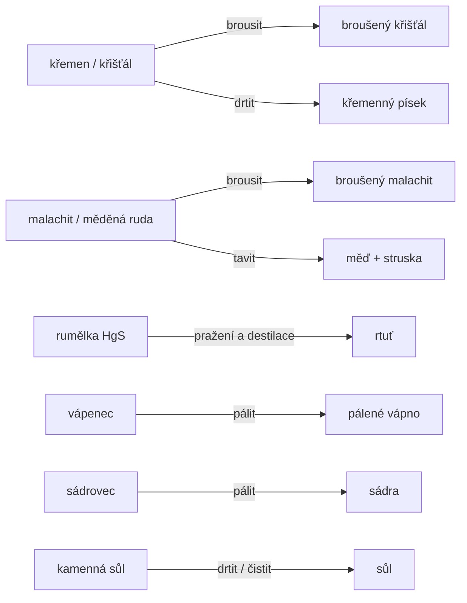

# Horniny: vlastnosti a těžba (návrh E65)

Stav: **návrh**, čeká na Jana. Sdílené tabulky vody se nepřepisují.

Datum: 19. 11. 2026, Europe/Berlin (CET). Studie blueprint-studie E65. Čísla zdrojů podle `blueprint-studie/ZDROJE.md`.

Toto není herní kód. Je to tabulka a model k rozhodnutí.

## Rozhodnutí a hypotézy v tomto návrhu

Rozhodnuto:

- 17. 11. 2026 17:53: výnos kopání je vždy 1 blok materiálu + šance na nález.
- 19. 11. 2026 13:23: každá hornina má seznam získatelných surovin (i více druhů). Blueprint vrstvy může přepsat procenta. Součet je 100 %. Smí jen suroviny povolené u té horniny.
- 19. 11. 2026 13:31: po identifikaci zůstanou obě jména (vlastní název hráče i skutečný název). Vlastní název může hráč sám smazat.

Hypotézy (ne rozhodnutí):

- 19. 11. 2026 13:27: zpracování rozloží horninu v poměrech bloku. Dovednost Mineralogie slouží k poznání. Neznámé suroviny stejně padají.
- 19. 11. 2026 13:33: krystaly mají kvalitu. Lze je brousit, drtit nebo dál zpracovat. Destilace a rozklad odemykají jinou dovednost (chemie / alchymie).
- Ostrov jako základna s chudým podzemím a plnou těžbou na výpravách zůstává dřívější hypotézou.

## Co už existuje (ať se to nenavrhuje znovu)

- Katalog pořadí 0–63 (+ sopouch) v `blueprint-studie/data/poradi_hornin.json` [10]. Zóny: plášť, krystalinikum, sedimenty, povrch, hory, vzduch.
- Vodní a mechanické pole v `sdilene/materialy_voda.json` v4 a `sdilene/horniny_voda.json` v2: perm, por, res, ret, load, cantilever, ero_v, ero_vol, sed_v, mode / režim, K_ms, Sy. Reálné vodní hodnoty jsou z E59/E61 [38]–[41].
- **load** = kolik buněk 0,5 m unese jako strop. **cantilever** = kolik buněk převisne. Jan 16:58; výpočet řícení zatím neběží.
- Hostitelé minerálů a skóre buněk v `data/mineraly_hostitele.json` (měď 40, železo 25, diamant 400, zlato 250, …).
- Rarita-v2 v prototypu: vážený průměr skóre buněk, původní i aktuální rarita bloku, samostatně vegetace. Skóre žuly/čediče 3, půdy 1–2, rud 25–40 (`godot-prototyp/scripts/mat.gd`).
- Materiál se zachovává: vytěžená buňka jde do inventáře a jde znovu položit. WVB1 kontroluje souhrn − vytěžené + položené (`navrhy/format-bloku-wvb1.md`).
- Šance na nález podle materiálu je rozhodnutá, tabulka nálezů ještě není.
- Tvrdost Mohs, UCS, nástroje, čas kopání a opotřebení **v datech nejsou**. To je nové v E65.
- Nic v kódu zatím nečte pole `rezim` z vodní tabulky (to platí dál, tuto studii to neřeší).

## Pořadí hornin (idx 0–63 + sopouch)

`idx` je pořadí možné posloupnosti, ne MaterialId. Některá ID se znovu používají z gen-v3 (0–12). Minerály 100+ v tomto pořadí nejsou; jsou to vtisknutá tělesa.

| idx | id | klíč | název | zóna | typ | aktivní | freq | load | cantilever | hostitel pro |
|---|---:|---|---|---|---|---|---:|---:|---:|---|
| 0 | 20 | `peridotite` | Peridotit / dunit | plast | layer | ano | 1.0 | 200 | 8 | — |
| 1 | 21 | `kimberlite` | Kimberlit (komíny) | plast | pipe | ano | 0.35 | 80 | 2 | diamond |
| 2 | 22 | `lherzolite` | Lherzolit, olivín | plast | layer | ne | 0.5 | 200 | 8 | — |
| 3 | 23 | `eclogite` | Eklogit | plast | layer | ne | 0.3 | 200 | 8 | garnet |
| 4 | 24 | `pyroxenite` | Pyroxenit | plast | layer | ne | 0.4 | 200 | 8 | — |
| 5 | 25 | `serpentinite` | Serpentinit (hadec) | plast | layer | ne | 0.4 | 100 | 3 | — |
| 6 | 26 | `gabbro` | Gabro | plast | layer | ano | 0.6 | 200 | 8 | fe_ti |
| 7 | 27 | `norite` | Norit / anortozit | plast | layer | ne | 0.4 | 200 | 8 | fe_ti |
| 8 | 28 | `fe_ti_zone` | Fe-Ti rudní zóna (magnetit) | plast | layer | ano | 0.3 | 200 | 8 | fe_ti |
| 9 | 7 | `diabase` | Diabaz (= čedič gen-v3) | plast | layer | ano | 0.7 | 200 | 8 | iron |
| 10 | 29 | `granulite` | Granulit | plast | layer | ne | 0.5 | 200 | 8 | — |
| 11 | 30 | `amphibolite` | Amfibolit | plast | layer | ano | 0.6 | 200 | 8 | — |
| 12 | 31 | `lower_gneiss` | Spodní přechodová břidlice / rula | plast | layer | ne | 0.6 | 200 | 8 | — |
| 13 | 32 | `migmatite` | Migmatit | krystalinikum | layer | ne | 0.5 | 200 | 8 | — |
| 14 | 33 | `orthogneiss` | Ortorula | krystalinikum | layer | ano | 0.8 | 200 | 8 | — |
| 15 | 34 | `biotite_gneiss` | Biotitická rula | krystalinikum | layer | ne | 0.6 | 200 | 8 | — |
| 16 | 35 | `two_mica_gneiss` | Dvojslídná rula | krystalinikum | layer | ne | 0.5 | 200 | 8 | — |
| 17 | 36 | `granodiorite` | Granodiorit | krystalinikum | layer | ano | 0.5 | 200 | 8 | copper |
| 18 | 6 | `granite` | Masivní žula (= žula gen-v3) | krystalinikum | layer | ano | 0.8 | 200 | 8 | copper |
| 19 | 37 | `leucogranite` | Světlá granitoidní žula | krystalinikum | layer | ne | 0.4 | 200 | 8 | — |
| 20 | 38 | `pegmatite` | Pegmatitové žíly | krystalinikum | vein | ano | 0.5 | 150 | 5 | gem, rare_metal, gold |
| 21 | 39 | `quartzite` | Krystalický kvarcit | krystalinikum | layer | ne | 0.4 | 200 | 8 | gold |
| 22 | 40 | `mica_schist` | Svor (granáty, slídy) | krystalinikum | layer | ano | 0.5 | 120 | 4 | garnet, gold |
| 23 | 41 | `phyllite` | Fylit | krystalinikum | layer | ne | 0.5 | 80 | 3 | — |
| 24 | 42 | `skarn` | Skarn (kontakt) | krystalinikum | contact | ano | 1.0 | 120 | 4 | copper, iron, garnet |
| 25 | 43 | `crystalline_transition` | Přechodová zóna krystalinika | krystalinikum | layer | ne | 0.5 | 200 | 8 | — |
| 26 | 44 | `deep_limestone` | Hlubinný vápenec / křída | sedimenty | layer | ano | 0.5 | 100 | 5 | — |
| 27 | 45 | `siltstone` | Prachovec | sedimenty | layer | ne | 0.5 | 40 | 2 | coal |
| 28 | 46 | `conglomerate` | Slepenec | sedimenty | layer | ne | 0.4 | 40 | 2 | — |
| 29 | 47 | `rock_salt` | Kamenná sůl (dómy) | sedimenty | dome | ano | 0.3 | 60 | 2 | — |
| 30 | 48 | `gypsum` | Sádrovec, anhydrit | sedimenty | layer | ne | 0.3 | 40 | 2 | — |
| 31 | 49 | `dolomite` | Dolomit | sedimenty | layer | ano | 0.4 | 120 | 5 | — |
| 32 | 5 | `cave_limestone` | Masivní jeskynní vápenec (= vápenec gen-v3) | sedimenty | layer | ano | 0.6 | 80 | 4 | iron |
| 33 | 50 | `black_coal` | Černé uhlí (sloj) | sedimenty | seam | ano | 0.5 | 150 | 5 | — |
| 34 | 51 | `shale` | Jílová břidlice | sedimenty | layer | ano | 0.7 | 30 | 1 | coal, lignite |
| 35 | 52 | `quartz_sandstone` | Křemenný pískovec | sedimenty | layer | ano | 0.6 | 60 | 3 | coal |
| 36 | 53 | `lignite` | Hnědé uhlí / lignit | sedimenty | seam | ano | 0.5 | 15 | 1 | — |
| 37 | 4 | `weathered_clay` | Zvětralá břidlice a jíly (= jíl gen-v3) | sedimenty | layer | ano | 0.7 | 12 | 1 | clay_deposit, lignite |
| 38 | 3 | `gravel_sand` | Štěrk, hlinitopísčité sedimenty (= písek gen-v3) | sedimenty | layer | ano | 0.5 | 3 | 0 | — |
| 39 | 54 | `loess` | Spraš a zvětraliny | sedimenty | layer | ano | 0.6 | 6 | 0 | lignite |
| 40 | 2 | `topsoil` | Ornice, humus (= hlína gen-v3, tráva navrchu) | povrch | soil | ano | 1.0 | 4 | 0 | — |
| 41 | 55 | `hill_sand` | Písčité podloží pahorků | hory | mountain | ano | 1.0 | 6 | 0 | — |
| 42 | 56 | `limestone_outcrop` | Vápencové výchozy | hory | mountain | ano | 0.6 | 80 | 4 | — |
| 43 | 57 | `weathered_volcanic` | Zvětralé vyvřeliny | hory | mountain | ano | 1.0 | 20 | 1 | — |
| 44 | 58 | `flysch` | Lesní půdy, flyš | hory | mountain | ano | 1.0 | 40 | 2 | — |
| 45 | 59 | `sandstone_towers` | Pískovcové věže a stěny | hory | mountain | ne | 0.5 | 60 | 3 | — |
| 46 | 60 | `weathered_granite` | Zvětralá žula vysočin | hory | mountain | ano | 1.0 | 40 | 2 | — |
| 47 | 61 | `mountain_ridge` | Horské hřebeny (Šumava/Krkonoše) | hory | mountain | ne | 0.6 | 150 | 6 | — |
| 48 | 62 | `slope_schist` | Krystalické břidlice svahů | hory | mountain | ne | 0.6 | 150 | 6 | — |
| 49 | 63 | `granite_massif` | Žulové masivy hřbetů | hory | mountain | ano | 1.0 | 150 | 6 | — |
| 50 | 64 | `rock_wall` | Strmé skalní stěny | hory | mountain | ano | 1.0 | 150 | 6 | — |
| 51 | 65 | `alpine_crystalline` | Vysokohorské krystalinikum | hory | mountain | ne | 0.6 | 150 | 6 | — |
| 52 | 66 | `subalpine_scree` | Subalpínské pásmo (skály, sutě) | hory | mountain | ano | 1.0 | 4 | 0 | — |
| 53 | 67 | `alpine_belt` | Alpínský stupeň | hory | mountain | ne | 0.6 | 150 | 6 | — |
| 54 | 68 | `alpine_granite` | Vysokohorský granit | hory | mountain | ano | 1.0 | 150 | 6 | — |
| 55 | 69 | `alpine_quartzite` | Vysokohorské kvarcity a břidlice | hory | mountain | ne | 0.6 | 150 | 6 | — |
| 56 | 70 | `extreme_ridge` | Extrémní hřebeny | hory | mountain | ano | 1.0 | 150 | 6 | — |
| 57 | 10 | `eternal_snow` | Věčný sníh a led (= sníh gen-v3) | hory | snow | ano | 1.0 | 4 | 0 | — |
| 58 | 71 | `high_massif` | Velehorský masiv | hory | mountain | ne | 0.6 | 150 | 6 | — |
| 59 | 72 | `rock_spire` | Skalní věže | hory | mountain | ne | 0.5 | 150 | 6 | — |
| 60 | 73 | `summit_pyramid` | Vrcholové pyramidy | hory | mountain | ne | 0.5 | 150 | 6 | — |
| 61 | 74 | `highest_point` | Nejvyšší bod (skála, led) | hory | mountain | ne | 0.5 | 150 | 6 | — |
| 62 | 0 | `cloud_line` | Hranice mraků (vzduch) | vzduch | air | ano | 1.0 | 150 | 5 | — |
| 63 | 0 | `map_ceiling` | Strop mapy, vzduch | vzduch | air | ano | 1.0 | 150 | 5 | — |
| 64 | 75 | `volcanic_conduit` | Sopouch (vulkanický kanál) | telesa | vent | ano | 1.0 | 100 | 4 | — |

## Reálné hodnoty (rešerše)

Typická hodnota je střed rozsahu, ne přesné číslo jedné lokality. Rozsahy UCS mají často 3–5× [42][43][44].

- **Mohs** u horniny bere dominantní minerál: kalcit 3, sádrovec 2, halit 2,5, živec/křemen 6–7, olivín 6,5–7, diamant 10 [48].
- **UCS** typicky: zeminy < 1 MPa, sádrovec ~12, sůl ~27, uhlí ~30, břidlice 5–100, vápenec typ. 107 (30–250), pískovec typ. 80–109 (20–170), žula typ. 154 (100–250), čedič typ. 145 (100–300), gabro typ. 228, kvarcit typ. 209 (150–300) [42][44][45].
- **Hustota** typicky: půdy 1,5–1,8 t/m³, uhlí 1,2–1,6, sůl 2,16, vápenec 2,64, žula 2,72, čedič/gabro ~3,0, peridotit ~3,2 [45].
- **CAI** (abraze, opotřebení nástrojů): jíl/uhlí 0,3–1; vápenec 1–2; čedič a křemenný pískovec 2–4; žula, rula, kvarcit 4–6 [46][47].
- **Jakost rud v přírodě** je nízká: porfyrická měď typicky 0,3–2 % Cu, průměr 2008 0,44 % [49]; diamant v kimberlitu 0,02–10 ct/t, medián 0,25 [50]; žilné zlato jednotky g/t; železná ruda DSO často > 50–60 % Fe [55].
- Ve hře už je rudná **buňka** samostatné ložisko (žíla, čočka, sloj). Proto výchozí podíly u buněk mědi/železa/zlata jsou herní abstrakce, ne surový průměr ložiska. Kimberlit jako hornina diamanty objemově nedává; diamanty zůstávají v buňkách `diamond` a ve šanci na nález.

Použití ve hře (výchozí výnosy):

- vápenec, dolomit → stavební kámen, vápno, štěrk
- žula, čedič, rula → stavební kámen, štěrk, trocha křemenného písku
- pískovec, kvarcit → kámen, křemenný písek, štěrk
- zvětralá žula → štěrk, písek, jíl (grus)
- sůl, sádrovec, uhlí, jíl → téměř čistá surovina + jalovina
- sypké (písek, suť, spraš) → písek / štěrk / hlína, bez kvádrů

## Navrhovaný model těžby

Doporučení (hypotéza, kromě bodů už rozhodnutých):

- Jedna tabulka `sdilene/horniny_tezba_navrh.json`. Čas i výnos jsou úměrné objemu. Buňka 0,5 m = 0,125 m³. Při vzorkování 0,125 m je vše × 1/64.
- Pět tříd tvrdosti podle typického UCS: sypká (ruka), měkká (kámen), střední (bronz), tvrdá (železo), velmi tvrdá (ocel). Trhaviny jsou zrychlení, ne šestá brána.
- Sypké a zeminy (cantilever 0, nízké load) se sypou a nestojí jako stěna. Soudržná hornina drží podle existujícího load / cantilever; podpěry zůstávají stavbou, jak už je rozhodnuto.
- Kopání (rozhodnutí 17:53): 1 buňka horniny do inventáře + šance na nález ze seedu buňky. Tím sedí i WVB1 (souhrn materiálů).
- Zpracování (rozhodnutí 13:23): buňka se rozloží na suroviny podle výchozích podílů, nebo podle přepisu vrstvy v blueprintu. Součet podílů je 1000 ‰. Jedna z povolených surovin může být znovu položitelný kvádr (`blok_horniny`).
- Kusový výnos (diamant, drahokam, granát) je počet kusů na buňku, ne objemové %. Objem buňky vyplní jalovina.
- Opotřebení nástroje na buňku 0,5 m je úměrné CAI (v tabulce `opotrebeni_na_bunku_05` = CAI / 6). Křemenné horniny žerou nástroje víc.
- Prach a suť: malý podíl `prach` u břidlic; trhaviny můžou převést část kvádrů na štěrk/prach (konfigurovatelné, např. +200 ‰).
- Rarita-v2 se nemění. Volitelný bonus z nadstandardních podílů cenných surovin je otevřená otázka (nesčítat rudné buňky dvakrát).

Čas na buňku 0,5 m (1 herní den = 10 min reálně, × 144):

| min. nástroj | odhad m³/h | reálně na buňku | po × 144 | návrh ke hře |
|---|---:|---:|---:|---:|
| ruka | 0,80 | 9 min | 4 s | 1 s |
| kámen | 0,25 | 30 min | 13 s | 3 s |
| bronz | 0,12 | 63 min | 26 s | 6 s |
| železo | 0,05 | 150 min | 63 s | 12 s |
| ocel | 0,03 | 250 min | 104 s | 18 s |

Odhad m³/h je řádový: ruční zemina podle 0,6–1,2 m³/h [51][52]; tvrdá skála je pomalejší než nakládání sypké zeminy, středověké ražení šachet bylo metry za měsíc [53]. Historický čas po × 144 je u žuly pořád ~1 min na buňku, na streamu to může vadit. Proto je v tabulce zvlášť kratší `t_navrh_s`. Jan vybere měřítko.

## Varianty času a nástrojů

| varianta | jak to počítá | plus | minus |
|---|---|---|---|
| **A** brána tříd | nástroj musí dosáhnout minima, čas je pevný podle třídy | jednoduché, čitelné | skok mezi třídami |
| **B** čas podle síly | čas = základ × (UCS / síla nástroje) | plynulé, sedí s UCS | hůř čitelné, hrozí extrémní časy |
| **C** práce / energie | práce = UCS × objem × (1 + CAI/3); nástroj má výkon a výdrž | nejlépe sedí s abrazí, nezávislé na rozlišení | víc parametrů |

Doporučení: hybrid A+B. O 1–2 stupně slabší nástroj než minimum kopat nemůže (rukou žulu ne). Jinak čas podle síly. Trhaviny zrychlí a zvednou podíl suti.

## Výnosy a přepis blueprintu (rozhodnutí 13:23)

Výchozí podíly jsou u každé horniny v `vytezek_vychozi_promile`. Příklad vápence: kvádr 600 ‰, vápno 250 ‰, štěrk 150 ‰.

Přepis patří k vrstvě / hostitelskému MaterialId v daném bloku, ne ke každé buňce zvlášť.

Tvar v JSON (promile, celá čísla, součet 1000):

```json
"yield_overrides": [
  {"host_mat_id": 5, "podily_promile": {"blok_horniny": 400, "vapno": 450, "sterk": 150}}
]
```

Validace (server při vydání i při zpracování):

- součet `podily_promile` je přesně 1000
- každá surovina je v seznamu povoleném u té horniny
- chybějící povolená položka = 0 ‰
- alespoň jedna surovina
- kusový výnos se do 1000 ‰ nepočítá
- neznámé `host_mat_id` nebo přepis u vzduchu / mlhy = chyba

Napojení na souhrn a raritu:

- Počty buněk v bloku (summary) se přepisem nemění. Mění se jen to, co zpracování z buňky dostane.
- Rarita-v2 dál běží z počtů MaterialId a jejich skóre. Rudy v zásobníku tedy raritu nesou jako dosud.
- Kvalita vrstvy (víc vápna, víc kvádrů) může dostat volitelný bonus. To Jan teprve rozhodne.

Návrh pole ve WVB1 (volitelné, nový bit ve `flags`). **Nepřidávat** podíly do `params` zásobníku: tabulka tvarů má pevný počet i32 a staré zásobníky by se rozbily.

| pole | typ | význam |
|---|---|---|
| yield_overrides_n | u16 | počet přepisů (0 = jen výchozí tabulka) |
| host_mat_id | u16 | MaterialId horniny v bloku |
| n_prod | u8 | počet surovin v přepisu |
| surovina_id, promile | u16, u16 | položka; součet promile = 1000 |

Server pole zkontroluje proti katalogu. Klient mu nevěří. `stack_hash` se nemění. Determinismus zpracování = (MaterialId, přepis nebo výchozí, objem buňky, seed jen u kusového nálezu / kvality).

## Znalosti a Mineralogie (hypotéza 13:27, jména 13:31)

Identifikace je u postavy, ne ve světě. Podíly bloku zná server vždy. Neznámá surovina stejně padá do inventáře a jde zkoušet ve výrobě.

Úrovně (konfigurovatelné):

| úroveň | zobrazení |
|---|---|
| 0 neznámý | „neznámý minerál“ + viditelné znaky (barva, Mohs, hustota) |
| 1 znaky | víc testů (vryp, hmotnost, tavení), ještě bez jistého jména |
| 2 identifikovaný | skutečný název i vlastní název hráče. Obě jména zůstanou. Vlastní název může hráč sám smazat. (rozhodnutí 13:31) |

Postup dovednosti (Jan vybere přepínač):

| režim | jak to funguje | plus | minus |
|---|---|---|---|
| třídy | zlepšení odemkne další třídu tvrdosti / vrstvu hornin | jednoduché, sedí s nástroji | méně volby |
| body | zlepšení dá body na poznání konkrétního materiálu | hráč si vybere, víc RPG | víc UI, může to táhnout |
| hybrid (doporučený výchozí) | úroveň odemkne třídu k poznávání; body nebo pokusy určí konkrétní surovinu | oboje laditelné | o něco víc pravidel |

Pokusy (tavení, vryp, hustota, kyselina u vápence) můžou zvednout úroveň nebo rovnou identifikovat. Neznámé lze použít naslepo, s rizikem zmetku.

## Řetězec zpracování (hypotéza 13:33)

Krystaly mají **kvalitu** 0–100 (rozsah laditelný).

- Hodnota se bere deterministicky z (seed bloku, MaterialId, index buňky). Kopáním znovu se nepřeroluje (stejný princip jako nález ze seedu, 17:53).
- Volitelně se rozdělení posune raritou bloku nebo nadstandardním podílem v `yield_overrides`.
- Broušený kámen hodnotu kvality drží (návrh: cena ~ kvalita², ať jsou špičky vzácné).
- Drcení kvalitu zničí. Vznikne písek nebo drť stejného objemu.

Operace a dovednosti (názvy laditelné):

| operace | dovednost | vstup | výstup | kvalita |
|---|---|---|---|---|
| identifikace | Mineralogie | surovina | pojmenování | nemění |
| brousit | Kamenictví | krystal / drahokam | broušený kámen | drží, malá ztráta objemu (5–15 %) |
| drtit | Kamenictví | krystal nebo kámen | písek / drť | zaniká |
| pálit | Chemie / alchymie | vápenec, sádrovec | pálené vápno, sádra | zaniká |
| destilovat | Chemie / alchymie | surovina s těkavou složkou | čistší látka + zbytek | zaniká |
| rozložit | Chemie / alchymie | složená surovina | jednodušší suroviny podle tabulky | zaniká |
| tavit | Chemie / alchymie | ruda + palivo | kov + struska | zaniká |

Chemie je **jiná** dovednost než Mineralogie. Tabulka reakcí je samostatná a konfigurovatelná. Nepřepisuje výnosy kopání.

Příklady (reálně věrohodné; rumělka v katalogu zatím není):



| vstup | brousit | drtit | chemie |
|---|---|---|---|
| křemen / křišťál | broušený křišťál (drží kvalitu) | křemenný písek | — |
| malachit / měděná ruda | broušený malachit | drť (horší k tavení) | tavit → měď + struska |
| rumělka (HgS) | — | prášek k pražení | pražení + destilace → rtuť |
| vápenec | — | štěrk / drť | pálení → pálené vápno [54] |
| sádrovec | alabastr (když kvalita stačí) | sádrový prášek | pálení → sádra |
| kamenná sůl | — | sůl | volitelně čištění |

## Negativa rešerše

- UCS a CAI mají široké rozsahy. Zařazení do třídy bere typickou hodnotu. Gabro (typ. 228 MPa) proto spadlo k oceli, žula (typ. 154) k železu, i když se obě často těží podobně. Práh 200 MPa jde posunout.
- Horské „pojmenované“ horniny (hřeben, věže, velehory) dědí vlastnosti žuly / ruly / kvarcitu. Nejsou to vždy samostatné litologie.
- Hlubinný vápenec / křída má v pořadí název křídy, ale load 100/5 je jako kompetentní vápenec, ne křída (~1 MPa) [44]. V návrhu jsou hodnoty vápence.
- Podíly surovin u ordinary hornin jsou herní, opřené o typické použití, ne o laboratoř.
- Historický čas po × 144 může být na streamu dlouhý. Návrh proto nabízí kratší `t_navrh_s`.
- Pole jsem ve hře nezkoušel. Žádný běh kódu to nečte.

## Otevřené otázky pro Jana

1. Kopání dvoukrokově (1 buňka, pak zpracování), nebo rozklad hned při kopání (hypotéza 13:27)?
2. Varianta času A, B, C, nebo hybrid A+B?
3. Měřítko času: historické × 144, nebo kratší `t_navrh_s`?
4. Mají ve hře být bronz a trhaviny jako stupně nástrojů?
5. Má kvalita výnosu (přepis podílů, kvalita krystalů) ovlivnit raritu-v2?
6. WVB1: souhlasí samostatné pole `yield_overrides`?
7. Mineralogie: třídy, body, nebo hybrid?
8. Jsou znalosti jen u postavy, nebo je může sdílet vesnice?
9. Kvalita krystalů 0–100 a cena ~ kvalita² vyhovuje, nebo jiné měřítko?
10. Mají do katalogu přibýt reaktanty jako rumělka, nebo stačí později?
11. Má prach / ztráta při trhavinách a broušení být použitelný materiál, nebo jen úbytek?

Rozhodnutí o svahu, režimu auto a jemné mřížce sem nepatří a dál čekají.

## Soubory

- `sdilene/horniny_tezba_navrh.json` — návrh tabulky (nepřepisuje existující tabulky)
- `blueprint-studie/tools/horniny65.py` — generátor tabulky a grafu
- `blueprint-studie/shots/65_horniny_tezba.png` — Mohs × UCS a pevnost podle nástroje
- `blueprint-studie/PROP.md` — záznam E65
- `blueprint-studie/ZDROJE.md` — [42]–[55]
- tento dokument
