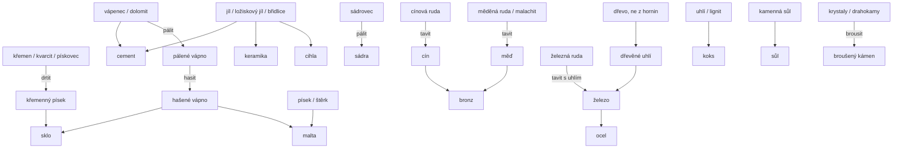

# Katalog materiálů a výrobků (návrh)

Stav: **hypotéza** (Jan 19. 11. 2026 13:36 a 13:39), hrubý přehled. Bez herních čísel. Čeká na Jana.

Datum: 19. 11. 2026, Europe/Berlin (CET). Navazuje na [vlastnosti a těžbu hornin](horniny-vlastnosti-tezba.md) a tabulku `sdilene/horniny_tezba_navrh.json` (E65). Zdroje jsou značky [n] podle `blueprint-studie/ZDROJE.md`.

Účel: ukázat, z čeho se běžné materiály dělají, kdo je zpracovává, na jaké výrobní jednotce a které reálné parametry ovlivňují kvalitu. Tyto hrubé popisy jsou základ **koupitelných receptů** (Jan 13:39): koupený recept řekne co a jak, ale dá jen průměrnou kvalitu. Ve výrobní jednotce (pec, dílna, huť) lze recept ladit a kvalitu výrazně zvednout. Vstupy odkazují na suroviny a horniny z tabulky E65. Některé vstupy ve hře ještě nejsou (cín, olovo, rumělka, potaž, dřevo). Jsou tu proto, aby bylo vidět, kam by řetězec vedl.

Dovednosti v tomto katalogu jsou návrh názvů, ne rozhodnutí. Mineralogie poznává suroviny. Kamenictví brousí a drtí. Chemie / alchymie pálí, destiluje a rozkládá (hypotézy 13:27 a 13:33). Výroba výrobků může mít vlastní dovednosti (sklářství, hrnčířství, hutnictví, kovářství, zednictví, uhlířství).

## Přehled řetězců

## 1 Pojiva a stavivo

### Pálené vápno

- **Z čeho:** vápenec nebo dolomit (surovina `vapno` / `blok_horniny` z vápence, dolomitu, výchozů a skarnu). Palivo: dřevo, dřevěné uhlí nebo uhlí.
- **Kdo:** vápeník / pecíř → Chemie (pálení) a Zednictví (použití).
- **Jak:** Kámen se pálí v peci, až uhličitan pustí oxid uhličitý a zbude oxid vápenatý (pálené vápno). V historických pecích na to stačí žár kolem 800–950 °C, tedy výrazně méně než na sklo. Čerstvé pálené vápno se hasí vodou na hašené vápno (kaši nebo prášek). Na vzduchu pak znovu tvrdne na uhličitan. Tomu se říká vápenný cyklus [57][58].
- **Jednotka:** vápenická pec.
- **Ladění kvality:** typ a čistota kamene (vápenec vs dolomit); velikost kusů; teplota výpalu (nedopal nechá uhličitan, přepal zhorší hašení); doba a rovnoměrnost žáru v peci; palivo (síra z uhlí špiní vápno) [57][58].

### Hašené vápno

- **Z čeho:** pálené vápno a voda.
- **Kdo:** vápeník nebo zedník → Zednictví.
- **Jak:** Pálené vápno se smísí s vodou. Vzniká hydroxid a uvolní se teplo. Kaši lze nechat uležet. Používá se do malty, omítky a nátěru (vápenné mléko) [57][58].
- **Jednotka:** hasicí jáma nebo kádě.
- **Ladění kvality:** poměr voda / pálené vápno; rychlost a teplota hašení; doba zrání kaše; čistota vody [58].

### Malta

- **Z čeho:** hašené vápno + písek (surovina `pisek` z písku, spraše, pískovce) nebo štěrk. Později i cement. Voda.
- **Kdo:** zedník → Zednictví.
- **Jak:** Pojivo se smísí s pískem a vodou a klade se mezi kameny nebo cihly. Čistě vápenná malta tvrdne pomalu vzduchem (karbonatace) a zůstává poddajnější než cementová. Tradičně se často hasilo vápno rovnou s pískem [57][58].
- **Jednotka:** zednická dílna / mísírna.
- **Ladění kvality:** poměr pojivo : písek; zrnitost a čistota písku (jíl, sůl); obsah vody; způsob hašení (kaše vs hašení s pískem); přísady (pucolán, cihlová moučka); doba míchání a zrání [57][58].

### Cement

- **Z čeho:** vápenec + jíl (nebo břidlice, spraš). Po výpalu se mele, někdy se přidá sádrovec, aby se rychlost tuhnutí dala řídit.
- **Kdo:** cementář (pozdější, průmyslovější stupeň) → Chemie + Zednictví.
- **Jak:** Směs vápence a jílu se vypálí ostřeji než čisté vápno, až vznikne slínek. Ten se semele na prášek. S vodou a pískem dává maltu nebo beton, která tuhne i ve vlhku. Je to mladší technologie než vápenná malta [66]. Ve hře může zůstat pozdním odemčením.
- **Jednotka:** cementárenská pec a mlýn (pozdější jednotka).
- **Ladění kvality:** poměr vápenec : jíl; teplota a doba výpalu slínku; jemnost mletí; přídavek sádrovce na tuhnutí; čistota surovin [66].

### Sádra

- **Z čeho:** sádrovec (surovina `sadrovec` z horniny `gypsum`).
- **Kdo:** štukatér / pecíř → Chemie (pálení) a Zednictví (použití).
- **Jak:** Sádrovec se suší při podstatně nižší teplotě než vápenec (řádově 100–160 °C, ne na sádrovec „přepálit“). Vznikne hemihydrát, který po smísení s vodou znovu zatuhne. Hodí se hlavně do interiéru a na odlitky; ve vlhku je slabší než vápno [59]. Kvalitní kus sádrovce lze i brousit jako alabastr.
- **Jednotka:** sádrová pec / sušárna.
- **Ladění kvality:** teplota (přepálení na anhydrit sádra špatně tuhne); doba výpalu; zrnitost; čistota sádrovce; poměr vody při míchání [59].

### Cihla

- **Z čeho:** jíl (surovina `jil` z jílu, ložiskového jílu, zvětralé břidlice, částečně i z břidlice). Někdy ostřivo: písek nebo drť.
- **Kdo:** cihlář → Hrnčířství (nebo samostatné Cihlářství).
- **Jak:** Jíl se propracuje, formuje do kvádrů, suší a pálí v peci (zhruba 900–1200 °C podle jílu). Výpal odstraní vodu a speče střep, takže cihla ve vodě nezmokvá jako sušená nepálená tvárnice [71].
- **Jednotka:** cihelna (formovna, sušárna, pec).
- **Ladění kvality:** složení jílu a podíl ostřiva; vlhkost při formování; doba a rovnoměrnost sušení (trhliny); teplota a křivka výpalu; atmosféra pece [71].

### Stavební kámen, štěrk a písek

- **Z čeho:** přímo z těžby a zpracování hornin. `blok_horniny` z žuly, čediče, vápence, pískovce, ruly, kvarcitu. `sterk` z týchž hornin po drcení, ze sutě a slepence. `pisek` a `kremenny_pisek` z písku, pískovce, kvarcitu a zvětralé žuly.
- **Kdo:** kameník / lamač → Kamenictví.
- **Jak:** Kvádr se láme a přisekává. Štěrk a písek vzniknou drcením, nebo se berou jako sypká hornina. Do malty a skla je důležitá čistota písku (železo barví sklo do zelena) [60][61].
- **Jednotka:** lom, drtírna, kamenická dílna.
- **Ladění kvality:** způsob dobývání (klíny vs trhaviny — víc trhlin v kvádru); přesnost opracování; třídění frakce štěrku a písku; čistota (jíl a železo v písku vadí maltě i sklu) [60][61].

## 2 Sklo a keramika

### Sklo

- **Z čeho:** **drcený křemen nebo křemenný písek** (`kremenny_pisek` z kvarcitu, křemenného pískovce, žuly, pegmatitu). Tavidlo: soda nebo potaž (z rostlinného popela; ve hře zatím není). Stabilizátor: vápno (pálené vápno nebo drcený vápenec). Příklad Jana 13:36: drcený křemen → sklo.
- **Kdo:** sklář → Sklářství (odděleně od Mineralogie; chemie může odemknout tavidla a čirost).
- **Jak:** Čistý křemen taje velmi vysoko (kolem 1700 °C). Soda nebo potaž teplotu tavení sníží, vápno sklo ustálí, aby se ve vodě nerozpouštělo. Směs se taví, čirá tavenina se rychle chladí, aby nevykrystalizovala, a tvaruje se foukáním nebo litím. Ve střední Evropě se historicky často mlely křemeny nebo valouny, později se bral sklářský písek; české sklo bylo typicky draselno-vápenaté z dřevěného popela [60][61].
- **Jednotka:** sklářská pec a chladicí pec (stájka / annealing).
- **Ladění kvality:** čistota křemene (železo barví do zelena); poměr křemen : soda/potaš : vápno; zrnitost vsázky; teplota tavení; doba čeření a odplynění; přísady (odbarvení, barviva, sůl jako čeřidlo); doba a křivka chlazení — rychlé chladnutí nechá pnutí a praskliny [60][61].

### Keramika (nádoby, kachle)

- **Z čeho:** jíl, případně ostřivo (písek, drť). Glazura viz níže.
- **Kdo:** hrnčíř → Hrnčířství.
- **Jak:** Jíl se plaví, propracuje, točí nebo formuje, suší a pálí. Nižší výpal dá porézní střep (terakota, květináč). Vyšší výpal střep speče. Na rozdíl od cihly jde o tenčí a tvarovější zboží, ale surovina je stejná [71].
- **Jednotka:** hrnčířská dílna a hrnčířská pec.
- **Ladění kvality:** plavení jílu a podíl ostřiva; vlhkost při točení; sušení; teplota a atmosféra výpalu; rychlost ohřevu a chlazení (trhliny, deformace) [71].

### Glazura

- **Z čeho:** křemenný písek + tavidlo (potaž, soda, olovnaté sloučeniny — olovo ve hře zatím není) + někdy jíl. Barvu dají oxidy kovů (měď zelená, železo hnědé až černé).
- **Kdo:** hrnčíř / sklář → Hrnčířství, později Chemie.
- **Jak:** Prášek se nanese na střep a při druhém výpalu se rozteče v tenkou sklovitou slupku. Je to vlastně tenká vrstva skla na keramice [60].
- **Jednotka:** glazovací / druhý výpal v hrnčířské peci.
- **Ladění kvality:** složení (křemen, tavidlo, případně olovo); tloušťka vrstvy; teplota; shoda roztažnosti glazury a střepu (odprýskání); čistota, bubliny [60].

### Porcelán (později)

- **Z čeho:** kaolin (světlý jíl ze zvětralé žuly a pegmatitu: `jil` z `weathered_granite` / pegmatitu) + živec + křemen.
- **Kdo:** hrnčíř vyššího stupně → Hrnčířství.
- **Jak:** Velmi čistá směs se pálí vysoko, až střep prosvítá a speče se. Ve hře to může být pozdní, vzácnější větev keramiky. Vstupy už z tabulky jdou (zvětralá žula dává jíl a křemenný písek).
- **Jednotka:** vysoká pec a úpravna kaolinu.
- **Ladění kvality:** poměr kaolin : živec : křemen; čistota kaolinu; teplota vysokého výpalu; atmosféra pece; sušení před výpalem.

## 3 Kovy

### Měď

- **Z čeho:** měděná ruda (`ruda_med` z buněk `copper`; vizuálně malachit). Palivo: dřevěné uhlí. Jalovina odpadá jako struska.
- **Kdo:** hutník → Hutnictví / Chemie (tavení).
- **Jak:** Karbonátovou rudu (malachit) lze v šachtové nebo miskové peci s dřevěným uhlím převést na kov při zhruba 1100–1200 °C, v redukčním prostředí. Sulfidické rudy se nejdřív praží. Kov se slévá, struska se oddělí. Buňka rudy ve hře už je obohacená žíla, ne průměr porfyru 0,44 % Cu [52][62].
- **Jednotka:** huť (misková nebo šachtová pec), u sulfidů i pražicí pec.
- **Ladění kvality:** typ a jakost rudy; zda a jak se praží; teplota a redukční atmosféra; tavidla a oddělení strusky; čistota dřevěného uhlí; opakované přetavení [62].

### Cín

- **Z čeho:** cínová ruda (kassiterit). Ve hře zatím může spadnout pod `ruda_vzacne` (žilné Li, Sn, Ta v pegmatitu). Samostatný materiál v katalogu hornin ještě není.
- **Kdo:** hutník → Hutnictví.
- **Jak:** Cínovec se drtí, často rýžuje, a taví s dřevěným uhlím. Cín je měkký kov s nízkým bodem tání a hlavně se slévá s mědí na bronz [63].
- **Jednotka:** rýžovna a cínová huť.
- **Ladění kvality:** podíl kassiteritu po úpravě; teplota a redukce; ztráty do strusky a dýmu [63].

### Bronz

- **Z čeho:** měď + cín (běžně zhruba 5–10 % cínu; zvonovina mívá cínu víc).
- **Kdo:** slévač / kovář barevných kovů → Hutnictví.
- **Jak:** Vytavená měď se slévá s cínem, nebo se kassiterit přidal rovnou k mědi v peci. Slitina je tvrdší než čistá měď, lépe se odlévá a má nižší teplotu tavení [62][63]. Ve hře to sváže dvě suroviny: bez cínu zůstane jen měď.
- **Jednotka:** slévárna, kelímek a formy.
- **Ladění kvality:** poměr měď : cín; teplota lití; míchání a odplynění; typ formy a rychlost chladnutí; nečistoty (železo, olovo) [62][63].

### Železo

- **Z čeho:** železná ruda (`ruda_zelezo` z buněk `iron`, případně `ruda_fe_ti`). Palivo a zároveň redukční činidlo: **dřevěné uhlí** (ne z hornin) nebo později koks z uhlí.
- **Kdo:** hutník, pak kovář → Hutnictví a Kovářství.
- **Jak:** V dýmačce (bloomery) ruda s dřevěným uhlím dá při vysokém žáru houbovitou lupu železa a strusku, ne hned tekutou ocel. Lupa se kuje, aby ze ní struska vyšla. Lití surového železa chce vyšší teplotu a pozdější pec. Jakost buněk ve hře je abstrakce bohatší čočky, ne chudá hornina [67][64].
- **Jednotka:** dýmačka (bloomery) a kovářská výheň na zpracování lupy.
- **Ladění kvality:** jakost a úprava rudy (drcení, pražení); poměr ruda : dřevěné uhlí; vzduch z měchů a teplota; tavidlo (vápenec na strusku); kování lupy (jak důkladně vyjde struska); vlhkost paliva [64][67].

### Ocel

- **Z čeho:** železo + uhlík (z dřevěného uhlí nebo uhlí).
- **Kdo:** kovář / ocelář → Kovářství (vyšší stupeň Hutnictví).
- **Jak:** Měkké kujné železo má uhlíku málo. Přidáním uhlíku (nacementování, později tavení v kelímku nebo sváření svárkové oceli) vznikne tvrdší materiál, který jde kalit. Je to navazující krok po železe, ne nová ruda [64][72].
- **Jednotka:** kovářská výheň, cementační skříň, kalicí lázeň.
- **Ladění kvality:** obsah uhlíku; teplota ohřevu; kalení (voda, olej, vzduch) a rychlost ochlazení; popouštění (teplota a čas); čistota výchozího železa; opakované sváření [64][72].

### Olovo

- **Z čeho:** typicky galenit (sulfid olovnatý). Ve hře zatím není. Může se objevit jako pozdější ruda, někdy doprovod stříbra.
- **Kdo:** hutník → Hutnictví / Chemie (pražení).
- **Jak:** Galenit se praží a taví; olovo taje nízko, takže se oddělí snadno. Používá se na trubky, závaží, sklo a glazury. Zmínka je tu jen proto, že olovo historicky patří do řetězce skla a glazur. Do katalogu hornin ho teď nedávám.
- **Jednotka:** huť a pražicí pec.
- **Ladění kvality:** pražení sulfidu; teplota tavení; oddělení stříbra, pokud v rudě je; čistota kovu.

## 4 Paliva

### Dřevěné uhlí

- **Z čeho:** dřevo (vegetace, **ne** z tabulky hornin).
- **Kdo:** uhlíř → Uhlířství.
- **Jak:** Dřevo se zahřívá bez přístupu vzduchu (suchá destilace v milíři nebo retortě). Zůstane skoro čistý uhlík, plyny a dehet odejdou. Dává čistší a teplejší žár než surové dřevo a v peci slouží i jako redukční činidlo při tavení kovů [65]. Bez něj staré hutnictví skoro nefunguje.
- **Jednotka:** milíř nebo retorta.
- **Ladění kvality:** druh a vlhkost dřeva; teplota a doba suché destilace; přístup vzduchu (při průvanu uhlí shoří); chlazení před otevřením [65].

### Koks

- **Z čeho:** černé uhlí (`uhli` z `black_coal` / `coal`). Hnědé uhlí je na koks horší.
- **Kdo:** koksáren / hutník → Chemie nebo Hutnictví.
- **Jak:** Uhlí se zahřívá bez vzduchu, podobně jako dřevo na dřevěné uhlí. Zůstane pevný uhlíkatý zbytek vhodný do pozdějších vysokých pecí. Ve hře to může být pozdní náhrada dřevěného uhlí, až je dřeva málo a uhlí dost [65].
- **Jednotka:** koksárenská komora.
- **Ladění kvality:** typ uhlí (černé vs hnědé, spékavost); teplota a doba; těsnost (bez vzduchu) [65].

## 5 Sůl, pigmenty, kameny

### Sůl

- **Z čeho:** kamenná sůl (`sul` z `rock_salt`, dómy) nebo odpar z vody (to už není hornina).
- **Kdo:** solný lamač / vařič soli → Kamenictví (lom) nebo Chemie (čištění).
- **Jak:** Sůl se láme jako měkká hornina, nebo se rozpustí a znovu odpaří, aby se oddělila jalovina. Používá se v jídle, k konzervaci, jako tavidlo do skla a k čištění [61][70].
- **Jednotka:** solný lom nebo varna.
- **Ladění kvality:** čistota ložiska; rozpouštění a krystalizace; teplota odparu; zbylé příměsi [70].

### Pigmenty

- **Z čeho:**
  - okrová a červená: železité zvětraliny a železná ruda (`ruda_zelezo`, zvětralé vyvřeliny, hlína)
  - zelená / modrá: malachit a azurit z měděné rudy
  - bílá: vápno, křída, sádrovec
  - černá: dřevěné uhlí, saze
  - jasně červená: rumělka (ve hře zatím není)
- **Kdo:** barvíř / malíř / chemik → Kamenictví (drcení) a Chemie (čištění, pražení).
- **Jak:** Minerál se drtí, plaví a někdy pálí, aby se změnil odstín (okra po výpalu zčervená). Rumělka je sulfid rtuťnatý; historicky z ní byla i rtuť po pražení a destilaci [68][69]. To je jen příklad chemického řetězce, do katalogu hornin rumělku teď nepřidávám.
- **Jednotka:** mlýn, plavírna, případně pec na pražení.
- **Ladění kvality:** zrnitost mletí; plavení hlušiny; teplota pražení (okra po výpalu zčervená); čistota a vlhkost; později i pojidlo, to už není minerál [68][69].

### Broušené kameny a drahokamy

- **Z čeho:** kusové krystaly (`drahokamy`, `diamanty`, `granaty`, kvalitní křemen) z buněk `gem`, `diamond`, `garnet` a z pegmatitu / svoru / kimberlitu. Kvalita krystalu je hypotéza 13:33.
- **Kdo:** brusič → Kamenictví (brousit; drtit je alternativa, která kvalitu zničí a dá písek).
- **Jak:** Kámen se brousí a leští na rovné plochy. Objem se trochu ztratí, kvalita zůstane. Špatný kámen je lepší rozdrtit na ostřivo nebo sklářský písek než brousit [61].
- **Jednotka:** brusičská dílna.
- **Ladění kvality:** výchozí kvalita krystalu; úhly a počet facet; volba, kolik objemu obětovat výbrusu; brusivo a doba leštění; teplo a tlak (praskliny) [61].

### Struska (odpad hutí)

- **Z čeho:** jalovina a tavidla po tavení rud (`jalovina` + zbytky rudy).
- **Kdo:** hutník → Hutnictví. Dá se dál použít jako ostřivo nebo štěrk.
- **Jak:** Při tavení oddělená tavenina hlušiny ztuhne ve sklovitou nebo kamenitou strusku. Není to primární cíl těžby, ale objem z řetězce nezmizí.
- **Jednotka:** huť (vzniká vedle kovu).
- **Ladění kvality:** složení tavidel; teplota tavení; způsob chladnutí (ostřivo vs sklovitý odpad).

## Recepty a ladění kvality (hypotéza 13:39)

Koupitelný recept vychází z popisu „Jak“ u materiálu. Řekne, z čeho a jak se to dělá, a na jaké jednotce. Když se uvaří **přesně podle receptu**, vznikne jen **průměrná** kvalita.

Výrobní jednotka (pec, dílna, huť, milíř, …) recept odemkne k **ladění**. Hráč může měnit poměry vstupů, teplotu, čas, přísady a volit čistší nebo kvalitnější vstupy. Tím jde kvalita výrazně nad průměr. Špatné ladění ji naopak zhorší (nedopal, praskliny, zelené sklo, křehká ocel, zmetek).

Každý laditelný parametr má **skryté optimum** nebo přijatelné okno (ne vždy „čím víc, tím líp“: nízká teplota nedopeče, vysoká přepálí). Koupený recept optimum neukáže, nebo ukáže jen hrubé rozmezí. Hráč ho hledá pokusy, lepšími recepty nebo zkušeností dovednosti. Konkrétní pravidlo je konfigurovatelné.

Náčrt funkce kvality (bez herních čísel, laditelné):

- Výchozí recept dá `Q ≈ Q_prumer`.
- U parametru `i` je trestem odchylka od skrytého optima `x_i*` (nebo vystoupení z okna), typicky zvonová křivka, ne lineární „víc = líp“.
- `Q` roste, když se parametry blíží optimu, a je omezené kvalitou a čistotou vstupů (špinavý písek neudělá čiré sklo, i když je pec nastavená dobře).
- Dovednost a lepší jednotka můžou zmenšit rozptyl (stejné nastavení vychází jistěji) nebo rozšířit dosah ladění. To je volitelné.
- Horní strop nad průměrem má být výrazný, ať se ladění vyplatí. Spodní strop může výrobek zničit.

Přehled jednotek je u jednotlivých materiálů v položce Jednotka. Stručně:

| jednotka | typické výrobky |
|---|---|
| vápenická pec | pálené vápno |
| hasicí jáma | hašené vápno |
| zednická dílna / mísírna | malta |
| cementárenská pec a mlýn | cement (později) |
| sádrová pec | sádra |
| cihelna | cihla |
| lom, drtírna, kamenická dílna | kámen, štěrk, písek |
| sklářská pec a chladicí pec | sklo |
| hrnčířská dílna a pec | keramika, glazura, porcelán |
| huť (misková / šachtová, pražení) | měď, cín, olovo |
| slévárna / kelímek | bronz |
| dýmačka a výheň | železo |
| kovářská výheň a kalicí lázeň | ocel |
| milíř / retorta | dřevěné uhlí |
| koksárenská komora | koks |
| solný lom / varna | sůl |
| mlýn a plavírna | pigmenty |
| brusičská dílna | broušené kameny |

## Co v tabulce hornin ještě chybí

Aby některé výrobky měly kompletní vstupy, chybí zejména: cín jako samostatná ruda (teď jen pod `rare_metal`), olovo, rumělka, soda / potaž (z popela rostlin), dřevo (vegetace). Sklo bez tavidla jde udělat jen velmi těžko; tavidlo proto nesmí zmizet jen proto, že není hornina.

## Otevřené (jen u katalogu)

- Které výrobky jsou ve hře od začátku (vápno, malta, cihla, sklo, měď, železo) a které až později (cement, porcelán, ocel, koks)?
- Mají mít sklářství, hrnčířství, hutnictví a zednictví vlastní dovednosti, nebo stačí Kamenictví + Chemie + Kovářství?
- Má se cín, olovo a rumělka doplnit do katalogu surovin, nebo zůstat jen jako možné rozšíření?
- Odemkne koupený recept výrobu natrvalo, nebo se spotřebuje?
- Ukázat u parametrů jen hrubé rozmezí, nebo optimum úplně skrýt?
- Jsou recepty a vyladěné profily jen u postavy, nebo je může sdílet vesnice?
- Má mít samotná výrobní jednotka vlastní „přesnost“, oddělenou od receptu?
