# Strom hornin, obsah a další rozklad surovin

Návrh **T02** studie `tezba-studie` (Jan 14:19, 2026-11-19). Strom je datový: `data/strom_rozkladu.json`, obrázky `shots/T02_strom_*.png`, sestavení a kontrola `tools/strom02.py`.

Krátké věty. Čísla složení jsou typická, ne herní zákon. Výnosy ‰ beru z T01. Výrobky odkazují na [katalog materiálů](katalog-materialu.md). Zdroje v `ZDROJE.md`.

## Jak strom číst

- **Hornina** se rozpadá dvěma směry: typické **složení minerálů** (Mineralogie) a **výchozí výnos surovin** po zpracování buňky (T01, součet 1000 ‰).
- **Základní výnos** (kámen, štěrk, písek, jíl, hlína, sůl, uhlí, sádrovec, jalovina, křemenný písek, sníh, prach) postava pozná vždy. Rudy, vápno jako surovina a drahokamy potřebují Mineralogii — stejně ale vypadnou (hypotéza T01, 13:27).
- Ze surovin, které skupina opravdu těží, vedou operace na **výrobky** katalogu a nakonec na **prvky**. U hrany je dovednost. Spoluvstupy z jiné skupiny (soda, dřevěné uhlí, vápno ke sklu) se jen ukážou.
- Horské faciální názvy (masiv, stěna, jehla…) dědí složení i výnos své skupiny. V diagramech jsou sloučené do rodiny.
- Hašení a tvrdnutí malty tvoří **záměrný cyklus** zpět na kalcit (na obrázku popisek „cyklus: kalcit“, ne zpětná šipka). Jiné cykly strom nemá.
- Detailní obrázky jsou řetězce **zleva doprava**, jeden pruh na surovinu nebo výrobek. Huby (struska, dřevěné uhlí, koks jako palivo, soda) nejsou samostatné uzly — jsou v popisku hrany (`+ dřevěné uhlí`).

## Počty

- Hornin (bez aliasů a vzduchu): **74** — zeminy a sypké 11, usazené 13, vyvřeliny 21, rudy a ložiska 10, přeměněné 19.
- Minerálů: **34**. Surovin T01: **22**. Výrobků: **28**. Prvků: **12**. Vnějších vstupů: **3** (dřevo, dřevěné uhlí, soda).
- Uzlů celkem: **175**. Hran: **550**. Procesů zpracování: **46**. Unikátních operací: **20**.

## Přehled skupin

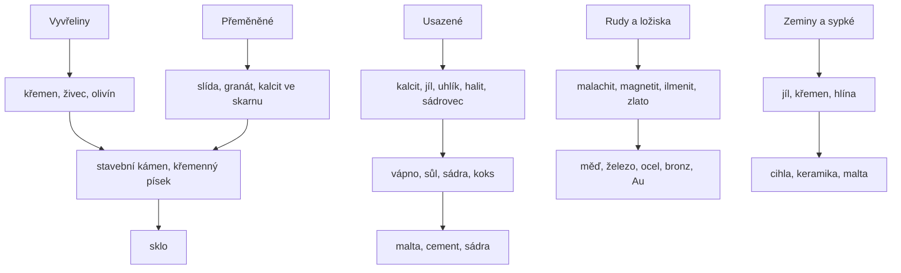

Obrázek: `shots/T02_strom_prehled.png`.

## Vyvřeliny

Hlubinné i výlevné horniny plastu, krystalinika a masivů.

Hornin v této skupině: 21.

- **čedič a výlevy:** čedič (`basalt`, id 7), Sopouch (vulkanický kanál) (`volcanic_conduit`, id 75).
- **zóna Fe-Ti (gabro):** Fe-Ti rudní zóna (magnetit) (`fe_ti_zone`, id 28).
- **gabro a norit:** Pyroxenit (`pyroxenite`, id 24), Gabro (`gabbro`, id 26), Norit / anortozit (`norite`, id 27).
- **kimberlit:** Kimberlit (komíny) (`kimberlite`, id 21).
- **pegmatit:** Pegmatitové žíly (`pegmatite`, id 38).
- **peridotit:** Peridotit / dunit (`peridotite`, id 20), Lherzolit, olivín (`lherzolite`, id 22).
- **žula a masivy:** žula (`granite`, id 6), Granodiorit (`granodiorite`, id 36), Světlá granitoidní žula (`leucogranite`, id 37), Žulové masivy hřbetů (`granite_massif`, id 63), Strmé skalní stěny (`rock_wall`, id 64), Vysokohorský granit (`alpine_granite`, id 68), Extrémní hřebeny (`extreme_ridge`, id 70), Velehorský masiv (`high_massif`, id 71), Skalní věže (`rock_spire`, id 72), Vrcholové pyramidy (`summit_pyramid`, id 73), Nejvyšší bod (skála, led) (`highest_point`, id 74).

### Složení

```mermaid
flowchart TB
  mineral_olivin["olivín"]
  mineral_slida["slída"]
  rodina_vyvreliny_pegmatite["Pegmatitové žíly"]
  mineral_plagioklas["plagioklas"]
  mineral_spinel["spinel"]
  rodina_vyvreliny_zula["žula a masivy (11)"]
  mineral_pyroxen["pyroxen"]
  rodina_vyvreliny_peridotit["peridotit (2)"]
  rodina_vyvreliny_kimberlit["Kimberlit (komíny)"]
  mineral_magnetit["magnetit"]
  rodina_vyvreliny_gabro["gabro a norit (3)"]
  rodina_vyvreliny_fe_ti_zone["Fe-Ti rudní zóna (magnetit)"]
  mineral_ilmenit["ilmenit"]
  mineral_kremen["křemen"]
  mineral_zivec_k["draselný živec"]
  mineral_karbonat_min["karbonát (v kimberlitu)"]
  rodina_vyvreliny_cedic["čedič a výlevy (2)"]
  rodina_vyvreliny_zula -->|300 ‰| mineral_kremen
  rodina_vyvreliny_zula -->|350 ‰| mineral_zivec_k
  rodina_vyvreliny_zula -->|250 ‰| mineral_plagioklas
  rodina_vyvreliny_zula -->|100 ‰| mineral_slida
  rodina_vyvreliny_cedic -->|500 ‰| mineral_plagioklas
  rodina_vyvreliny_cedic -->|350 ‰| mineral_pyroxen
  rodina_vyvreliny_cedic -->|100 ‰| mineral_olivin
  rodina_vyvreliny_cedic -->|50 ‰| mineral_magnetit
  rodina_vyvreliny_peridotit -->|700 ‰| mineral_olivin
  rodina_vyvreliny_peridotit -->|250 ‰| mineral_pyroxen
  rodina_vyvreliny_peridotit -->|50 ‰| mineral_spinel
  rodina_vyvreliny_kimberlit -->|550 ‰| mineral_olivin
  rodina_vyvreliny_kimberlit -->|200 ‰| mineral_pyroxen
  rodina_vyvreliny_kimberlit -->|150 ‰| mineral_karbonat_min
  rodina_vyvreliny_kimberlit -->|100 ‰| mineral_slida
  rodina_vyvreliny_gabro -->|450 ‰| mineral_plagioklas
  rodina_vyvreliny_gabro -->|400 ‰| mineral_pyroxen
  rodina_vyvreliny_gabro -->|100 ‰| mineral_olivin
  rodina_vyvreliny_gabro -->|50 ‰| mineral_magnetit
  rodina_vyvreliny_fe_ti_zone -->|400 ‰| mineral_plagioklas
  rodina_vyvreliny_fe_ti_zone -->|300 ‰| mineral_pyroxen
  rodina_vyvreliny_fe_ti_zone -->|150 ‰| mineral_magnetit
  rodina_vyvreliny_fe_ti_zone -->|150 ‰| mineral_ilmenit
  rodina_vyvreliny_pegmatite -->|450 ‰| mineral_zivec_k
  rodina_vyvreliny_pegmatite -->|400 ‰| mineral_kremen
  rodina_vyvreliny_pegmatite -->|150 ‰| mineral_slida
```

### Výnosy

Základní vždy známý výnos je v datech `zakladni` a v popisku hrany `zákl.`

```mermaid
flowchart TB
  rodina_vyvreliny_pegmatite["Pegmatitové žíly"]
  surovina_blok_horniny["stavební kámen / kvádr"]
  rodina_vyvreliny_kimberlit["Kimberlit (komíny)"]
  rodina_vyvreliny_zula["žula a masivy (11)"]
  rodina_vyvreliny_peridotit["peridotit (2)"]
  rodina_vyvreliny_fe_ti_zone["Fe-Ti rudní zóna (magnetit)"]
  rodina_vyvreliny_gabro["gabro a norit (3)"]
  surovina_kremenny_pisek["křemenný písek"]
  surovina_sterk["štěrk / drcený kámen"]
  rodina_vyvreliny_cedic["čedič a výlevy (2)"]
  rodina_vyvreliny_zula -->|zákl., 700 ‰| surovina_blok_horniny
  rodina_vyvreliny_zula -->|zákl., 250 ‰| surovina_sterk
  rodina_vyvreliny_zula -->|zákl., 50 ‰| surovina_kremenny_pisek
  rodina_vyvreliny_cedic -->|zákl., 700 ‰| surovina_blok_horniny
  rodina_vyvreliny_cedic -->|zákl., 300 ‰| surovina_sterk
  rodina_vyvreliny_peridotit -->|zákl., 700 ‰| surovina_blok_horniny
  rodina_vyvreliny_peridotit -->|zákl., 300 ‰| surovina_sterk
  rodina_vyvreliny_kimberlit -->|zákl., 850 ‰| surovina_sterk
  rodina_vyvreliny_kimberlit -->|zákl., 150 ‰| surovina_blok_horniny
  rodina_vyvreliny_gabro -->|zákl., 650 ‰| surovina_blok_horniny
  rodina_vyvreliny_gabro -->|zákl., 350 ‰| surovina_sterk
  rodina_vyvreliny_fe_ti_zone -->|zákl., 650 ‰| surovina_blok_horniny
  rodina_vyvreliny_fe_ti_zone -->|zákl., 350 ‰| surovina_sterk
  rodina_vyvreliny_pegmatite -->|zákl., 700 ‰| surovina_blok_horniny
  rodina_vyvreliny_pegmatite -->|zákl., 250 ‰| surovina_sterk
  rodina_vyvreliny_pegmatite -->|zákl., 50 ‰| surovina_kremenny_pisek
```

### Další rozklad a zpracování

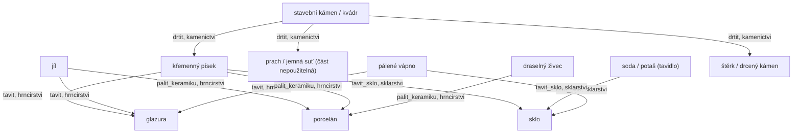

Obrázky: `shots/T02_strom_vyvreliny_slozeni.png`, `shots/T02_strom_vyvreliny_vynosy.png`, `shots/T02_strom_vyvreliny_zpracovani.png`.

## Přeměněné

Ruly, svory, kvarcit, eklogit, hadec a kontaktní skarn.

Hornin v této skupině: 19.

- **amfibolit:** Amfibolit (`amphibolite`, id 30).
- **eklogit:** Eklogit (`eclogite`, id 23).
- **fylit:** Fylit (`phyllite`, id 41).
- **hadec:** Serpentinit (hadec) (`serpentinite`, id 25).
- **kvarcit:** Krystalický kvarcit (`quartzite`, id 39), Vysokohorské kvarcity a břidlice (`alpine_quartzite`, id 69).
- **rula a granulit:** Granulit (`granulite`, id 29), Spodní přechodová břidlice / rula (`lower_gneiss`, id 31), Migmatit (`migmatite`, id 32), Ortorula (`orthogneiss`, id 33), Biotitická rula (`biotite_gneiss`, id 34), Dvojslídná rula (`two_mica_gneiss`, id 35), Přechodová zóna krystalinika (`crystalline_transition`, id 43), Horské hřebeny (Šumava/Krkonoše) (`mountain_ridge`, id 61), Vysokohorské krystalinikum (`alpine_crystalline`, id 65), Alpínský stupeň (`alpine_belt`, id 67).
- **skarn:** Skarn (kontakt) (`skarn`, id 42).
- **svor:** Svor (granáty, slídy) (`mica_schist`, id 40), Krystalické břidlice svahů (`slope_schist`, id 62).

### Složení

```mermaid
flowchart TB
  rodina_premenene_skarn["Skarn (kontakt)"]
  mineral_chlorit["chlorit"]
  mineral_plagioklas["plagioklas"]
  mineral_pyroxen["pyroxen"]
  rodina_premenene_kvarcit["kvarcit (2)"]
  mineral_kremen["křemen"]
  rodina_premenene_svor["svor (2)"]
  mineral_zivec_k["draselný živec"]
  rodina_premenene_amfibolit["Amfibolit"]
  mineral_granat_min["granát"]
  mineral_olivin["olivín"]
  mineral_slida["slída"]
  rodina_premenene_rula["rula a granulit (10)"]
  rodina_premenene_fylit["Fylit"]
  rodina_premenene_hadec["Serpentinit (hadec)"]
  mineral_kalcit["kalcit"]
  mineral_serpentin["serpentin"]
  rodina_premenene_eklogit["Eklogit"]
  mineral_rutil["rutil"]
  mineral_magnetit["magnetit"]
  mineral_jil_min["jílové minerály"]
  mineral_amfibol["amfibol"]
  rodina_premenene_eklogit -->|500 ‰| mineral_granat_min
  rodina_premenene_eklogit -->|450 ‰| mineral_pyroxen
  rodina_premenene_eklogit -->|50 ‰| mineral_rutil
  rodina_premenene_hadec -->|850 ‰| mineral_serpentin
  rodina_premenene_hadec -->|100 ‰| mineral_magnetit
  rodina_premenene_hadec -->|50 ‰| mineral_olivin
  rodina_premenene_rula -->|300 ‰| mineral_kremen
  rodina_premenene_rula -->|250 ‰| mineral_zivec_k
  rodina_premenene_rula -->|200 ‰| mineral_plagioklas
  rodina_premenene_rula -->|150 ‰| mineral_slida
  rodina_premenene_rula -->|100 ‰| mineral_amfibol
  rodina_premenene_amfibolit -->|550 ‰| mineral_amfibol
  rodina_premenene_amfibolit -->|350 ‰| mineral_plagioklas
  rodina_premenene_amfibolit -->|100 ‰| mineral_granat_min
  rodina_premenene_kvarcit -->|920 ‰| mineral_kremen
  rodina_premenene_kvarcit -->|80 ‰| mineral_slida
  rodina_premenene_svor -->|400 ‰| mineral_slida
  rodina_premenene_svor -->|350 ‰| mineral_kremen
  rodina_premenene_svor -->|150 ‰| mineral_plagioklas
  rodina_premenene_svor -->|100 ‰| mineral_granat_min
  rodina_premenene_fylit -->|400 ‰| mineral_slida
  rodina_premenene_fylit -->|300 ‰| mineral_kremen
  rodina_premenene_fylit -->|200 ‰| mineral_chlorit
  rodina_premenene_fylit -->|100 ‰| mineral_jil_min
  rodina_premenene_skarn -->|400 ‰| mineral_kalcit
  rodina_premenene_skarn -->|300 ‰| mineral_granat_min
  rodina_premenene_skarn -->|300 ‰| mineral_pyroxen
```

### Výnosy

Základní vždy známý výnos je v datech `zakladni` a v popisku hrany `zákl.`

```mermaid
flowchart TB
  rodina_premenene_skarn["Skarn (kontakt)"]
  surovina_jil["jíl"]
  surovina_blok_horniny["stavební kámen / kvádr"]
  rodina_premenene_fylit["Fylit"]
  rodina_premenene_hadec["Serpentinit (hadec)"]
  rodina_premenene_rula["rula a granulit (10)"]
  rodina_premenene_eklogit["Eklogit"]
  rodina_premenene_kvarcit["kvarcit (2)"]
  surovina_kremenny_pisek["křemenný písek"]
  rodina_premenene_svor["svor (2)"]
  surovina_vapno["vápno / vápencová surovina"]
  rodina_premenene_amfibolit["Amfibolit"]
  surovina_sterk["štěrk / drcený kámen"]
  rodina_premenene_eklogit -->|zákl., 700 ‰| surovina_blok_horniny
  rodina_premenene_eklogit -->|zákl., 300 ‰| surovina_sterk
  rodina_premenene_hadec -->|zákl., 600 ‰| surovina_blok_horniny
  rodina_premenene_hadec -->|zákl., 400 ‰| surovina_sterk
  rodina_premenene_rula -->|zákl., 650 ‰| surovina_blok_horniny
  rodina_premenene_rula -->|zákl., 350 ‰| surovina_sterk
  rodina_premenene_amfibolit -->|zákl., 600 ‰| surovina_blok_horniny
  rodina_premenene_amfibolit -->|zákl., 400 ‰| surovina_sterk
  rodina_premenene_kvarcit -->|zákl., 600 ‰| surovina_blok_horniny
  rodina_premenene_kvarcit -->|zákl., 200 ‰| surovina_kremenny_pisek
  rodina_premenene_kvarcit -->|zákl., 200 ‰| surovina_sterk
  rodina_premenene_svor -->|zákl., 300 ‰| surovina_blok_horniny
  rodina_premenene_svor -->|zákl., 700 ‰| surovina_sterk
  rodina_premenene_fylit -->|zákl., 700 ‰| surovina_sterk
  rodina_premenene_fylit -->|zákl., 200 ‰| surovina_blok_horniny
  rodina_premenene_fylit -->|zákl., 100 ‰| surovina_jil
  rodina_premenene_skarn -->|zákl., 500 ‰| surovina_blok_horniny
  rodina_premenene_skarn -->|200 ‰| surovina_vapno
  rodina_premenene_skarn -->|zákl., 300 ‰| surovina_sterk
```

### Další rozklad a zpracování

```mermaid
flowchart TB
  surovina_sterk["štěrk / drcený kámen"]
  vnejsi_soda["soda / potaš (tavidlo)"]
  surovina_jil["jíl"]
  surovina_blok_horniny["stavební kámen / kvádr"]
  vyrobek_glazura["glazura"]
  vyrobek_sklo["sklo"]
  surovina_prach["prach / jemná suť (část nepoužitelná)"]
  vyrobek_cihla["cihla"]
  surovina_pisek["písek"]
  vyrobek_palene_vapno["pálené vápno"]
  vyrobek_keramika["keramika"]
  surovina_vapno["vápno / vápencová surovina"]
  vyrobek_porcelan["porcelán"]
  mineral_zivec_k["draselný živec"]
  surovina_kremenny_pisek["křemenný písek"]
  vyrobek_cement["cement"]
  surovina_vapno -->|palit, chemie| vyrobek_cement
  surovina_jil -->|palit, chemie| vyrobek_cement
  surovina_jil -->|palit_cihly, zednictvi| vyrobek_cihla
  surovina_pisek -->|palit_cihly, zednictvi| vyrobek_cihla
  surovina_jil -->|palit_keramiku, hrncirstvi| vyrobek_keramika
  surovina_kremenny_pisek -->|tavit, hrncirstvi| vyrobek_glazura
  surovina_jil -->|tavit, hrncirstvi| vyrobek_glazura
  vyrobek_palene_vapno -->|tavit, hrncirstvi| vyrobek_glazura
  surovina_jil -->|palit_keramiku, hrncirstvi| vyrobek_porcelan
  surovina_kremenny_pisek -->|palit_keramiku, hrncirstvi| vyrobek_porcelan
  mineral_zivec_k -->|palit_keramiku, hrncirstvi| vyrobek_porcelan
  surovina_blok_horniny -->|drtit, kamenictvi| surovina_sterk
  surovina_blok_horniny -->|drtit, kamenictvi| surovina_prach
  surovina_blok_horniny -->|drtit, kamenictvi| surovina_kremenny_pisek
  surovina_vapno -->|palit, chemie| vyrobek_palene_vapno
  surovina_kremenny_pisek -->|tavit_sklo, sklarstvi| vyrobek_sklo
  vnejsi_soda -->|tavit_sklo, sklarstvi| vyrobek_sklo
  vyrobek_palene_vapno -->|tavit_sklo, sklarstvi| vyrobek_sklo
```

Obrázky: `shots/T02_strom_premenene_slozeni.png`, `shots/T02_strom_premenene_vynosy.png`, `shots/T02_strom_premenene_zpracovani_stavba.png`, `shots/T02_strom_premenene_zpracovani_ohen.png`.

## Usazené

Vápence, pískovce, evapority, uhelné sloje a flyš.

Hornin v této skupině: 13.

- **břidlice:** Jílová břidlice (`shale`, id 51).
- **dolomit:** Dolomit (`dolomite`, id 49).
- **sádrovec:** Sádrovec, anhydrit (`gypsum`, id 48).
- **sůl (halit):** Kamenná sůl (dómy) (`rock_salt`, id 47).
- **flyš:** Lesní půdy, flyš (`flysch`, id 58).
- **pískovec:** Křemenný pískovec (`quartz_sandstone`, id 52), Pískovcové věže a stěny (`sandstone_towers`, id 59).
- **prachovec:** Prachovec (`siltstone`, id 45).
- **slepence:** Slepenec (`conglomerate`, id 46).
- **černé uhlí:** Černé uhlí (sloj) (`black_coal`, id 50).
- **vápenec:** vápenec (`limestone`, id 5), Hlubinný vápenec / křída (`deep_limestone`, id 44), Vápencové výchozy (`limestone_outcrop`, id 56).

### Složení

```mermaid
flowchart TB
  mineral_sadrovec_min["sádrovec"]
  mineral_kremen["křemen"]
  rodina_usazene_evap_sad["Sádrovec, anhydrit"]
  mineral_pyrit["pyrit"]
  mineral_zivec_k["draselný živec"]
  mineral_slida["slída"]
  rodina_usazene_vapenec["vápenec (3)"]
  mineral_halit["halit"]
  mineral_horninove_ulomky["horninové úlomky"]
  rodina_usazene_flys["Lesní půdy, flyš"]
  rodina_usazene_dolomit["Dolomit"]
  mineral_dolomit_min["dolomit"]
  rodina_usazene_bridlice["Jílová břidlice"]
  rodina_usazene_evap_sul["Kamenná sůl (dómy)"]
  rodina_usazene_uhli["Černé uhlí (sloj)"]
  mineral_kalcit["kalcit"]
  mineral_anhydrit["anhydrit"]
  rodina_usazene_prachovec["Prachovec"]
  rodina_usazene_slepenec["Slepenec"]
  mineral_uhli_org["organický uhlík"]
  rodina_usazene_piskovec["pískovec (2)"]
  mineral_jil_min["jílové minerály"]
  rodina_usazene_vapenec -->|950 ‰| mineral_kalcit
  rodina_usazene_vapenec -->|50 ‰| mineral_jil_min
  rodina_usazene_prachovec -->|500 ‰| mineral_jil_min
  rodina_usazene_prachovec -->|400 ‰| mineral_kremen
  rodina_usazene_prachovec -->|100 ‰| mineral_slida
  rodina_usazene_slepenec -->|500 ‰| mineral_kremen
  rodina_usazene_slepenec -->|350 ‰| mineral_horninove_ulomky
  rodina_usazene_slepenec -->|150 ‰| mineral_kalcit
  rodina_usazene_evap_sul -->|950 ‰| mineral_halit
  rodina_usazene_evap_sul -->|50 ‰| mineral_sadrovec_min
  rodina_usazene_evap_sad -->|850 ‰| mineral_sadrovec_min
  rodina_usazene_evap_sad -->|150 ‰| mineral_anhydrit
  rodina_usazene_dolomit -->|850 ‰| mineral_dolomit_min
  rodina_usazene_dolomit -->|150 ‰| mineral_kalcit
  rodina_usazene_uhli -->|800 ‰| mineral_uhli_org
  rodina_usazene_uhli -->|150 ‰| mineral_jil_min
  rodina_usazene_uhli -->|50 ‰| mineral_pyrit
  rodina_usazene_bridlice -->|650 ‰| mineral_jil_min
  rodina_usazene_bridlice -->|250 ‰| mineral_kremen
  rodina_usazene_bridlice -->|100 ‰| mineral_uhli_org
  rodina_usazene_piskovec -->|800 ‰| mineral_kremen
  rodina_usazene_piskovec -->|100 ‰| mineral_zivec_k
  rodina_usazene_piskovec -->|100 ‰| mineral_kalcit
  rodina_usazene_flys -->|400 ‰| mineral_kremen
  rodina_usazene_flys -->|350 ‰| mineral_jil_min
  rodina_usazene_flys -->|250 ‰| mineral_kalcit
```

### Výnosy

Základní vždy známý výnos je v datech `zakladni` a v popisku hrany `zákl.`

```mermaid
flowchart TB
  rodina_usazene_evap_sad["Sádrovec, anhydrit"]
  surovina_blok_horniny["stavební kámen / kvádr"]
  rodina_usazene_vapenec["vápenec (3)"]
  rodina_usazene_flys["Lesní půdy, flyš"]
  rodina_usazene_dolomit["Dolomit"]
  surovina_sadrovec["sádrovec"]
  rodina_usazene_bridlice["Jílová břidlice"]
  rodina_usazene_evap_sul["Kamenná sůl (dómy)"]
  rodina_usazene_uhli["Černé uhlí (sloj)"]
  surovina_prach["prach / jemná suť (část nepoužitelná)"]
  surovina_vapno["vápno / vápencová surovina"]
  rodina_usazene_prachovec["Prachovec"]
  surovina_kremenny_pisek["křemenný písek"]
  rodina_usazene_slepenec["Slepenec"]
  surovina_jil["jíl"]
  surovina_sul["sůl"]
  surovina_pisek["písek"]
  rodina_usazene_piskovec["pískovec (2)"]
  surovina_uhli["černé uhlí"]
  surovina_jalovina["jalovina"]
  surovina_sterk["štěrk / drcený kámen"]
  rodina_usazene_vapenec -->|zákl., 600 ‰| surovina_blok_horniny
  rodina_usazene_vapenec -->|250 ‰| surovina_vapno
  rodina_usazene_vapenec -->|zákl., 150 ‰| surovina_sterk
  rodina_usazene_prachovec -->|zákl., 600 ‰| surovina_sterk
  rodina_usazene_prachovec -->|zákl., 300 ‰| surovina_jil
  rodina_usazene_prachovec -->|zákl., 100 ‰| surovina_pisek
  rodina_usazene_slepenec -->|zákl., 400 ‰| surovina_blok_horniny
  rodina_usazene_slepenec -->|zákl., 500 ‰| surovina_sterk
  rodina_usazene_slepenec -->|zákl., 100 ‰| surovina_pisek
  rodina_usazene_evap_sul -->|zákl., 900 ‰| surovina_sul
  rodina_usazene_evap_sul -->|zákl., 100 ‰| surovina_sterk
  rodina_usazene_evap_sad -->|zákl., 850 ‰| surovina_sadrovec
  rodina_usazene_evap_sad -->|zákl., 150 ‰| surovina_sterk
  rodina_usazene_dolomit -->|zákl., 500 ‰| surovina_blok_horniny
  rodina_usazene_dolomit -->|300 ‰| surovina_vapno
  rodina_usazene_dolomit -->|zákl., 200 ‰| surovina_sterk
  rodina_usazene_uhli -->|zákl., 850 ‰| surovina_uhli
  rodina_usazene_uhli -->|zákl., 150 ‰| surovina_jalovina
  rodina_usazene_bridlice -->|zákl., 500 ‰| surovina_jil
  rodina_usazene_bridlice -->|zákl., 400 ‰| surovina_sterk
  rodina_usazene_bridlice -->|zákl., 100 ‰| surovina_prach
  rodina_usazene_piskovec -->|zákl., 500 ‰| surovina_blok_horniny
  rodina_usazene_piskovec -->|zákl., 300 ‰| surovina_kremenny_pisek
  rodina_usazene_piskovec -->|zákl., 200 ‰| surovina_sterk
  rodina_usazene_flys -->|zákl., 400 ‰| surovina_sterk
  rodina_usazene_flys -->|zákl., 300 ‰| surovina_jil
  rodina_usazene_flys -->|zákl., 300 ‰| surovina_pisek
```

### Další rozklad a zpracování

Stavební vápno, malta, cement, sádra, cihly:

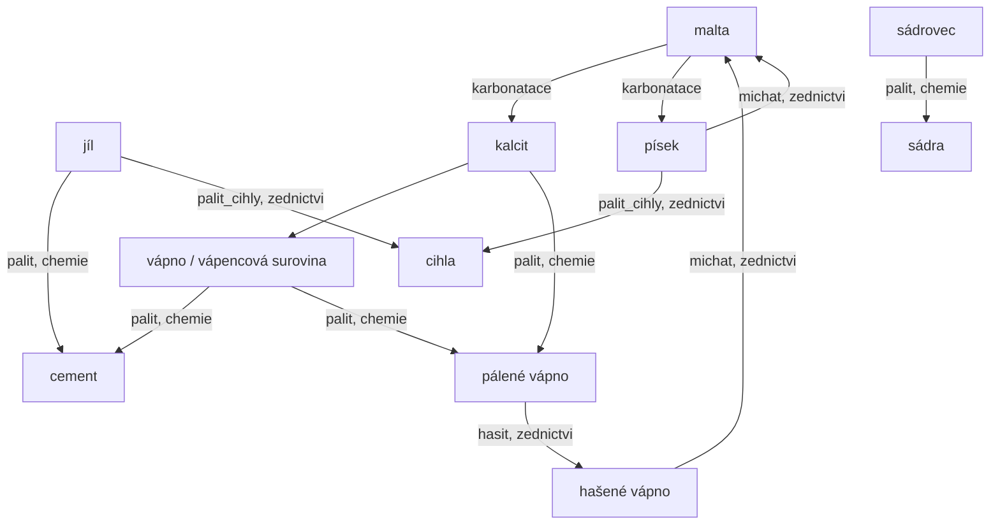

Oheň a chemie: sklo, keramika, koks, sůl:

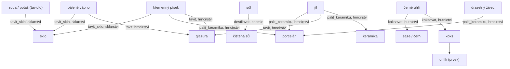

Obrázky: `shots/T02_strom_usazene_slozeni.png`, `shots/T02_strom_usazene_vynosy.png`, `shots/T02_strom_usazene_zpracovani_stavba.png`, `shots/T02_strom_usazene_zpracovani_ohen.png`.

## Rudy a ložiska

Žíly, kapsy a uhelné vrstvy v zóně rud (T01, zona=rudy).

Hornin v této skupině: 10.

- **černé uhlí (minerál):** černé uhlí (minerál) (`coal`, id 104).
- **měděná ruda:** měděná ruda (`copper`, id 8).
- **diamanty:** diamanty (`diamond`, id 100).
- **titanomagnetit (Fe-Ti):** titanomagnetit (Fe-Ti) (`fe_ti`, id 103).
- **granáty:** granáty (`garnet`, id 106).
- **drahokamy:** drahokamy (`gem`, id 101).
- **zlato:** zlato (`gold`, id 107).
- **železná ruda:** železná ruda (`iron`, id 9).
- **hnědé uhlí (minerál):** hnědé uhlí (minerál) (`lignite`, id 105).
- **vzácné kovy (Li, Sn, Ta):** vzácné kovy (Li, Sn, Ta) (`rare_metal`, id 102).

### Složení

```mermaid
flowchart TB
  rodina_rudy_diamond["diamanty"]
  mineral_plagioklas["plagioklas"]
  mineral_hematit["hematit"]
  mineral_pyroxen["pyroxen"]
  mineral_kremen["křemen"]
  mineral_korund["korund"]
  mineral_pyrit["pyrit"]
  rodina_rudy_copper["měděná ruda"]
  mineral_zivec_k["draselný živec"]
  mineral_spodumen["spodumen"]
  rodina_rudy_garnet["granáty"]
  mineral_granat_min["granát"]
  mineral_olivin["olivín"]
  mineral_slida["slída"]
  rodina_rudy_gold["zlato"]
  rodina_rudy_iron["železná ruda"]
  mineral_malachit["malachit"]
  rodina_rudy_fe_ti["titanomagnetit (Fe-Ti)"]
  rodina_rudy_rare_metal["vzácné kovy (Li, Sn, Ta)"]
  mineral_ilmenit["ilmenit"]
  mineral_kalcit["kalcit"]
  mineral_zlato_nativni["ryzí zlato"]
  mineral_beryl["beryl"]
  rodina_rudy_coal["černé uhlí (minerál)"]
  rodina_rudy_lignite["hnědé uhlí (minerál)"]
  mineral_kassiterit["kasiterit"]
  mineral_uhli_org["organický uhlík"]
  mineral_magnetit["magnetit"]
  mineral_kolumbit["kolumbit-tantalit"]
  rodina_rudy_gem["drahokamy"]
  mineral_jil_min["jílové minerály"]
  rodina_rudy_copper -->|400 ‰| mineral_malachit
  rodina_rudy_copper -->|300 ‰| mineral_kremen
  rodina_rudy_copper -->|300 ‰| mineral_kalcit
  rodina_rudy_iron -->|500 ‰| mineral_magnetit
  rodina_rudy_iron -->|200 ‰| mineral_hematit
  rodina_rudy_iron -->|300 ‰| mineral_kremen
  rodina_rudy_lignite -->|650 ‰| mineral_uhli_org
  rodina_rudy_lignite -->|250 ‰| mineral_jil_min
  rodina_rudy_lignite -->|100 ‰| mineral_kremen
  rodina_rudy_diamond -->|350 ‰| mineral_olivin
  rodina_rudy_diamond -->|250 ‰| mineral_pyroxen
  rodina_rudy_diamond -->|200 ‰| mineral_kremen
  rodina_rudy_diamond -->|200 ‰| mineral_granat_min
  rodina_rudy_gem -->|500 ‰| mineral_kremen
  rodina_rudy_gem -->|200 ‰| mineral_korund
  rodina_rudy_gem -->|150 ‰| mineral_beryl
  rodina_rudy_gem -->|150 ‰| mineral_slida
  rodina_rudy_rare_metal -->|350 ‰| mineral_zivec_k
  rodina_rudy_rare_metal -->|300 ‰| mineral_kremen
  rodina_rudy_rare_metal -->|200 ‰| mineral_spodumen
  rodina_rudy_rare_metal -->|100 ‰| mineral_kassiterit
  rodina_rudy_rare_metal -->|50 ‰| mineral_kolumbit
  rodina_rudy_fe_ti -->|350 ‰| mineral_ilmenit
  rodina_rudy_fe_ti -->|250 ‰| mineral_magnetit
  rodina_rudy_fe_ti -->|250 ‰| mineral_plagioklas
  rodina_rudy_fe_ti -->|150 ‰| mineral_pyroxen
  rodina_rudy_coal -->|800 ‰| mineral_uhli_org
  rodina_rudy_coal -->|150 ‰| mineral_jil_min
  rodina_rudy_coal -->|50 ‰| mineral_pyrit
  rodina_rudy_garnet -->|500 ‰| mineral_granat_min
  rodina_rudy_garnet -->|200 ‰| mineral_slida
  rodina_rudy_garnet -->|200 ‰| mineral_kremen
  rodina_rudy_garnet -->|100 ‰| mineral_pyroxen
  rodina_rudy_gold -->|800 ‰| mineral_kremen
  rodina_rudy_gold -->|180 ‰| mineral_pyrit
  rodina_rudy_gold -->|20 ‰| mineral_zlato_nativni
```

### Výnosy

Základní vždy známý výnos je v datech `zakladni` a v popisku hrany `zákl.`

```mermaid
flowchart TB
  rodina_rudy_diamond["diamanty"]
  surovina_drahokamy["drahokamy"]
  surovina_ruda_med["měděná ruda"]
  rodina_rudy_copper["měděná ruda"]
  rodina_rudy_garnet["granáty"]
  surovina_ruda_fe_ti["titanomagnetit (Fe-Ti)"]
  surovina_granaty["granáty"]
  surovina_lignit["hnědé uhlí"]
  rodina_rudy_gold["zlato"]
  rodina_rudy_iron["železná ruda"]
  rodina_rudy_fe_ti["titanomagnetit (Fe-Ti)"]
  rodina_rudy_rare_metal["vzácné kovy (Li, Sn, Ta)"]
  surovina_diamanty["diamanty"]
  surovina_ruda_vzacne["vzácné kovy (Li, Sn, Ta)"]
  rodina_rudy_coal["černé uhlí (minerál)"]
  surovina_kremenny_pisek["křemenný písek"]
  surovina_ruda_zlato["zlatá ruda"]
  rodina_rudy_lignite["hnědé uhlí (minerál)"]
  surovina_jil["jíl"]
  rodina_rudy_gem["drahokamy"]
  surovina_uhli["černé uhlí"]
  surovina_jalovina["jalovina"]
  surovina_sterk["štěrk / drcený kámen"]
  surovina_ruda_zelezo["železná ruda"]
  rodina_rudy_copper -->|400 ‰| surovina_ruda_med
  rodina_rudy_copper -->|zákl., 600 ‰| surovina_jalovina
  rodina_rudy_iron -->|700 ‰| surovina_ruda_zelezo
  rodina_rudy_iron -->|zákl., 300 ‰| surovina_jalovina
  rodina_rudy_lignite -->|zákl., 800 ‰| surovina_lignit
  rodina_rudy_lignite -->|zákl., 200 ‰| surovina_jil
  rodina_rudy_diamond -->|zákl., 900 ‰| surovina_jalovina
  rodina_rudy_diamond -->|zákl., 100 ‰| surovina_sterk
  rodina_rudy_diamond -->|kus| surovina_diamanty
  rodina_rudy_gem -->|zákl., 900 ‰| surovina_jalovina
  rodina_rudy_gem -->|zákl., 100 ‰| surovina_sterk
  rodina_rudy_gem -->|kus| surovina_drahokamy
  rodina_rudy_rare_metal -->|300 ‰| surovina_ruda_vzacne
  rodina_rudy_rare_metal -->|zákl., 700 ‰| surovina_jalovina
  rodina_rudy_fe_ti -->|600 ‰| surovina_ruda_fe_ti
  rodina_rudy_fe_ti -->|zákl., 400 ‰| surovina_jalovina
  rodina_rudy_coal -->|zákl., 850 ‰| surovina_uhli
  rodina_rudy_coal -->|zákl., 150 ‰| surovina_jalovina
  rodina_rudy_garnet -->|zákl., 900 ‰| surovina_jalovina
  rodina_rudy_garnet -->|zákl., 100 ‰| surovina_sterk
  rodina_rudy_garnet -->|kus| surovina_granaty
  rodina_rudy_gold -->|80 ‰| surovina_ruda_zlato
  rodina_rudy_gold -->|zákl., 620 ‰| surovina_kremenny_pisek
  rodina_rudy_gold -->|zákl., 300 ‰| surovina_jalovina
```

### Další rozklad a zpracování

Měď a bronz:

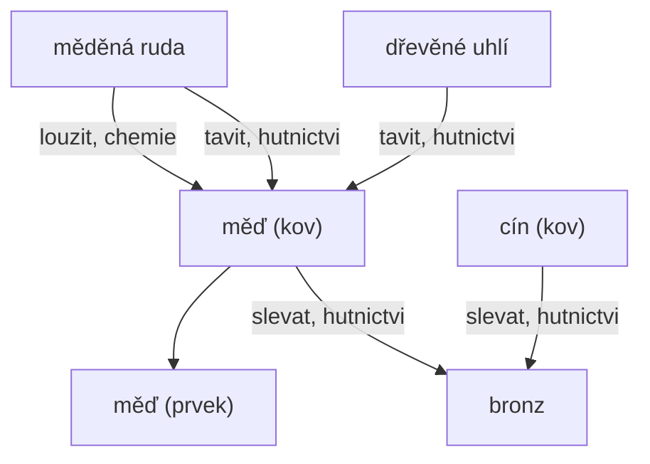

Železo, ocel a Fe-Ti:

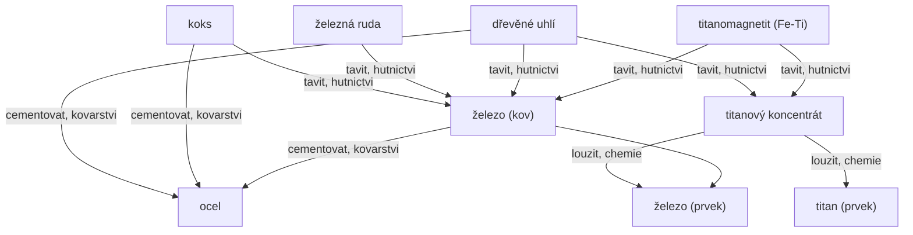

Cín:

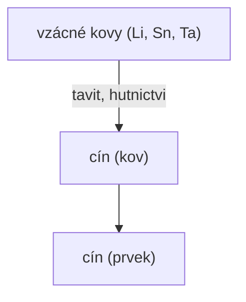

Zlato:

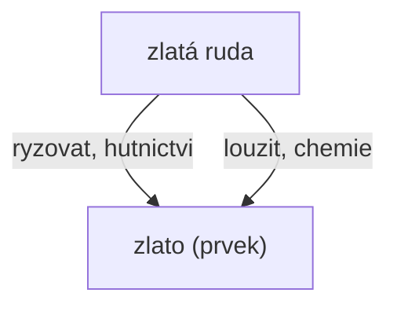

Vzácné kovy (Li, Ta):

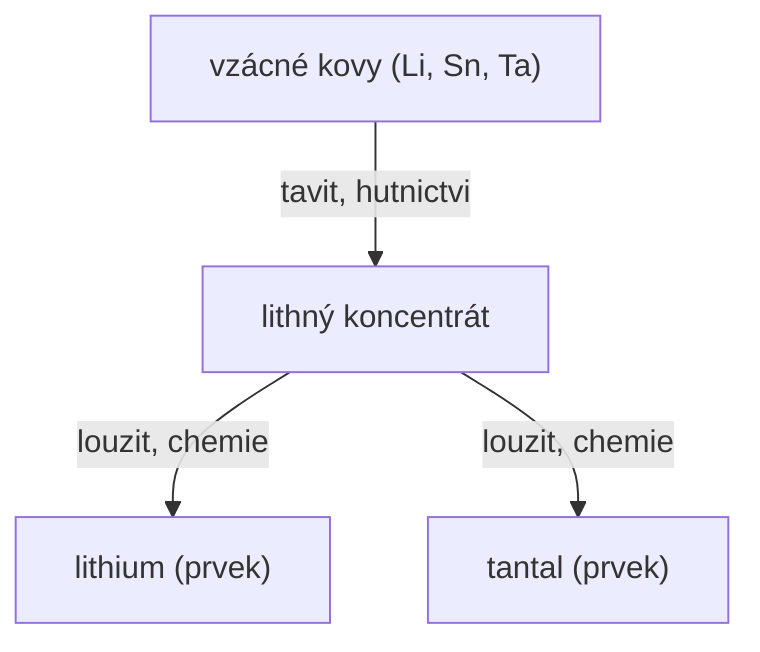

Uhlí a koks:

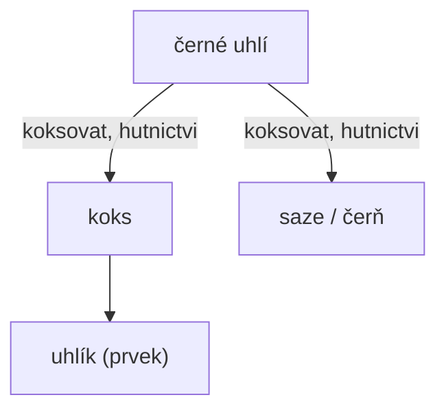

Drahokamy a broušení:

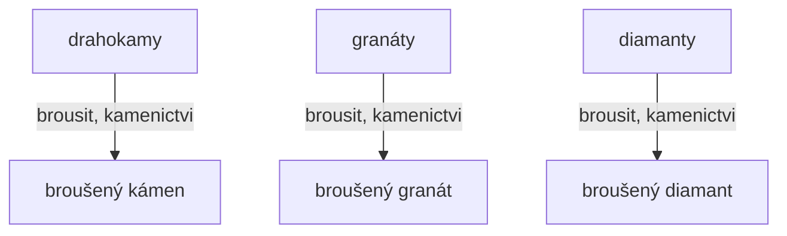


Obrázky: `shots/T02_strom_rudy_slozeni.png`, `shots/T02_strom_rudy_vynosy.png`, `shots/T02_strom_rudy_zpracovani_med.png`, `shots/T02_strom_rudy_zpracovani_zelezo.png`, `shots/T02_strom_rudy_zpracovani_cin.png`, `shots/T02_strom_rudy_zpracovani_zlato.png`, `shots/T02_strom_rudy_zpracovani_vzacne.png`, `shots/T02_strom_rudy_zpracovani_uhli.png`, `shots/T02_strom_rudy_zpracovani_kameny.png`.

## Zeminy a sypké

Půdy, písek, jíl, spraše, zvětraliny, suť a sníh.

Hornin v této skupině: 11.

- **jíl:** jíl (`clay`, id 4), ložiskový jíl (`clay_deposit`, id 12).
- **písek:** písek (`sand`, id 3), Písčité podloží pahorků (`hill_sand`, id 55).
- **půda a hlína:** tráva / drn (`grass`, id 1), hlína (`dirt`, id 2).
- **sníh / led:** sníh (`snow`, id 10).
- **spraš:** Spraš a zvětraliny (`loess`, id 54).
- **štěrk a suť:** Subalpínské pásmo (skály, sutě) (`subalpine_scree`, id 66).
- **zvětraliny:** Zvětralé vyvřeliny (`weathered_volcanic`, id 57), Zvětralá žula vysočin (`weathered_granite`, id 60).

### Složení

```mermaid
flowchart TB
  rodina_zeminy_spras["Spraš a zvětraliny"]
  hornina_dirt["hlína"]
  rodina_zeminy_sterk["Subalpínské pásmo (skály, sutě)"]
  hornina_grass["tráva / drn"]
  rodina_zeminy_zvetr["zvětraliny (2)"]
  rodina_zeminy_pisek["písek (2)"]
  rodina_zeminy_jil["jíl (2)"]
  mineral_kalcit["kalcit"]
  mineral_led["led / sníh"]
  mineral_horninove_ulomky["horninové úlomky"]
  mineral_kremen["křemen"]
  mineral_jil_min["jílové minerály"]
  mineral_organika["organická příměs"]
  rodina_zeminy_snih["sníh"]
  mineral_zivec_k["draselný živec"]
  hornina_grass -->|300 ‰| mineral_organika
  hornina_grass -->|250 ‰| mineral_jil_min
  hornina_grass -->|250 ‰| mineral_kremen
  hornina_grass -->|200 ‰| mineral_zivec_k
  hornina_dirt -->|200 ‰| mineral_organika
  hornina_dirt -->|250 ‰| mineral_jil_min
  hornina_dirt -->|250 ‰| mineral_kremen
  hornina_dirt -->|200 ‰| mineral_zivec_k
  hornina_dirt -->|100 ‰| mineral_kalcit
  rodina_zeminy_pisek -->|850 ‰| mineral_kremen
  rodina_zeminy_pisek -->|150 ‰| mineral_zivec_k
  rodina_zeminy_jil -->|850 ‰| mineral_jil_min
  rodina_zeminy_jil -->|150 ‰| mineral_kremen
  rodina_zeminy_snih -->|1000 ‰| mineral_led
  rodina_zeminy_spras -->|400 ‰| mineral_kremen
  rodina_zeminy_spras -->|300 ‰| mineral_kalcit
  rodina_zeminy_spras -->|300 ‰| mineral_jil_min
  rodina_zeminy_zvetr -->|400 ‰| mineral_kremen
  rodina_zeminy_zvetr -->|300 ‰| mineral_jil_min
  rodina_zeminy_zvetr -->|200 ‰| mineral_zivec_k
  rodina_zeminy_zvetr -->|100 ‰| mineral_horninove_ulomky
  rodina_zeminy_sterk -->|600 ‰| mineral_horninove_ulomky
  rodina_zeminy_sterk -->|300 ‰| mineral_kremen
  rodina_zeminy_sterk -->|100 ‰| mineral_zivec_k
```

### Výnosy

Základní vždy známý výnos je v datech `zakladni` a v popisku hrany `zákl.`

```mermaid
flowchart TB
  rodina_zeminy_spras["Spraš a zvětraliny"]
  hornina_dirt["hlína"]
  surovina_hlina["hlína"]
  surovina_jil["jíl"]
  rodina_zeminy_sterk["Subalpínské pásmo (skály, sutě)"]
  hornina_grass["tráva / drn"]
  surovina_snih["sníh / led"]
  rodina_zeminy_zvetr["zvětraliny (2)"]
  rodina_zeminy_pisek["písek (2)"]
  hornina_clay["jíl"]
  surovina_pisek["písek"]
  hornina_clay_deposit["ložiskový jíl"]
  rodina_zeminy_snih["sníh"]
  surovina_sterk["štěrk / drcený kámen"]
  hornina_grass -->|zákl., 700 ‰| surovina_hlina
  hornina_grass -->|zákl., 150 ‰| surovina_jil
  hornina_grass -->|zákl., 150 ‰| surovina_pisek
  hornina_dirt -->|zákl., 800 ‰| surovina_hlina
  hornina_dirt -->|zákl., 150 ‰| surovina_jil
  hornina_dirt -->|zákl., 50 ‰| surovina_pisek
  rodina_zeminy_pisek -->|zákl., 900 ‰| surovina_pisek
  rodina_zeminy_pisek -->|zákl., 100 ‰| surovina_sterk
  hornina_clay -->|zákl., 900 ‰| surovina_jil
  hornina_clay -->|zákl., 100 ‰| surovina_hlina
  hornina_clay_deposit -->|zákl., 1000 ‰| surovina_jil
  rodina_zeminy_snih -->|zákl., 1000 ‰| surovina_snih
  rodina_zeminy_spras -->|zákl., 500 ‰| surovina_hlina
  rodina_zeminy_spras -->|zákl., 400 ‰| surovina_pisek
  rodina_zeminy_spras -->|zákl., 100 ‰| surovina_jil
  rodina_zeminy_zvetr -->|zákl., 500 ‰| surovina_sterk
  rodina_zeminy_zvetr -->|zákl., 300 ‰| surovina_pisek
  rodina_zeminy_zvetr -->|zákl., 200 ‰| surovina_jil
  rodina_zeminy_sterk -->|zákl., 800 ‰| surovina_sterk
  rodina_zeminy_sterk -->|zákl., 200 ‰| surovina_pisek
```

### Další rozklad a zpracování

```mermaid
flowchart TB
  vyrobek_malta["malta"]
  surovina_jil["jíl"]
  vyrobek_glazura["glazura"]
  vyrobek_cihla["cihla"]
  mineral_kalcit["kalcit"]
  surovina_pisek["písek"]
  vyrobek_palene_vapno["pálené vápno"]
  vyrobek_hasene_vapno["hašené vápno"]
  vyrobek_keramika["keramika"]
  surovina_vapno["vápno / vápencová surovina"]
  vyrobek_porcelan["porcelán"]
  mineral_zivec_k["draselný živec"]
  surovina_kremenny_pisek["křemenný písek"]
  vyrobek_cement["cement"]
  surovina_vapno -->|palit, chemie| vyrobek_cement
  surovina_jil -->|palit, chemie| vyrobek_cement
  surovina_jil -->|palit_cihly, zednictvi| vyrobek_cihla
  surovina_pisek -->|palit_cihly, zednictvi| vyrobek_cihla
  surovina_jil -->|palit_keramiku, hrncirstvi| vyrobek_keramika
  surovina_kremenny_pisek -->|tavit, hrncirstvi| vyrobek_glazura
  surovina_jil -->|tavit, hrncirstvi| vyrobek_glazura
  vyrobek_palene_vapno -->|tavit, hrncirstvi| vyrobek_glazura
  surovina_jil -->|palit_keramiku, hrncirstvi| vyrobek_porcelan
  surovina_kremenny_pisek -->|palit_keramiku, hrncirstvi| vyrobek_porcelan
  mineral_zivec_k -->|palit_keramiku, hrncirstvi| vyrobek_porcelan
  vyrobek_hasene_vapno -->|michat, zednictvi| vyrobek_malta
  surovina_pisek -->|michat, zednictvi| vyrobek_malta
  vyrobek_malta -->|karbonatace| mineral_kalcit
  vyrobek_malta -->|karbonatace| surovina_pisek
  mineral_kalcit --> surovina_vapno
  mineral_kalcit -->|palit, chemie| vyrobek_palene_vapno
```

Obrázky: `shots/T02_strom_zeminy_slozeni.png`, `shots/T02_strom_zeminy_vynosy.png`, `shots/T02_strom_zeminy_zpracovani.png`.

## Dovednosti u kroků

- **mineralogie:** Mineralogie (rozpoznání minerálů a rud)
- **kamenictvi:** Kamenictví (drcení, broušení, kvádry)
- **chemie:** Chemie / alchymie (pálení, pražení, destilace, loužení)
- **hutnictvi:** Hutnictví (tavení kovů, koksování, slévání)
- **sklarstvi:** Sklářství
- **hrncirstvi:** Hrnčířství / keramika
- **zednictvi:** Zednictví (hašení, malta, cihly)
- **kovarstvi:** Kovářství (ocel, kalení)
- **uhlistvi:** Uhlířství (dřevěné uhlí) — vstup zvenku, ne z horniny

Mineralogie odemyká rozpoznání minerálů a výnosů, které nejsou základní. Kamenictví drtí a brousí. Chemie pálí, praží, čistí a louží. Hutnictví taví a slévá. Sklářství, hrnčířství, zednictví a kovářství navazují na katalog (T01).

## Mezery a nejistoty

- Olovo je v katalogu, v tabulce hornin chybí galenit.
- Rumělka / rtuť je příklad z T01, ložisko v tabulce není.
- Kaolin pro porcelán není oddělený od jílu.
- Soda / potaš je vnější tavidlo, ne výnos horniny.
- Dřevěné uhlí je z dřeva, ne z horniny.
- Podíl ryzího zlata ve složení buňky (20 ‰) je herní abstrakce; reálně g/t [37].
- Směs Li-Sn-Ta v jedné surovině ruda_vzacne je hrubá; reálně jdou odděleně.
- Složení drahokamové kapsy (korund+beryl) je nejisté — T01 typ nespecifikuje.
- Výtěžky tavení (400–550 ‰ kovu) jsou herní, ne stechiometrie ložiska.
- Hnědé uhlí je v návrhu hlavně palivo; na koks ho nevedu (slabá koksovatelnost).
- Pigmenty z malachitu a hematitu jsou v datech (procesy pigment_*), na obrázku kovů je kreslím jen jako součást katalogu, ne jako hlavní větev tavení.

Otevřené pro Jana: má se složení minerálů ve hře stát vlastní vrstvou znalostí, nebo stačí výnos surovin? Mají olovo a rumělka dostat vlastní ložiska? Má se `ruda_vzacne` rozdělit na Li / Sn / Ta? Je 20 ‰ zlata ve složení buňky přijatelná abstrakce, nebo má složení zůstat u křemene a pyritu a kov jen jako kusový nález?

## Soubory

- `data/strom_rozkladu.json`
- `navrhy/strom-hornin.md` (tento text, generovaný skriptem)
- `tools/strom02.py`
- `shots/T02_strom_prehled.png` a detaily skupin (složení, výnosy, zpracování)

